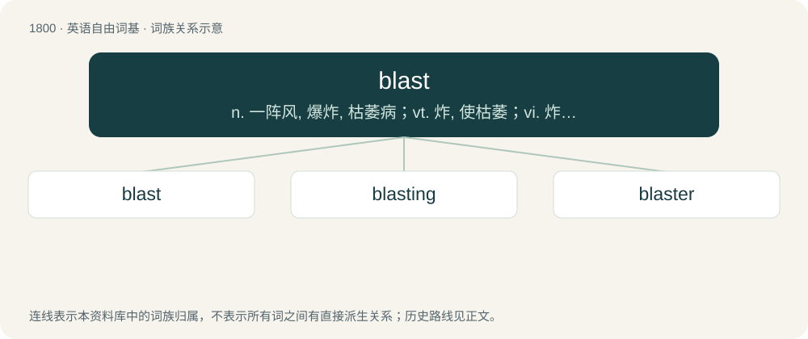

# 1902 · blast — n. 一阵风, 爆炸, 枯萎病；vt. 炸, 使枯萎；vi. 炸, 猛攻, 猛烈抨击, 枯萎

[总目录](../00_总目录_按常用程度.md)

**类型**：英语自由词基　｜　**来源语言**：见词源记录

## 核心含义与来源

- 核心含义：n. 一阵风, 爆炸, 枯萎病；vt. 炸, 使枯萎；vi. 炸, 猛攻, 猛烈抨击, 枯萎
- 英文含义：A violent gust of wind (in windy weather) or apparent wind (around a moving vehicle).
- 词形：blast

**多个词源／构词路径**：同一拼写可能有不同来源；以下按词性和含义分别列出。

**来源记录 1**（名词；A violent gust of wind (in windy weather) or apparent wind (around a moving vehicle).）

Inherited from Middle English blast, from Old English blǣst (“blowing, blast”), from Proto-West Germanic \*blāstu, from Proto-Germanic \*blēstuz (“blowing, blast”). Cognate with West Frisian blast (“blast”), dialectal Dutch blast (“stubborn intent, drumming”), obsolete German Blast (“wind, blowing”), German blasen (“to blow”), Dutch blazen (“to blow”), Danish blæst (“wind”), French blaser (“to blunt, dull”). More at blow.

**来源记录 2**（动词；To make an impression on, by making a loud blast or din.）

Inherited from Middle English blasten, from Old English blǣstan (“to blow, blast”), from Proto-West Germanic \*blēstijan, from Proto-Germanic \*blēstijaną. Possibly related to Middle High German blesten (“to stand out, plop, splash”).

**来源记录 3**（名词；An immature or undifferentiated cell (e.g., lymphoblast, myeloblast).）

Learned borrowing from Ancient Greek βλᾰστός (blăstós, “germ or sprout”).

**来源记录 4**（动词；To run a nucleotide sequence (for nucleic acids) or an amino acid sequence (for proteins) through a BLAST (Basic Local Alignment Search Tool).）

From BLAST (“Basic Local Alignment Search Tool”, acronym).

## 词族图

## 单词速览（常用到不常用）

| 单词 | 音标 | 释义 |
|---|---|---|
| [blast](#w-1) | 英 /blɑːst/；美 /blæst/ | n. 一阵风, 爆炸, 枯萎病；vt. 炸, 使枯萎；vi. 炸, 猛攻, 猛烈抨击, 枯萎 |
| [blasting](#w-2) | /ˈblɑːstiŋ/ | \[计\] 过载失真 |
| [blaster](#w-3) | 英 /ˈblɑːs.tə/；美 /ˈblæs.təɹ/ | \[计\] 熔固器, 装置 |

## 逐词详解

### 1. blast

**词性**：名词　｜　**音标**：英 /blɑːst/；美 /blæst/

**中文释义**：n. 一阵风, 爆炸, 枯萎病；vt. 炸, 使枯萎；vi. 炸, 猛攻, 猛烈抨击, 枯萎

**英文义项**：A violent gust of wind (in windy weather) or apparent wind (around a moving vehicle). / A forcible stream of gas or liquid from an orifice, for example from a bellows, the tuyeres of a blast furnace, a person's mouth, etc.

**词源与演化**：

Inherited from Middle English blast, from Old English blǣst (“blowing, blast”), from Proto-West Germanic \*blāstu, from Proto-Germanic \*blēstuz (“blowing, blast”). Cognate with West Frisian blast (“blast”), dialectal Dutch blast (“stubborn intent, drumming”), obsolete German Blast (“wind, blowing”), German blasen (“to blow”), Dutch blazen (“to blow”), Danish blæst (“wind”), French blaser (“to blunt, dull”). More at blow.

**例句**：

> My manager gave me a blast yesterday for coming in late.

该用例对应义项：A verbal attack or punishment; a severe criticism or reprimand.

### 2. blasting

**词性**：名词　｜　**音标**：/ˈblɑːstiŋ/

**中文释义**：\[计\] 过载失真

**英文义项**：A planned explosion, as in mining. / The act by which something is blasted, or blighted.

**构词拆分**：blast + -ing (gerundive ending)

**词源与演化**：

From Middle English blastyng, blastynge, equivalent to blast + -ing (gerundive ending).

**例句**：

> You're always blasting your music loudly. Can't you be considerate of others?

### 3. blaster

**词性**：名词　｜　**音标**：英 /ˈblɑːs.tə/；美 /ˈblæs.təɹ/

**中文释义**：\[计\] 熔固器, 装置

**英文义项**：Anything that, or anyone who blasts. / A device to detonate an explosive, often consisting of a box with a handle to be pressed down.

**构词拆分**：blast + -er

**词源与演化**：

From blast + -er.

**用法示例／搭配（非完整句）**：

> infrared blaster

该用例对应义项：Anything that, or anyone who blasts.
