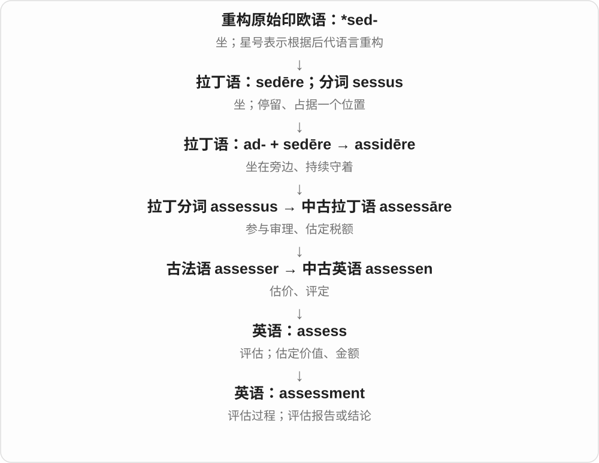

# 1905 · assessment — 评估结果与重新评估

[逐词精讲目录](../00_逐词精讲目录.md) · [总目录](../00_总目录_按常用程度.md)

## 核心词根与来源

评估不只是考试分数，也可判断风险、需求、情况。把评估过程和给出的结果放在一起理解，比只记测评两个字更灵活。

**ASSESSMENT：先作判断，再看是否需要重新称量**

assessment 评估；reassessment 用新材料再评估，不预设结论一定改变。

- **评估与重看**：assessment · reassessment
- **assess + -ment → assessment → assessments**：assessments

## 词形与演化规律

assess + -ment → assessment；re- + assessment → reassessment。assess 历史联系法语与拉丁协助判定、估定。

assess 远接拉丁坐在旁边协助判断的词族，早期与评定税额、罚额等有关。assessment 的评估、测评等义后来扩展，现代复数 -s。

## 单词速览（按词族由简到繁）

同一基础词的相关扩展放在一起，先读基础形式，再读扩展；各组之间优先读常用的。具体词源关系见各词讲解。

| 单词 | 音标 | 核心意思 |
|---|---|---|
| [assessment](#w-1) | /əˈsesmənt/ | 评估；评价结果；考核 |
| [assessments](#w-3) | 英、美 /əˈsesmənts/ | 评估；测评；评定结果〔复数〕 |
| [reassessment](#w-2) | /ˌriːəˈsesmənt/ | 重新评估、再次评价 |

## 逐词讲解

### 1. assessment — 评估；评价结果；考核

**音标**：/əˈsesmənt/

**先抓住这个画面**

assessment 像把证据摆在桌上，仔细看过之后给出判断：现在是什么情况，有多少价值或风险。

**怎么拆**

assess + -ment，表示评估行为或所得结论。

**怎么变成今天的意思**

a risk assessment 是风险评估；a language assessment 可以是语言能力考核；an honest assessment 是坦诚评价。

**常见搭配与例句**

make an assessment；a needs assessment；continuous assessment。

> The team completed an assessment of the building’s condition.

团队完成了对建筑状况的评估。

> Her assessment of the situation proved accurate.

她对局势的判断后来证明是准确的。

**别混淆**

test 可以只是一次测试；assessment 可综合观察、测试和材料形成判断。

### 2. assessments — 评估；测评；评定结果〔复数〕

**音标**：英、美 /əˈsesmənts/

**先抓住这个画面**

先看材料、表现和条件，再作判断、给出评价，这些活动或结果可以叫 assessments。

**怎么拆**

assess + -ment → assessment，再加 -s。assess 接法语、拉丁评定词族，较远连 ad- 向 + sedere 坐的旁坐、协助判断材料。

**怎么变成今天的意思**

**拉丁 assidere、assessus 坐在旁边协助判断 → 评定税额等词族**  
早期具体职务、评定用途的历史联系

↓

**英语 assess + -ment → assessment → assessments**  
现代扩展到价值、能力、风险等评估

written assessments 是书面评估；skills assessments 是技能测评；different assessments 是不同判断、评价。

**常见搭配与例句**

written assessments；skills assessments；assessments of the design。

> The course uses short assessments after each unit.

这门课每单元后安排简短测评。

> The two reviewers gave different assessments of the design.

两位评审对设计给出了不同评价。

**别混淆**

assessments 可以是测评活动，也可以是形成的判断。它不总是一张考试卷，更不只指分数。

### 3. reassessment — 重新评估、再次评价

**音标**：/ˌriːəˈsesmənt/

**先抓住这个画面**

原来给过一个判断，现在有新证据，再拿出来称一遍分量；结论可以改，也可以仍然一样。

**怎么拆**

re- 再次 + assessment 评估；assessment 对应 assess + -ment。更远的 assess 经法语接拉丁 assidēre 坐在旁边，联系协助判定、估定税额等历史。

**怎么变成今天的意思**

**assess → assessment**  
评估、估定 → 评估过程或结果

↓

**re- + assessment → reassessment**  
把已有判断重新检查、评价

a reassessment of the evidence 重新评估证据，a risk reassessment 风险再评估，call for reassessment 要求重新评价。

**常见搭配与例句**

a reassessment of；risk reassessment；prompt a reassessment。

> The new evidence prompted a reassessment of the case.

新证据促使人们重新评估这起案件。

> A reassessment confirmed that the original estimate was reasonable.

重新评估确认，最初的估计是合理的。

**别混淆**

reassessment 只保证重新看，不保证结论翻转；revaluation 常强调重新估值，也可有专门经济含义，不能所有场景机械互换。

## 这一组要分清什么

assessment 可以是过程或结果；reassessment 不一定推翻原结论，也不一定重新举行一场考试。

## 串起来练习

The reassessment used new evidence to check the earlier assessment.

这次重新评估用新证据检查先前的判断。
