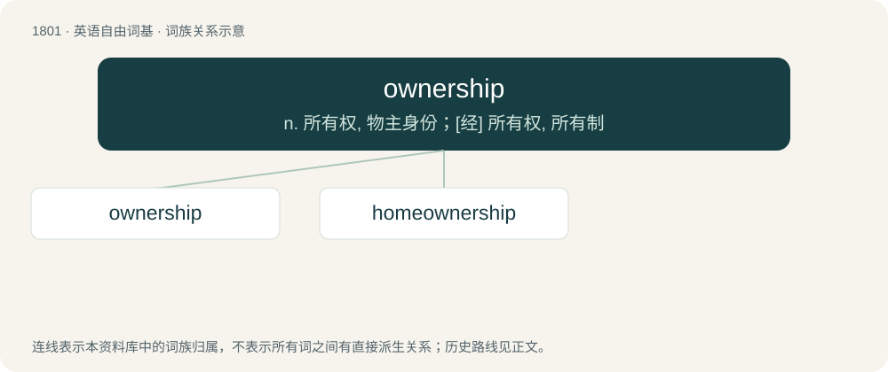

# 1905 · ownership — n. 所有权, 物主身份；\[经\] 所有权, 所有制

[总目录](../00_总目录_按常用程度.md)

**类型**：英语自由词基　｜　**来源语言**：见词源记录

## 核心含义与来源

- 核心含义：n. 所有权, 物主身份；\[经\] 所有权, 所有制
- 英文含义：The state of having complete legal control of something; possession; proprietorship.
- 词形：ownership

**来源记录 1**（名词；The state of having complete legal control of something; possession; proprietorship.）

From owner + -ship.

## 词族图

## 单词速览（常用到不常用）

| 单词 | 音标 | 释义 |
|---|---|---|
| [ownership](#w-1) | 英 /ˈəʊnəʃɪp/；美 /ˈoʊnɚʃɪp/ | n. 所有权, 物主身份；\[经\] 所有权, 所有制 |
| [homeownership](#w-2) |  | n. 私房屋主；自己拥有住房者 (homeowner的变形) |

## 逐词详解

### 1. ownership

**词性**：名词　｜　**音标**：英 /ˈəʊnəʃɪp/；美 /ˈoʊnɚʃɪp/

**中文释义**：n. 所有权, 物主身份；\[经\] 所有权, 所有制

**英文义项**：The state of having complete legal control of something; possession; proprietorship. / Responsibility for or control over something.

**构词拆分**：owner + -ship

**词源与演化**：

From owner + -ship.

**例句**：

> The successful candidate will take ownership of all internal design projects.

该用例对应义项：Responsibility for or control over something.

### 2. homeownership

**词性**：名词

**中文释义**：n. 私房屋主；自己拥有住房者 (homeowner的变形)

**英文义项**：The state of being a homeowner.

**构词拆分**：homeowner + -ship；home + ownership

**词源与演化**：

From homeowner + -ship or home + ownership.

**例句**：

> Today, the homeownership rate in the United States stands at around 65%.
