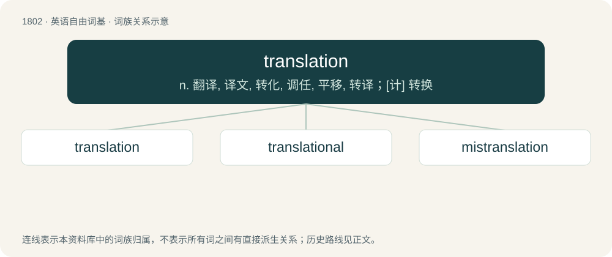

# 1906 · translation — n. 翻译, 译文, 转化, 调任, 平移, 转译；\[计\] 转换

[总目录](../00_总目录_按常用程度.md)

**类型**：英语自由词基　｜　**来源语言**：见词源记录

## 核心含义与来源

- 核心含义：n. 翻译, 译文, 转化, 调任, 平移, 转译；\[计\] 转换
- 英文含义：The conversion of text from one language to another.
- 词形：translation

**来源记录 1**（名词；The conversion of text from one language to another.）

From Middle English translacioun (“transfer, translation”), from Anglo-Norman translacioun, from Latin trānslātiō, from trānslāt-, the supine stem of trānsferō (“to transfer, transport, transform, translate”). Equivalent to translate + -ion. Displaced native Old English wending.

## 词族图

## 单词速览（常用到不常用）

| 单词 | 音标 | 释义 |
|---|---|---|
| [translation](#w-1) | 英 /tɹænzˈleɪʃən/；美 /tɹænzˈleɪʃən/ | n. 翻译, 译文, 转化, 调任, 平移, 转译；\[计\] 转换 |
| [translational](#w-2) | /tɹænzˈleɪʃənəl/ | \[机\] 平移的 |
| [mistranslation](#w-3) | /mɪsˈtɹænz.leɪ.ʃən/ | \[化\] 错译 |

## 逐词详解

### 1. translation

**词性**：名词　｜　**音标**：英 /tɹænzˈleɪʃən/；美 /tɹænzˈleɪʃən/

**中文释义**：n. 翻译, 译文, 转化, 调任, 平移, 转译；\[计\] 转换

**英文义项**：The conversion of text from one language to another. / The discipline or study of translating written language (as opposed to interpretation, which concerns itself with spoken language).

**构词拆分**：translate + -ion

**词源与演化**：

From Middle English translacioun (“transfer, translation”), from Anglo-Norman translacioun, from Latin trānslātiō, from trānslāt-, the supine stem of trānsferō (“to transfer, transport, transform, translate”). Equivalent to translate + -ion. Displaced native Old English wending.

**例句**：

> This old text needs translation into modern English before it is published.

该用例对应义项：The conversion of text from one language to another.

### 2. translational

**词性**：形容词　｜　**音标**：/tɹænzˈleɪʃənəl/

**中文释义**：\[机\] 平移的

**英文义项**：Relating the act of translating text etc. from one language into another. / Relating to movement of a body in a straight line.

**构词拆分**：translation + -al

**词源与演化**：

From translation + -al.

**用法示例／搭配（非完整句）**：

> translational regulation

该用例对应义项：Relating to the process whereby a strand of mRNA directs assembly of amino acids into proteins.

### 3. mistranslation

**词性**：名词　｜　**音标**：/mɪsˈtɹænz.leɪ.ʃən/

**中文释义**：\[化\] 错译

**英文义项**：An incorrect translation. / The incorporation of the incorrect amino acid into a peptide sequence.

**构词拆分**：mis- + translation

**词源与演化**：

From mis- + translation.

**例句**：

> A mistranslation is sometimes called a leiterjakab in Hungarian.
