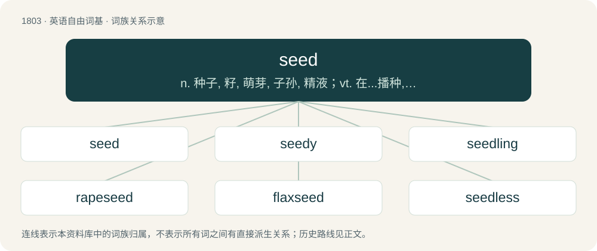

# 1907 · seed — n. 种子, 籽, 萌芽, 子孙, 精液；vt. 在...播种, 催...发育, 脱...籽；vi. 结实, 播种

[总目录](../00_总目录_按常用程度.md)

**类型**：英语自由词基　｜　**来源语言**：见词源记录

## 核心含义与来源

- 核心含义：n. 种子, 籽, 萌芽, 子孙, 精液；vt. 在...播种, 催...发育, 脱...籽；vi. 结实, 播种
- 英文含义：Any propagative portion of a plant which may be sown, such as true seeds, seed-like fruits, tubers, or bulbs.
- 词形：seed

**来源记录 1**（名词；Any propagative portion of a plant which may be sown, such as true seeds, seed-like fruits, tubers, or bulbs.）

\] From Middle English seed, sede, side, from Old English sēd, sǣd (“seed, that which is sown”), from Proto-West Germanic \*sād, from Proto-Germanic \*sēdą, from Proto-Indo-European \*seh₁- (“to sow, throw”). Cognates Cognate with Yola zeade (“seed”), North Frisian sead, seed, siad, Siid, sädj, säid (“seed”), Saterland Frisian Säid (“seed”), West Frisian sied (“seed”), Dutch zaad (“seed”), German Saat (“seed; sowing”), Limburgish zaod (“seed”), Danish, Norwegian Bokmål, and Norwegian Nynorsk sæd (“seed”), Faroese and Icelandic sáð (“seed”), Swedish säd (“seed”), Gothic \*𐍃𐌴𐌸𐍃 (\*sēþs, “seed”); also Latin serō (“to sow, plant”), Latvian sēt (“to sow”), Lithuanian sėti (“to sow”), Bulgarian се́я (séja, “to sow, plant”), Czech sít (“to sow”), Macedonian сее (see, “to sow”), Polish siać (“to sow”), Russian се́ять (séjatʹ, “to sow”), Serbo-Croatian се̏јати, sȅjati, си̏јати, sȉjati (“to sow”), Slovak siať (“to sow”), Slovene sejáti (“to sow”), Ukrainian сі́яти (síjaty, “to sow”). More at sow.

## 词族图

## 单词速览（常用到不常用）

| 单词 | 音标 | 释义 |
|---|---|---|
| [seed](#w-1) | 英 /siːd/ | n. 种子, 籽, 萌芽, 子孙, 精液；vt. 在...播种, 催...发育, 脱...籽；vi. 结实, 播种 |
| [seedy](#w-2) | /ˈsiːdi/ | a. 多种子的, 结籽的, 破烂的, 肮脏的 |
| [seedling](#w-3) | /ˈsiːdlɪŋ/ | n. 秧苗, 树苗；\[医\] 籽苗, 幼苗, 实生苗 |
| [rapeseed](#w-4) | /ˈɹeɪp.siːd/ | n. 油菜籽 |
| [flaxseed](#w-5) | /ˈflæks.siːd/ | n. 亚麻子, 亚麻仁；\[医\] 亚麻子 |
| [seedless](#w-6) | /ˈsiːdləs/ | a. 无核的 |
| [oilseed](#w-7) | /ˈɔilsiːd/ | \[经\] 油籽 |

## 逐词详解

### 1. seed

**词性**：名词　｜　**音标**：英 /siːd/

**中文释义**：n. 种子, 籽, 萌芽, 子孙, 精液；vt. 在...播种, 催...发育, 脱...籽；vi. 结实, 播种

**英文义项**：Any propagative portion of a plant which may be sown, such as true seeds, seed-like fruits, tubers, or bulbs. / A fertilized and ripened ovule, containing an embryonic plant.

**词源与演化**：

\] From Middle English seed, sede, side, from Old English sēd, sǣd (“seed, that which is sown”), from Proto-West Germanic \*sād, from Proto-Germanic \*sēdą, from Proto-Indo-European \*seh₁- (“to sow, throw”). Cognates Cognate with Yola zeade (“seed”), North Frisian sead, seed, siad, Siid, sädj, säid (“seed”), Saterland Frisian Säid (“seed”), West Frisian sied (“seed”), Dutch zaad (“seed”), German Saat (“seed; sowing”), Limburgish zaod (“seed”), Danish, Norwegian Bokmål, and Norwegian Nynorsk sæd (“seed”), Faroese and Icelandic sáð (“seed”), Swedish säd (“seed”), Gothic \*𐍃𐌴𐌸𐍃 (\*sēþs, “seed”); also Latin serō (“to sow, plant”), Latvian sēt (“to sow”), Lithuanian sėti (“to sow”), Bulgarian се́я (séja, “to sow, plant”), Czech sít (“to sow”), Macedonian сее (see, “to sow”), Polish siać (“to sow”), Russian се́ять (séjatʹ, “to sow”), Serbo-Croatian се̏јати, sȅjati, си̏јати, sȉjati (“to sow”), Slovak siať (“to sow”), Slovene sejáti (“to sow”), Ukrainian сі́яти (síjaty, “to sow”). More at sow.

**例句**：

> The team with the best regular season record receives the top seed in the conference tournament.

该用例对应义项：The initial position of a competitor or team in a tournament. (seed position)

### 2. seedy

**词性**：形容词　｜　**音标**：/ˈsiːdi/

**中文释义**：a. 多种子的, 结籽的, 破烂的, 肮脏的

**英文义项**：Containing or full of seeds. / Seedlike; having the flavour of seeds.

**构词拆分**：seed + -y

**词源与演化**：

From Middle English sedy, equivalent to seed + -y. The senses with negative connotation, first attested by 1725 in slang, originally especially “poor, out of money”, probably arose from the metaphor of a flower that has gone to seed, and is no longer considered beautiful. From there the word came to be used to describe unwell or past-their-prime people, and parallelly run-down places and by extension low-income or crime-affected urban areas. Compare the figurative expressions go to seed (by 1817), etc., originally in reference to plants, “cease flowering as seeds develop”.

**例句**：

> With her aching back and pronounced limp, she was feeling particularly seedy today.

该用例对应义项：Infirm, unwell, gone to seed.

### 3. seedling

**词性**：名词　｜　**音标**：/ˈsiːdlɪŋ/

**中文释义**：n. 秧苗, 树苗；\[医\] 籽苗, 幼苗, 实生苗

**英文义项**：A young plant grown from seed. / one grown in a nursery for transplanting.

**构词拆分**：seed + -ling

**词源与演化**：

From seed + -ling.

**例句**：

> At the foot of the palm tree there grows a palm seedling.

### 4. rapeseed

**词性**：名词　｜　**音标**：/ˈɹeɪp.siːd/

**中文释义**：n. 油菜籽

**英文义项**：The seed of the rape plant (Brassica napus), used widely for animal feed and vegetable oil. / The rape plant itself.

**构词拆分**：rape (“rapeseed plant(s)”) + seed

**词源与演化**：

From Middle English rape sede, rape seed, equivalent to rape (“rapeseed plant(s)”) + seed. As a meronym for the entire plant, from the need to distinguish the plant from the etymologically unrelated verb and act rape. In this context, rape is from Latin rāpa, from rāpum (“turnip”). Not to be confused with grapeseed.

### 5. flaxseed

**词性**：名词　｜　**音标**：/ˈflæks.siːd/

**中文释义**：n. 亚麻子, 亚麻仁；\[医\] 亚麻子

**英文义项**：The seed of the flax plant; a source of linseed oil.

**构词拆分**：flax + seed

**词源与演化**：

From flax + seed.

**例句**：

> How long does it take for flaxseed to lower cholesterol?

### 6. seedless

**词性**：形容词　｜　**音标**：/ˈsiːdləs/

**中文释义**：a. 无核的

**英文义项**：Not having (noticeable) seeds.

**构词拆分**：seed + -less

**词源与演化**：

From seed + -less.

**例句**：

> What do you plant to grow seedless grapes? Actually, they have seeds, but they are quite edible by humans.

该用例对应义项：Not having (noticeable) seeds.

### 7. oilseed

**词性**：名词　｜　**音标**：/ˈɔilsiːd/

**中文释义**：\[经\] 油籽

**英文义项**：The seed of any of several plants which are used commercially as a source of vegetable oil. / The plant that yields such seed.

**构词拆分**：oil + seed

**词源与演化**：

From oil + seed.
