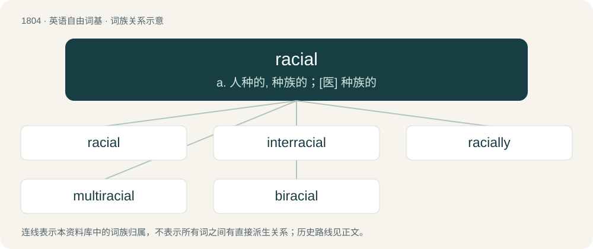

# 1908 · racial — a. 人种的, 种族的；\[医\] 种族的

[总目录](../00_总目录_按常用程度.md)

**类型**：英语自由词基　｜　**来源语言**：见词源记录

## 核心含义与来源

- 核心含义：a. 人种的, 种族的；\[医\] 种族的
- 英文含义：Of or relating to a race (or a people).
- 词形：racial

**来源记录 1**（形容词；Of or relating to a race (or a people).）

From race + -ial.

## 词族图

## 单词速览（常用到不常用）

| 单词 | 音标 | 释义 |
|---|---|---|
| [racial](#w-1) | /ˈɹeɪʃəl/ | a. 人种的, 种族的；\[医\] 种族的 |
| [interracial](#w-2) | /ˌɪntəˈɹeɪʃəl/ | a. 人种间的, 人种混合的 |
| [racially](#w-3) | /ˈreiʃəli/ | adv. 按人种, 人种上 |
| [multiracial](#w-4) | /ˌmʌltiˈɹeɪʃəl/ | a. 多民族的 |
| [biracial](#w-5) | /baiˈreiʃəl/ | a. 两种人种的 |

## 逐词详解

### 1. racial

**词性**：形容词　｜　**音标**：/ˈɹeɪʃəl/

**中文释义**：a. 人种的, 种族的；\[医\] 种族的

**英文义项**：Of or relating to a race (or a people).

**构词拆分**：race + -ial

**词源与演化**：

From race + -ial.

**用法示例／搭配（非完整句）**：

> the racial complexion

该用例对应义项：Of or relating to a race (or a people).

### 2. interracial

**词性**：形容词　｜　**音标**：/ˌɪntəˈɹeɪʃəl/

**中文释义**：a. 人种间的, 人种混合的

**英文义项**：Between or among two or more different races.

**构词拆分**：inter- + racial

**词源与演化**：

From inter- + racial.

**例句**：

> Interracial struggle against Europid people is a para-Marxist notion.

该用例对应义项：Between or among two or more different races.

### 3. racially

**词性**：副词　｜　**音标**：/ˈreiʃəli/

**中文释义**：adv. 按人种, 人种上

**英文义项**：Relating to race.

**构词拆分**：racial + -ly

**词源与演化**：

From racial + -ly.

**用法示例／搭配（非完整句）**：

> a racially aggravated attack

该用例对应义项：Relating to race.

### 4. multiracial

**词性**：形容词　｜　**音标**：/ˌmʌltiˈɹeɪʃəl/

**中文释义**：a. 多民族的

**英文义项**：Composed of, or having a mixture of, multiple races.

**构词拆分**：multi- + racial

**词源与演化**：

From multi- + racial.

**例句**：

> Japanese should not forget that America is a multiracial nation.

### 5. biracial

**词性**：形容词　｜　**音标**：/baiˈreiʃəl/

**中文释义**：a. 两种人种的

**英文义项**：Of or pertaining to two races.

**构词拆分**：bi- + racial

**词源与演化**：

From bi- + racial.

**例句**：

> Sami was attracted to biracial girls.
