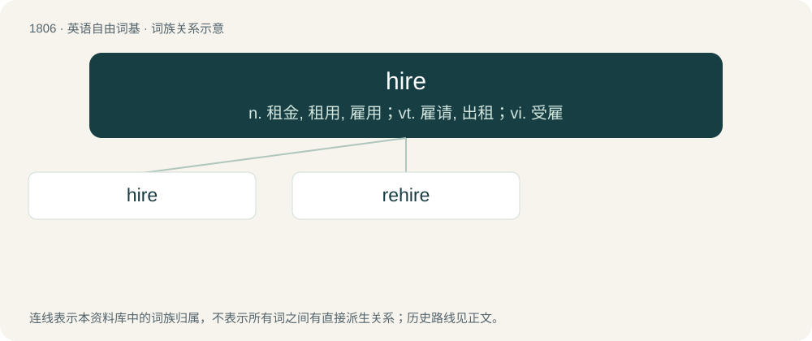

# 1912 · hire — n. 租金, 租用, 雇用；vt. 雇请, 出租；vi. 受雇

[总目录](../00_总目录_按常用程度.md)

**类型**：英语自由词基　｜　**来源语言**：见词源记录

## 核心含义与来源

- 核心含义：n. 租金, 租用, 雇用；vt. 雇请, 出租；vi. 受雇
- 英文含义：A person who has been hired, especially in a cohort.
- 词形：hire

**多个词源／构词路径**：同一拼写可能有不同来源；以下按词性和含义分别列出。

**来源记录 1**（名词；A person who has been hired, especially in a cohort.）

From Middle English hire, hyre, here, hure, from Old English hȳr (“employment for wages; pay for service; interest on money lent”), from Proto-West Germanic \*hūʀiju (“payment”), from the verb \*hūʀijan, from Proto-Germanic \*hūzijaną, from Proto-Indo-European \*kewHs- or \*kweHs-. Compare Hittite 𒆪𒊭𒀭 (kuššan-, “fee, pay, wages, price”). Cognate with West Frisian hier (“hire”), Dutch huur (“lease, rental”), German Low German Hüür (“lease, rental”).

**来源记录 2**（动词；To obtain the services of in return for fixed payment.）

From Middle English hiren, hyren, from Old English hȳrian (“to hire”), from the noun (see above). Compare West Frisian hiere (“to rent, lease”), Dutch huren (“to rent, lease”), Low German hüren (“to rent”), Danish hyre (“to hire”), Swedish hyra (“to hire”). Eclipsed Middle English souden (“to hire, employ, enlist”), borrowed from Old French souder, soudre, souldre (“to take into employ, pay”); see English sold (“salary, military pay”).

## 词族图

## 单词速览（常用到不常用）

| 单词 | 音标 | 释义 |
|---|---|---|
| [hire](#w-1) | 英 /ˈhaɪ(.)ə/；美 /ˈhaɪɹ/ | n. 租金, 租用, 雇用；vt. 雇请, 出租；vi. 受雇 |
| [rehire](#w-2) | /riːˈhaiə/ | \[法\] 再雇用 |

## 逐词详解

### 1. hire

**词性**：名词　｜　**音标**：英 /ˈhaɪ(.)ə/；美 /ˈhaɪɹ/

**中文释义**：n. 租金, 租用, 雇用；vt. 雇请, 出租；vi. 受雇

**英文义项**：A person who has been hired, especially in a cohort. / The state of being hired, or having a job; employment.

**词源与演化**：

From Middle English hire, hyre, here, hure, from Old English hȳr (“employment for wages; pay for service; interest on money lent”), from Proto-West Germanic \*hūʀiju (“payment”), from the verb \*hūʀijan, from Proto-Germanic \*hūzijaną, from Proto-Indo-European \*kewHs- or \*kweHs-. Compare Hittite 𒆪𒊭𒀭 (kuššan-, “fee, pay, wages, price”). Cognate with West Frisian hier (“hire”), Dutch huur (“lease, rental”), German Low German Hüür (“lease, rental”).

**例句**：

> When my grandfather retired, he had over twenty mechanics in his hire.

该用例对应义项：The state of being hired, or having a job; employment.

### 2. rehire

**词性**：动词　｜　**音标**：/riːˈhaiə/

**中文释义**：\[法\] 再雇用

**英文义项**：To hire again.

**构词拆分**：re- + hire

**词源与演化**：

From re- + hire.

**例句**：

> Ziri went in and asked the manager to rehire Rima.
