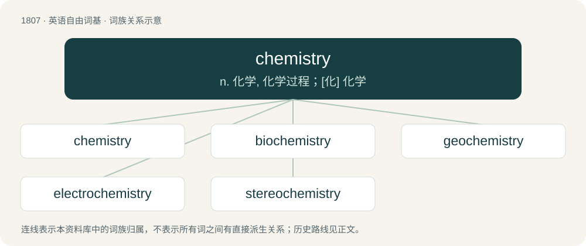

# 1914 · chemistry — n. 化学, 化学过程；\[化\] 化学

[总目录](../00_总目录_按常用程度.md)

**类型**：英语自由词基　｜　**来源语言**：见词源记录

## 核心含义与来源

- 核心含义：n. 化学, 化学过程；\[化\] 化学
- 英文含义：The branch of natural science that deals with the composition and constitution of substances and the changes that they undergo as a consequence of alterations in the constitution of their molecules.
- 词形：chemistry

**来源记录 1**（名词；The branch of natural science that deals with the composition and constitution of substances and the changes that they undergo as a consequence of alterations in the constitution of their molecules.）

First coined 1605, from chemist + -ry. From chemist, chymist, from Latin alchimista, from Arabic اَلْكِيمِيَاء (al-kīmiyāʔ), from article اَل (al-) + Ancient Greek χυμεία (khumeía, “art of alloying metals”), from χύμα (khúma, “fluid”), from χυμός (khumós, “juice”), from χέω (khéō, “to pour”).

## 词族图

## 单词速览（常用到不常用）

| 单词 | 音标 | 释义 |
|---|---|---|
| [chemistry](#w-1) | /ˈkɛm.ɪ.stɹi/ | n. 化学, 化学过程；\[化\] 化学 |
| [biochemistry](#w-2) | /ˌbaɪəʊˈkɛmɪstɹi/ | n. 生物化学；\[化\] 生物化学; 生化 |
| [geochemistry](#w-3) | /.dʒiːəˈkemistri/ | n. 地球化学；\[化\] 地球化学 |
| [electrochemistry](#w-4) | /i,lektrəjˈkemistri/ | n. 电化学；\[计\] 电化学 |
| [stereochemistry](#w-5) | /.stiəriəˈkemistri/ | n. 立体化学；\[化\] 立体化学 |

## 逐词详解

### 1. chemistry

**词性**：名词　｜　**音标**：/ˈkɛm.ɪ.stɹi/

**中文释义**：n. 化学, 化学过程；\[化\] 化学

**英文义项**：The branch of natural science that deals with the composition and constitution of substances and the changes that they undergo as a consequence of alterations in the constitution of their molecules. / An application of chemical theory and method to a particular substance.

**构词拆分**：chemist + -ry

**词源与演化**：

First coined 1605, from chemist + -ry. From chemist, chymist, from Latin alchimista, from Arabic اَلْكِيمِيَاء (al-kīmiyāʔ), from article اَل (al-) + Ancient Greek χυμεία (khumeía, “art of alloying metals”), from χύμα (khúma, “fluid”), from χυμός (khumós, “juice”), from χέω (khéō, “to pour”).

**例句**：

> The on-screen chemistry between the lead actors led many viewers to believe they were a couple in real life.

该用例对应义项：The mutual attraction between two people; rapport.

### 2. biochemistry

**词性**：名词　｜　**音标**：/ˌbaɪəʊˈkɛmɪstɹi/

**中文释义**：n. 生物化学；\[化\] 生物化学; 生化

**英文义项**：The chemistry of those compounds that occur in living organisms, and the processes that occur in their metabolism and catabolism; the study of such chemistry. / The chemical characteristics of a particular living organism.

**构词拆分**：bio- + chemistry

**词源与演化**：

From bio- + chemistry.

**例句**：

> The biochemistry of NO differs from that of NO₂.

该用例对应义项：The biochemical activity associated with a particular chemical or condition.

### 3. geochemistry

**词性**：名词　｜　**音标**：/.dʒiːəˈkemistri/

**中文释义**：n. 地球化学；\[化\] 地球化学

**英文义项**：The branch of chemistry that deals with the chemical composition of the Earth and other planets, and with the chemical processes that occur in the formation of rocks and minerals etc.

**构词拆分**：geo- + chemistry

**词源与演化**：

From geo- + chemistry.

### 4. electrochemistry

**词性**：名词　｜　**音标**：/i,lektrəjˈkemistri/

**中文释义**：n. 电化学；\[计\] 电化学

**英文义项**：The science of the chemistry associated with the flow of electricity, especially at the surface of an electrode.

**构词拆分**：electro- + chemistry

**词源与演化**：

From electro- + chemistry.

### 5. stereochemistry

**词性**：名词　｜　**音标**：/.stiəriəˈkemistri/

**中文释义**：n. 立体化学；\[化\] 立体化学

**英文义项**：the branch of chemistry that involves the spatial arrangement of the atoms of molecules, and studies how this affects the physical and chemical properties of such species / the effect of such spatial arrangement on the chemistry of a particular compound

**构词拆分**：stereo- + chemistry

**词源与演化**：

From stereo- + chemistry.
