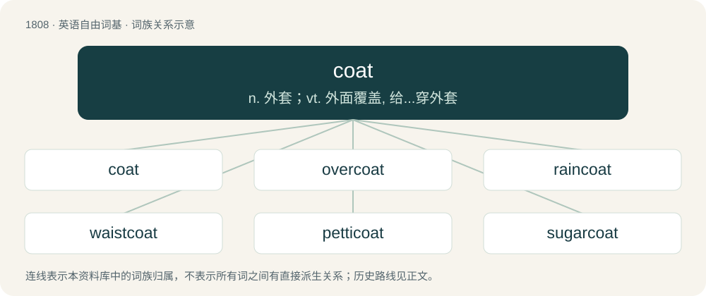

# 1915 · coat — n. 外套；vt. 外面覆盖, 给...穿外套

[总目录](../00_总目录_按常用程度.md)

**类型**：英语自由词基　｜　**来源语言**：见词源记录

## 核心含义与来源

- 核心含义：n. 外套；vt. 外面覆盖, 给...穿外套
- 英文含义：An outer garment covering the upper torso and arms.
- 词形：coat

**来源记录 1**（名词；An outer garment covering the upper torso and arms.）

From Middle English cote, coate, cotte, from Old French cote, cotte (“outer garment with sleeves”), from Latin cotta (“undercoat, tunic”), from Proto-Germanic \*kuttô, \*kuttǭ (“cowl, woolen cloth, coat”), from Proto-Indo-European \*gʷewd-, \*gud- (“woolen clothes”). Cognate with Old High German kozza, kozzo (“woolen coat”) (German Kotze (“coarse woolen blanket; woolen cape”)), Middle Low German kot (“coat”), Middle Dutch cote (“coat”), Ancient Greek βεῦδος (beûdos, “woman's attire”).

## 词族图

## 单词速览（常用到不常用）

| 单词 | 音标 | 释义 |
|---|---|---|
| [coat](#w-1) | 英 /ˈkəʊ̯t/；美 /ˈkoʊ̯t/ | n. 外套；vt. 外面覆盖, 给...穿外套 |
| [overcoat](#w-2) | 英 /ˈəʊvəkəʊt/；美 /ˈoʊvɚkoʊt/ | n. 外套大衣 |
| [raincoat](#w-3) | 英 /ˈɹeɪnkəʊt/；美 /ˈɹeɪnkoʊt/ | n. 雨衣 |
| [waistcoat](#w-4) | /ˈweɪs(t)kəʊt/ | n. 西装背心, 马甲 |
| [petticoat](#w-5) | 英 /ˈpɛt.ɪ.kəʊt/；美 /ˈpɛt.ɪ.koʊt/ | n. 衬裙, 裙子 |
| [sugarcoat](#w-6) | 英 /ˈʃʊɡəˌkəʊt/；美 /ˈʃʊɡɚˌkoʊt/ | n. 糖衣；vt. 裹以糖衣, 粉饰 |
| [undercoat](#w-7) | 美 /ˈʌndɚˌkoʊt/ | n. 下层绒毛, 底漆, 内涂层；\[化\] 底漆 |

## 逐词详解

### 1. coat

**词性**：名词　｜　**音标**：英 /ˈkəʊ̯t/；美 /ˈkoʊ̯t/

**中文释义**：n. 外套；vt. 外面覆盖, 给...穿外套

**英文义项**：An outer garment covering the upper torso and arms. / A covering of material, such as paint.

**词源与演化**：

From Middle English cote, coate, cotte, from Old French cote, cotte (“outer garment with sleeves”), from Latin cotta (“undercoat, tunic”), from Proto-Germanic \*kuttô, \*kuttǭ (“cowl, woolen cloth, coat”), from Proto-Indo-European \*gʷewd-, \*gud- (“woolen clothes”). Cognate with Old High German kozza, kozzo (“woolen coat”) (German Kotze (“coarse woolen blanket; woolen cape”)), Middle Low German kot (“coat”), Middle Dutch cote (“coat”), Ancient Greek βεῦδος (beûdos, “woman's attire”).

**例句**：

> When the dog shed its coat, it left hair all over the furniture and the carpet.

该用例对应义项：The fur or feathers covering an animal's skin.

### 2. overcoat

**词性**：名词　｜　**音标**：英 /ˈəʊvəkəʊt/；美 /ˈoʊvɚkoʊt/

**中文释义**：n. 外套大衣

**英文义项**：A heavy garment worn over other clothes, for protection from cold or weather. / An outer coat, an outer coating (of paint, etc).

**构词拆分**：over- + coat

**词源与演化**：

From over- + coat.

**例句**：

> Wait 24 hours before applying an overcoat.

该用例对应义项：An outer coat, an outer coating (of paint, etc).

### 3. raincoat

**词性**：名词　｜　**音标**：英 /ˈɹeɪnkəʊt/；美 /ˈɹeɪnkoʊt/

**中文释义**：n. 雨衣

**英文义项**：A waterproof coat to be worn in the rain; (loosely) any coat or jacket with this purpose. / A condom.

**构词拆分**：rain + coat

**词源与演化**：

From rain + coat.

**例句**：

> Today I bought a raincoat and wore it on a sunny day.

### 4. waistcoat

**词性**：名词　｜　**音标**：/ˈweɪs(t)kəʊt/

**中文释义**：n. 西装背心, 马甲

**英文义项**：An ornamental garment worn under a doublet. / A sleeveless, collarless garment worn over a shirt and under a suit jacket.

**构词拆分**：waist + coat

**词源与演化**：

From waist + coat. Compare Yola wauscoat, wazcoote.

**例句**：

> Your waistcoat is inside out. Put it on the right way round.

### 5. petticoat

**词性**：形容词　｜　**音标**：英 /ˈpɛt.ɪ.kəʊt/；美 /ˈpɛt.ɪ.koʊt/

**中文释义**：n. 衬裙, 裙子

**英文义项**：Feminine; female; involving a woman.

**构词拆分**：petty + coat

**词源与演化**：

From Middle English petticote, petycote, peticote, petite cote, equivalent to petty + coat.

**用法示例／搭配（非完整句）**：

> petticoat influence

该用例对应义项：Feminine; female; involving a woman.

### 6. sugarcoat

**词性**：动词　｜　**音标**：英 /ˈʃʊɡəˌkəʊt/；美 /ˈʃʊɡɚˌkoʊt/

**中文释义**：n. 糖衣；vt. 裹以糖衣, 粉饰

**英文义项**：To coat with sugar. / To make superficially more attractive; to give a falsely pleasant appearance to.

**构词拆分**：sugar + coat

**词源与演化**：

From sugar + coat; figurative sense from the practice of coating medicinal tablets or pills with sugar in order to disguise their unpleasant taste (sugarcoating the pill).

**例句**：

> There's no way to sugarcoat the loss of the space shuttle; it was an unmitigated disaster.

该用例对应义项：To make superficially more attractive; to give a falsely pleasant appearance to.

### 7. undercoat

**词性**：名词　｜　**音标**：美 /ˈʌndɚˌkoʊt/

**中文释义**：n. 下层绒毛, 底漆, 内涂层；\[化\] 底漆

**英文义项**：A layer of short hairs underneath the longer ones of an animal's fur. / A coat of paint or other material applied onto a surface before that of a topcoat; sometimes, a coloured primer.

**构词拆分**：under- + coat

**词源与演化**：

From under- + coat.

**例句**：

> Whether you first paint this wood with primer or undercoat, when you add this topcoat, you'll end up with the same result.
