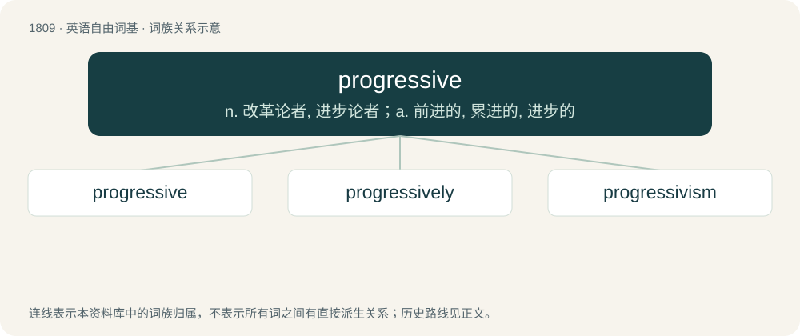

# 1916 · progressive — n. 改革论者, 进步论者；a. 前进的, 累进的, 进步的

[总目录](../00_总目录_按常用程度.md)

**类型**：英语自由词基　｜　**来源语言**：见词源记录

## 核心含义与来源

- 核心含义：n. 改革论者, 进步论者；a. 前进的, 累进的, 进步的
- 英文含义：Favouring or promoting progress; advanced.
- 词形：progressive

**来源记录 1**（形容词；Favouring or promoting progress; advanced.）

From the Middle French progressif, from the Latin prōgressīvus, from prōgredior (perfect participial stem: prōgress-) + -īvus. Displaced native Old English forþgenġe. By surface analysis, progress + -ive.

## 词族图

## 单词速览（常用到不常用）

| 单词 | 音标 | 释义 |
|---|---|---|
| [progressive](#w-1) | 英 /pɹəˈɡɹɛsɪv/；美 /pɹəˈɡɹɛsɪv/ | n. 改革论者, 进步论者；a. 前进的, 累进的, 进步的 |
| [progressively](#w-2) | /pɹəˈɡɹɛsɪvli/ | adv. 进步, 先进, 向前进, 不断前进, 累进, 渐进, 逐渐, 渐次, 主张进步, 进行性 |
| [progressivism](#w-3) | 英 /prəˈɡrɛsᵻvɪz(ə)m/；美 /prəˈɡrɛsɪˌvɪzəm/ | n. 进步党主义, 进步人士的政见, 进步教育理论 |

## 逐词详解

### 1. progressive

**词性**：形容词　｜　**音标**：英 /pɹəˈɡɹɛsɪv/；美 /pɹəˈɡɹɛsɪv/

**中文释义**：n. 改革论者, 进步论者；a. 前进的, 累进的, 进步的

**英文义项**：Favouring or promoting progress; advanced. / Gradually advancing in extent; increasing.

**词源与演化**：

From the Middle French progressif, from the Latin prōgressīvus, from prōgredior (perfect participial stem: prōgress-) + -īvus. Displaced native Old English forþgenġe. By surface analysis, progress + -ive.

**用法示例／搭配（非完整句）**：

> progressive business leadership

该用例对应义项：Promoting or favoring progress towards improved conditions or new policies, ideas, or methods.

### 2. progressively

**词性**：副词　｜　**音标**：/pɹəˈɡɹɛsɪvli/

**中文释义**：adv. 进步, 先进, 向前进, 不断前进, 累进, 渐进, 逐渐, 渐次, 主张进步, 进行性

**英文义项**：In a progressive manner. / As part of a progression.

**构词拆分**：progressive + -ly

**词源与演化**：

From progressive + -ly.

**用法示例／搭配（非完整句）**：

> The questions get progressively more difficult

该用例对应义项：In a progressive manner.

### 3. progressivism

**词性**：名词　｜　**音标**：英 /prəˈɡrɛsᵻvɪz(ə)m/；美 /prəˈɡrɛsɪˌvɪzəm/

**中文释义**：n. 进步党主义, 进步人士的政见, 进步教育理论

**英文义项**：A political ideology that favours progress towards better conditions in society.

**构词拆分**：progressive + -ism

**词源与演化**：

From progressive + -ism.

**例句**：

> A period of reform had now begun, and after 1909 a wave of "progressivism" overspread the country.
