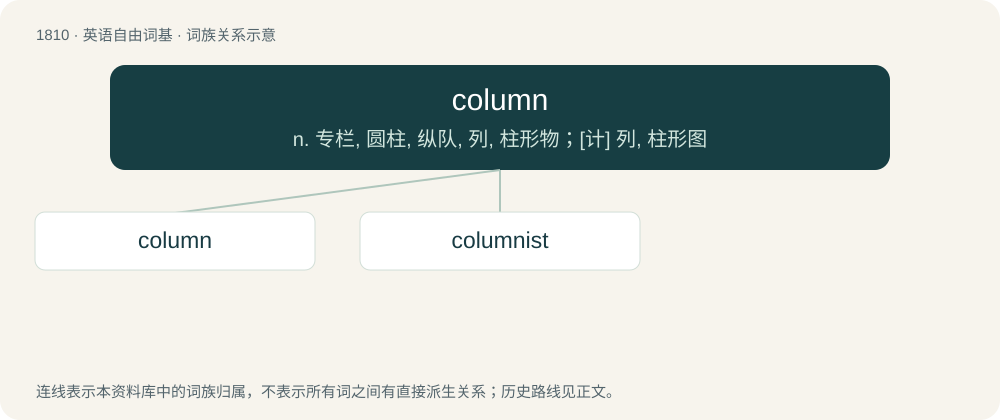

# 1917 · column — n. 专栏, 圆柱, 纵队, 列, 柱形物；\[计\] 列, 柱形图

[总目录](../00_总目录_按常用程度.md)

**类型**：英语自由词基　｜　**来源语言**：见词源记录

## 核心含义与来源

- 核心含义：n. 专栏, 圆柱, 纵队, 列, 柱形物；\[计\] 列, 柱形图
- 英文含义：A solid upright structure designed usually to support a larger structure above it, such as a roof or horizontal beam, but sometimes for decoration.
- 词形：column

**来源记录 1**（名词；A solid upright structure designed usually to support a larger structure above it, such as a roof or horizontal beam, but sometimes for decoration.）

From Middle English columne, columpne, columpe, borrowed from Old French columne, from Latin columna (“a column, pillar, post”), originally a collateral form of columen, contraction culmen (“a pillar, top, crown, summit”). Akin to Latin collis (“a hill”), celsus (“high”), probably to Ancient Greek κολοφών (kolophṓn, “top, summit”).

## 词族图

## 单词速览（常用到不常用）

| 单词 | 音标 | 释义 |
|---|---|---|
| [column](#w-1) | 英 /ˈkɒləm/ | n. 专栏, 圆柱, 纵队, 列, 柱形物；\[计\] 列, 柱形图 |
| [columnist](#w-2) | 英 /ˈkɒ.lə.mɪst/；美 /ˈkɑ.ləm.nɪst/ | n. 专栏作家 |

## 逐词详解

### 1. column

**词性**：名词　｜　**音标**：英 /ˈkɒləm/

**中文释义**：n. 专栏, 圆柱, 纵队, 列, 柱形物；\[计\] 列, 柱形图

**英文义项**：A solid upright structure designed usually to support a larger structure above it, such as a roof or horizontal beam, but sometimes for decoration. / A vertical line of entries in a table, usually read from top to bottom.

**词源与演化**：

From Middle English columne, columpne, columpe, borrowed from Old French columne, from Latin columna (“a column, pillar, post”), originally a collateral form of columen, contraction culmen (“a pillar, top, crown, summit”). Akin to Latin collis (“a hill”), celsus (“high”), probably to Ancient Greek κολοφών (kolophṓn, “top, summit”).

**例句**：

> It was too hard to read the text across the whole page, so I split it into two columns.

该用例对应义项：A body of text meant to be read line by line, especially in printed material that has multiple adjacent such on a single page.

### 2. columnist

**词性**：名词　｜　**音标**：英 /ˈkɒ.lə.mɪst/；美 /ˈkɑ.ləm.nɪst/

**中文释义**：n. 专栏作家

**英文义项**：A regular writer of a column, such as in a magazine or newspaper.

**构词拆分**：column + -ist

**词源与演化**：

From column + -ist, from Latin and Greek, ultimately from Proto-Indo-European \*kʷel-.

**用法示例／搭配（非完整句）**：

> a sporadic columnist

该用例对应义项：A regular writer of a column, such as in a magazine or newspaper.
