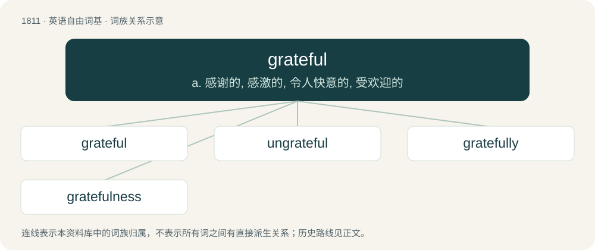

# 1918 · grateful — a. 感谢的, 感激的, 令人快意的, 受欢迎的

[总目录](../00_总目录_按常用程度.md)

**类型**：英语自由词基　｜　**来源语言**：见词源记录

## 核心含义与来源

- 核心含义：a. 感谢的, 感激的, 令人快意的, 受欢迎的
- 英文含义：Of a person or their actions, feelings, etc.: expressing gratitude or appreciation; appreciative, thankful.
- 词形：grateful

**来源记录 1**（形容词；Of a person or their actions, feelings, etc.: expressing gratitude or appreciation; appreciative, thankful.）

From grate (“(obsolete) serving to gratify, agreeable, pleasing; grateful, thankful”) + -ful (suffix forming adjectives with the sense of tending to have or thoroughly having a quality). Grate is a learned borrowing from Latin grātus (“agreeable, pleasing; beloved, dear; grateful, thankful”), ultimately from Proto-Indo-European \*gʷerH- (“to express approval, praise; to elevate”).

## 词族图

## 单词速览（常用到不常用）

| 单词 | 音标 | 释义 |
|---|---|---|
| [grateful](#w-1) | 英 /ˈɡɹeɪtf(ʊ)l/；美 /ˈɡɹeɪtf(ə)l/ | a. 感谢的, 感激的, 令人快意的, 受欢迎的 |
| [ungrateful](#w-2) | /ʌnˈɡɹeɪtfəl/ | a. 忘恩负义的, 使人不愉快的, 徒劳的, 讨厌的 |
| [gratefully](#w-3) | /ˈɡɹeɪtfəli/ | adv. 感激地 |
| [gratefulness](#w-4) |  | n. 感激, 感恩 |

## 逐词详解

### 1. grateful

**词性**：形容词　｜　**音标**：英 /ˈɡɹeɪtf(ʊ)l/；美 /ˈɡɹeɪtf(ə)l/

**中文释义**：a. 感谢的, 感激的, 令人快意的, 受欢迎的

**英文义项**：Of a person or their actions, feelings, etc.: expressing gratitude or appreciation; appreciative, thankful.

**构词拆分**：grate (“(obsolete) serving to gratify, agreeable, pleasing; grateful, thankful”) + -ful (suffix forming adjectives with the sense of tending to have or thoroughly having a quality)

**词源与演化**：

From grate (“(obsolete) serving to gratify, agreeable, pleasing; grateful, thankful”) + -ful (suffix forming adjectives with the sense of tending to have or thoroughly having a quality). Grate is a learned borrowing from Latin grātus (“agreeable, pleasing; beloved, dear; grateful, thankful”), ultimately from Proto-Indo-European \*gʷerH- (“to express approval, praise; to elevate”).

**例句**：

> I’m grateful that you helped me out.

该用例对应义项：Of a person or their actions, feelings, etc.: expressing gratitude or appreciation; appreciative, thankful.

### 2. ungrateful

**词性**：形容词　｜　**音标**：/ʌnˈɡɹeɪtfəl/

**中文释义**：a. 忘恩负义的, 使人不愉快的, 徒劳的, 讨厌的

**英文义项**：Not grateful; not expressing gratitude. / Disagreeable, repellent, unpleasant.

**构词拆分**：From un- + grateful.

**词源与演化**：

From un- + grateful.

**例句**：

> I will not perform the ungrateful task of comparing cases of failure.

该用例对应义项：disagreeable

### 3. gratefully

**词性**：副词　｜　**音标**：/ˈɡɹeɪtfəli/

**中文释义**：adv. 感激地

**英文义项**：In a grateful manner.

**构词拆分**：grateful + -ly

**词源与演化**：

From grateful + -ly.

**例句**：

> Mademoiselle, Allow me very gratefully but firmly to refuse your kind invitation.

### 4. gratefulness

**词性**：名词

**中文释义**：n. 感激, 感恩

**英文义项**：The state of being grateful.

**构词拆分**：grateful + -ness

**词源与演化**：

From grateful + -ness.

**例句**：

> Let's try to live a life of gratefulness.
