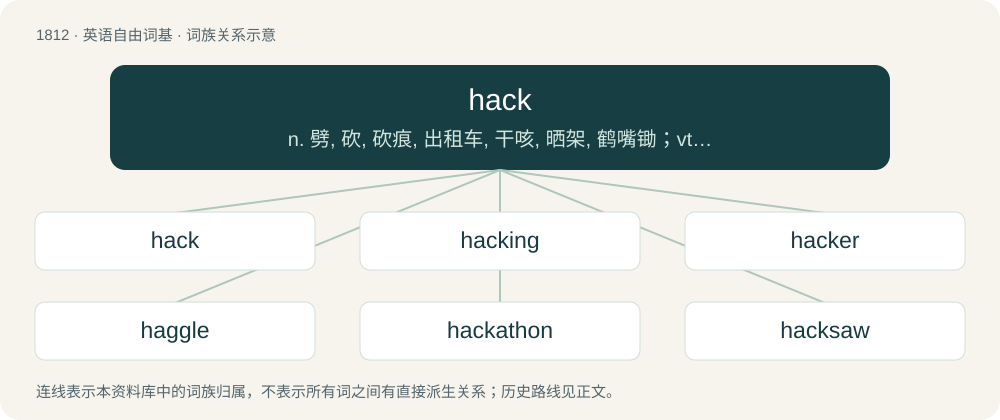

# 1919 · hack — n. 劈, 砍, 砍痕, 出租车, 干咳, 晒架, 鹤嘴锄；vt. 劈, 砍, 出租, 用旧；vi. 劈, 砍, 干咳, 驾驶出租车

[总目录](../00_总目录_按常用程度.md)

**类型**：英语自由词基　｜　**来源语言**：见词源记录

## 核心含义与来源

- 核心含义：n. 劈, 砍, 砍痕, 出租车, 干咳, 晒架, 鹤嘴锄；vt. 劈, 砍, 出租, 用旧；vi. 劈, 砍, 干咳, 驾驶出租车
- 英文含义：To chop or cut down in a rough manner.
- 词形：hack

**多个词源／构词路径**：同一拼写可能有不同来源；以下按词性和含义分别列出。

**来源记录 1**（动词；To chop or cut down in a rough manner.）

From Middle English hacken, hakken, from Old English \*haccian (“to hack”), from Proto-West Germanic \*hakkōn, from Proto-Germanic \*hakkōną (“to chop; hoe; hew”), from Proto-Indo-European \*keg-, \*keng- (“to be sharp; peg; hook; handle”). Cognate with Saterland Frisian häkje (“to hack”), West Frisian hakje (“to hack”), Dutch hakken (“to chop up; hack”), German hacken (“to chop; hack; hoe”), Danish hakke (“to chop”), Swedish hacka (“to hack; chop”), French hacher (“to chop”). Related to hatch. The computer senses date back to at least 1955 when it initially referred to creative problem solving. By 1963, the negative connotations of “black hat” or malicious hacking had become associated with telephone hacking (cf. phreaking).

**来源记录 2**（名词；A board upon which the falcon's food is placed; used by extension for the state of partial freedom in which they are kept before being trained.）

Variations of hatch, heck.

**来源记录 3**（名词；A horse for hire, especially one which is old and tired.）

Abbreviation of hackney (“an ordinary horse”), probably from place name Hackney.

**来源记录 4**（动词；To cough noisily.）

Unclear. Perhaps imitative; compare hock, hawk. Alternatively, perhaps from hack (“chop; do something difficult”) via the idea of doing something (like breathing) or with difficulty.

**来源记录 5**（名词；A small ball usually made of woven cotton or suede and filled with rice, sand or some other filler, for use in hackeysack.）

From hackysack.

## 词族图

## 单词速览（常用到不常用）

| 单词 | 音标 | 释义 |
|---|---|---|
| [hack](#w-1) | /hæk/ | n. 劈, 砍, 砍痕, 出租车, 干咳, 晒架, 鹤嘴锄；vt. 劈, 砍, 出租, 用旧；vi. 劈, 砍, 干咳, 驾驶出租车 |
| [hacking](#w-2) | /ˈhækɪŋ/ | \[计\] 程序"挖口"不轨用机 |
| [hacker](#w-3) | 英 /hækə/；美 /hækəɹ/ | \[计\] 计算机窃贼, 计算机新技术挑战者, 黑客 |
| [haggle](#w-4) | 英 /ˈhæɡəl/ | vi. 争论, 杀价；vt. 乱砍, 乱劈；n. 杀价, 讨论, 争论 |
| [hackathon](#w-5) | 英 /ˈhæ.kə.θɒn/；美 /ˈhæ.kə.θɑn/ | \[网络\] 黑客马拉松；黑客松；骇客马拉松 |
| [hacksaw](#w-6) | /ˈhæksɒː/ | n. 弓锯, 钢锯；\[化\] 弓锯 |
| [hackman](#w-7) | /ˈhækmən/ | n. 出租马车夫, 出租车司机 |
| [hacky](#w-8) | /ˈhæki/ | n. 出租汽车司机 |

## 逐词详解

### 1. hack

**词性**：动词　｜　**音标**：/hæk/

**中文释义**：n. 劈, 砍, 砍痕, 出租车, 干咳, 晒架, 鹤嘴锄；vt. 劈, 砍, 出租, 用旧；vi. 劈, 砍, 干咳, 驾驶出租车

**英文义项**：To chop or cut down in a rough manner. / To withstand or put up with a difficult situation.

**词源与演化**：

From Middle English hacken, hakken, from Old English \*haccian (“to hack”), from Proto-West Germanic \*hakkōn, from Proto-Germanic \*hakkōną (“to chop; hoe; hew”), from Proto-Indo-European \*keg-, \*keng- (“to be sharp; peg; hook; handle”). Cognate with Saterland Frisian häkje (“to hack”), West Frisian hakje (“to hack”), Dutch hakken (“to chop up; hack”), German hacken (“to chop; hack; hoe”), Danish hakke (“to chop”), Swedish hacka (“to hack; chop”), French hacher (“to chop”). Related to hatch. The computer senses date back to at least 1955 when it initially referred to creative problem solving. By 1963, the negative connotations of “black hat” or malicious hacking had become associated with telephone hacking (cf. phreaking).

**例句**：

> There's a scramble in front of the net as the forwards are hacking at the bouncing puck.

该用例对应义项：To make a flailing attempt to hit the puck with a hockey stick.

### 2. hacking

**词性**：形容词　｜　**音标**：/ˈhækɪŋ/

**中文释义**：\[计\] 程序"挖口"不轨用机

**英文义项**：Short and interrupted, broken, jerky; hacky.

**构词拆分**：hack + -ing

**词源与演化**：

From Middle English \*hackynge, hackande, hakand, equivalent to hack + -ing.

**例句**：

> North Korea has rejected accusations that it has been involved in hacking.

### 3. hacker

**词性**：名词　｜　**音标**：英 /hækə/；美 /hækəɹ/

**中文释义**：\[计\] 计算机窃贼, 计算机新技术挑战者, 黑客

**英文义项**：Someone who hacks. / One who cuts with heavy or rough blows.

**构词拆分**：hack (“to chop or cut down in a rough manner”) + -er (suffix forming agent nouns)

**词源与演化**：

From Late Middle English hackere, hakker, hakkere (“one who cuts wood, woodchopper, woodcutter; (rare) tool for cutting wood”), from hakken, hacke (“to cut (something) with a chopping action, hack; to make a chopping action”) + -er(e) (suffix forming agent nouns). Hakken is derived from Old English \*haccian (“to hack”), from Proto-West Germanic \*hakkōn (“to chop, hack”), from Proto-Germanic \*hakkōną (“to chop, hack”), from Proto-Indo-European \*keg-, \*keng- (“to be sharp; a handle; a hook; a peg”). The English word may be analysed as hack (“to chop or cut down in a rough manner”) + -er (suffix forming agent nouns).

**例句**：

> A hacker hacked into his computer account yesterday.

该用例对应义项：Someone who hacks.

### 4. haggle

**词性**：动词　｜　**音标**：英 /ˈhæɡəl/

**中文释义**：vi. 争论, 杀价；vt. 乱砍, 乱劈；n. 杀价, 讨论, 争论

**英文义项**：To argue for a better deal, especially over prices between a buyer and seller. / To hack (cut crudely)

**构词拆分**：hack + -le

**词源与演化**：

1570s, "to cut unevenly" (implied in haggler), frequentative of Middle English haggen (“to chop”), variant of hacken (“to hack”), equivalent to hack + -le. Sense of "argue about price" first recorded c.1600, probably from notion of chopping away.

**例句**：

> Let's not haggle over a few dollars.

该用例对应义项：wrangle (over a price, terms of an agreement, etc.)

### 5. hackathon

**词性**：名词　｜　**音标**：英 /ˈhæ.kə.θɒn/；美 /ˈhæ.kə.θɑn/

**中文释义**：\[网络\] 黑客马拉松；黑客松；骇客马拉松

**英文义项**：An event where programmers and others meet for collaborative software development, usually over several days.

**构词拆分**：hack + -athon

**词源与演化**：

From hack + -athon.

**例句**：

> What's taking place is the world's biggest hackathon!

### 6. hacksaw

**词性**：动词　｜　**音标**：/ˈhæksɒː/

**中文释义**：n. 弓锯, 钢锯；\[化\] 弓锯

**英文义项**：To cut with a hacksaw.

**构词拆分**：hack + saw

**词源与演化**：

From hack + saw. Attested since 1867.

**例句**：

> This bolt is so rusted I'll have to hacksaw it off.

该用例对应义项：To cut with a hacksaw.

### 7. hackman

**词性**：名词　｜　**音标**：/ˈhækmən/

**中文释义**：n. 出租马车夫, 出租车司机

**英文义项**：The driver of a hack (a carriage, cab, or taxi).

**构词拆分**：hack + -man

**词源与演化**：

From hack + -man.

### 8. hacky

**词性**：形容词　｜　**音标**：/ˈhæki/

**中文释义**：n. 出租汽车司机

**英文义项**：Like a hack; amateurish. / Filthy or totally dirty.

**构词拆分**：hack + -y

**词源与演化**：

From hack + -y.

**例句**：

> s hacky cough. A hacky laugh. A hacky breath.

该用例对应义项：Short and interrupted, broken, jerky; hacking.
