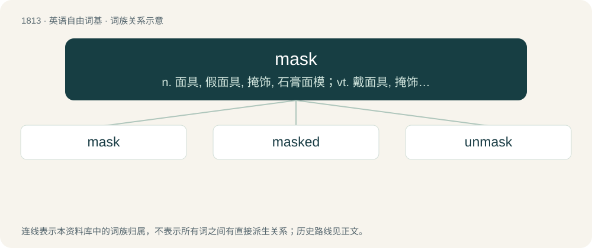

# 1920 · mask — n. 面具, 假面具, 掩饰, 石膏面模；vt. 戴面具, 掩饰, 使模糊；vi. 化装, 戴面具, 掩饰, 参加化装舞会

[总目录](../00_总目录_按常用程度.md)

**类型**：英语自由词基　｜　**来源语言**：见词源记录

## 核心含义与来源

- 核心含义：n. 面具, 假面具, 掩饰, 石膏面模；vt. 戴面具, 掩饰, 使模糊；vi. 化装, 戴面具, 掩饰, 参加化装舞会
- 英文含义：A cover, or partial cover, for the face, used for disguise or protection.
- 词形：mask

**多个词源／构词路径**：同一拼写可能有不同来源；以下按词性和含义分别列出。

**来源记录 1**（名词；A cover, or partial cover, for the face, used for disguise or protection.）

Borrowed from Middle French masque (“a covering to hide or protect the face”), from Italian maschera (“mask, disguise”), from (a byform of, see it for more) Medieval Latin masca, mascha, a borrowing of Proto-West Germanic \*maskā, from which English mesh and mask (“mesh”) (below at Etymology 2) are inherited. Doublet of mascara, masque, and mesh. Replaced Old English grīma (“mask”), whence grime, and displaced non-native Middle English viser (“visor, mask”) borrowed from Old French viser, visier.

**来源记录 2**（名词；Mesh.）

From Middle English maske, from Old English max, masċ (“net”), from Proto-West Germanic \*maskā (“mesh, netting, mask”). Doublet of mesh and mask above.

**来源记录 3**（名词；Mash.）

From Middle English \*mask, masch, from Old English māx, māsc (“mash”). Doublet of mash.

**来源记录 4**（动词；To bewilder; confuse.）

From Middle English masken, short for \*maskeren, malskren (“to bewilder; be confused, wander”). More at masker.

## 词族图

## 单词速览（常用到不常用）

| 单词 | 音标 | 释义 |
|---|---|---|
| [mask](#w-1) | 英 /mɑːsk/；美 /mæsk/ | n. 面具, 假面具, 掩饰, 石膏面模；vt. 戴面具, 掩饰, 使模糊；vi. 化装, 戴面具, 掩饰, 参加化装舞会 |
| [masked](#w-2) | 英 /mɑːskt/；美 /mæskt/ | a. 戴假面具的, 隐现的, 伪装的；\[医\] 掩蔽的, 隐蔽的 |
| [unmask](#w-3) | 英 /ʌnˈmæsk/；美 /ʌnˈmæsk/ | vi. 脱去假面具；vt. 暴露 |

## 逐词详解

### 1. mask

**词性**：名词　｜　**音标**：英 /mɑːsk/；美 /mæsk/

**中文释义**：n. 面具, 假面具, 掩饰, 石膏面模；vt. 戴面具, 掩饰, 使模糊；vi. 化装, 戴面具, 掩饰, 参加化装舞会

**英文义项**：A cover, or partial cover, for the face, used for disguise or protection. / That which disguises; a pretext or subterfuge.

**词源与演化**：

Borrowed from Middle French masque (“a covering to hide or protect the face”), from Italian maschera (“mask, disguise”), from (a byform of, see it for more) Medieval Latin masca, mascha, a borrowing of Proto-West Germanic \*maskā, from which English mesh and mask (“mesh”) (below at Etymology 2) are inherited. Doublet of mascara, masque, and mesh. Replaced Old English grīma (“mask”), whence grime, and displaced non-native Middle English viser (“visor, mask”) borrowed from Old French viser, visier.

**用法示例／搭配（非完整句）**：

> a dancer's mask; a fencer's mask; a ball player's mask

该用例对应义项：A cover, or partial cover, for the face, used for disguise or protection.

### 2. masked

**词性**：形容词　｜　**音标**：英 /mɑːskt/；美 /mæskt/

**中文释义**：a. 戴假面具的, 隐现的, 伪装的；\[医\] 掩蔽的, 隐蔽的

**英文义项**：Wearing a mask or masks. / Characterized by masks.

**构词拆分**：mask + -ed

**词源与演化**：

From mask + -ed.

**例句**：

> The masked face of a raccoon.

该用例对应义项：having markings suggestive of a mask

### 3. unmask

**词性**：动词　｜　**音标**：英 /ʌnˈmæsk/；美 /ʌnˈmæsk/

**中文释义**：vi. 脱去假面具；vt. 暴露

**英文义项**：To remove a mask from someone. / To expose, or reveal the true character of someone.

**构词拆分**：un- + mask

**词源与演化**：

From un- + mask. Compare typologically reveal (see more).

**例句**：

> Despite all her efforts, Rebecca wasn't able to unmask the impostors.
