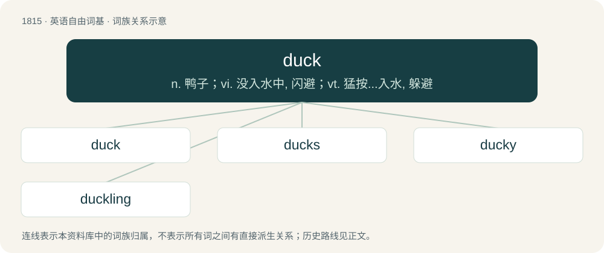

# 1922 · duck — n. 鸭子；vi. 没入水中, 闪避；vt. 猛按...入水, 躲避

[总目录](../00_总目录_按常用程度.md)

**类型**：英语自由词基　｜　**来源语言**：见词源记录

## 核心含义与来源

- 核心含义：n. 鸭子；vi. 没入水中, 闪避；vt. 猛按...入水, 躲避
- 英文含义：To quickly lower (the head or body), often in order to prevent it from being struck by something.
- 词形：duck

**多个词源／构词路径**：同一拼写可能有不同来源；以下按词性和含义分别列出。

**来源记录 1**（动词；To quickly lower (the head or body), often in order to prevent it from being struck by something.）

From Middle English ducken, duken, douken (“to duck, plunge under water, submerge”), from Old English \*dūcan (“to dip, dive, duck”), from Proto-West Germanic \*dūkan, from Proto-Germanic \*dūkaną (“to dip, dive, bend down, stoop, duck”). Cognates Related to Scots dulk (“to duck”), Middle Dutch ducken (“to duck”), Low German ducken (“to duck”), German ducken (“to duck”), Danish dukke, dykke (“to dive”). Related also to Scots dook, douk (“to bathe, drench, soak, baptise”), West Frisian dûke (“to plunge, dive”), Dutch duiken (“to dive, plunge, duck”), Low German duken (“to duck, dive, stoop”), German tauchen (“to dive, plunge, immerse, duck”), Swedish dyka (“to dive, submerge”).

**来源记录 2**（名词；Any of certain aquatic birds of the family Anatidae, having a flat bill and webbed feet, distinguished from swans and geese by generally being smaller and shorter-necked.）

From Middle English doke, ducke, dukke, dokke, douke, duke, from Old English duce, dūce (“duck”, literally “dipper, diver, ducker”), from Old English \*dūcan (“to dip, dive, duck”), from Proto-West Germanic \*dūkan, from Proto-Germanic \*dūkaną (“to dive, bend down”). See verb above. Cognates Cognate with Scots duik, duke, dook (“duck”), Danish dukand, dykand (“sea-duck”), Swedish dykfågel (“a diver, diving bird, plungeon”), Dutch duiker (“diving bird, loon”, literally “diver, dipper, plunger”), German Low German Düker (“diving bird, loon”, literally “diver”), German Taucher (“diving bird, loon, grebe”, literally “diver, plunger”). For the meaning development compare Russian ныро́к (nyrók, “pochard”) (&lt; ныря́ть (nyrjátʹ, “to dive”)).

**来源记录 3**（名词；A tightly-woven cotton or linen fabric, often used as sailcloth.）

From Dutch doek, from Middle Dutch doeck, doec (“linen cloth”), from Old Dutch \*dōc, from Proto-West Germanic \*dōk, from Proto-Germanic \*dōkaz (“cloth, rag”), from Proto-Indo-European \*dwōg-, \*dwōk-. Cognate with German Tuch (“cloth”), Swedish duk (“cloth, canvas”), Icelandic dúkur (“cloth, fabric”). Doublet of doek.

**来源记录 4**（名词；A term of endearment; pet; darling.）

Potteries dialect, Black Country dialect and dialects of the former territory of Mercia (central England). Compare Danish dukke (“doll”), Swedish docka (“baby; doll”), dialectal English doxy (“sweetheart”).

**来源记录 5**（动词；To surreptitiously leave a rubber duck on someone's parked Jeep as an act of kindness (see Jeep ducking).）

Denominal verb of duck (noun) and ellipsis of rubber duck

## 词族图

## 单词速览（常用到不常用）

| 单词 | 音标 | 释义 |
|---|---|---|
| [duck](#w-1) | /dʌk/ | n. 鸭子；vi. 没入水中, 闪避；vt. 猛按...入水, 躲避 |
| [ducks](#w-2) | /dʌks/ | 【英文】Dear (used as a pet name). |
| [ducky](#w-3) | 英 /ˈdʌk.i/ | a. 极好的, 可爱的, 令人愉快的 |
| [duckling](#w-4) | /ˈdʌklɪŋ/ | n. 小鸭子 |

## 逐词详解

### 1. duck

**词性**：动词　｜　**音标**：/dʌk/

**中文释义**：n. 鸭子；vi. 没入水中, 闪避；vt. 猛按...入水, 躲避

**英文义项**：To quickly lower (the head or body), often in order to prevent it from being struck by something. / To lower (something) into water; to thrust or plunge under liquid and suddenly withdraw.

**词源与演化**：

From Middle English ducken, duken, douken (“to duck, plunge under water, submerge”), from Old English \*dūcan (“to dip, dive, duck”), from Proto-West Germanic \*dūkan, from Proto-Germanic \*dūkaną (“to dip, dive, bend down, stoop, duck”). Cognates Related to Scots dulk (“to duck”), Middle Dutch ducken (“to duck”), Low German ducken (“to duck”), German ducken (“to duck”), Danish dukke, dykke (“to dive”). Related also to Scots dook, douk (“to bathe, drench, soak, baptise”), West Frisian dûke (“to plunge, dive”), Dutch duiken (“to dive, plunge, duck”), Low German duken (“to duck, dive, stoop”), German tauchen (“to dive, plunge, immerse, duck”), Swedish dyka (“to dive, submerge”).

**例句**：

> I'm just going to duck into the loo for a minute; can you hold my bag?

该用例对应义项：To enter a place for a short moment.

### 2. ducks

**词性**：名词　｜　**音标**：/dʌks/

**英文义项**：Dear (used as a pet name).

**构词拆分**：duck + -s

**词源与演化**：

From duck (“darling”) + -s (hypocoristic suffix).

### 3. ducky

**词性**：形容词　｜　**音标**：英 /ˈdʌk.i/

**中文释义**：a. 极好的, 可爱的, 令人愉快的

**英文义项**：Resembling or characteristic of a duck.

**构词拆分**：duck + -y

**词源与演化**：

From duck (“aquatic bird”) + -y.

**例句**：

> Ziri found a rubber ducky in the bath.

### 4. duckling

**词性**：名词　｜　**音标**：/ˈdʌklɪŋ/

**中文释义**：n. 小鸭子

**英文义项**：A young duck. / A young female duck.

**构词拆分**：duck + -ling

**词源与演化**：

From Middle English dokeling, dukling, dookelynge (“duckling”), equivalent to duck + -ling.

**例句**：

> The small duckling can swim but has not demonstrated this ability.
