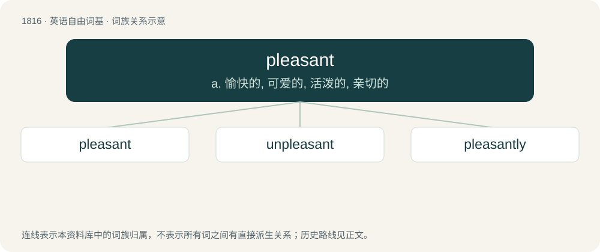

# 1923 · pleasant — a. 愉快的, 可爱的, 活泼的, 亲切的

[总目录](../00_总目录_按常用程度.md)

**类型**：英语自由词基　｜　**来源语言**：见词源记录

## 核心含义与来源

- 核心含义：a. 愉快的, 可爱的, 活泼的, 亲切的
- 英文含义：Giving pleasure; pleasing in manner.
- 词形：pleasant

**来源记录 1**（形容词；Giving pleasure; pleasing in manner.）

From Middle English plesaunte, from Old French plaisant. By surface analysis, please + -ant. Related to Dutch plezant (“full of fun or pleasure”). Partly displaced Old English wynsum, which became Modern English winsome.

## 词族图

## 单词速览（常用到不常用）

| 单词 | 音标 | 释义 |
|---|---|---|
| [pleasant](#w-1) | /ˈplɛz.ənt/ | a. 愉快的, 可爱的, 活泼的, 亲切的 |
| [unpleasant](#w-2) | /ʌnˈplɛzn̩t/ | a. 使人不愉快的, 使人厌恶的, 煞风景的 |
| [pleasantly](#w-3) | /ˈplɛzəntli/ | adv. 和蔼地, 亲切地；友好地；愉快地 |

## 逐词详解

### 1. pleasant

**词性**：形容词　｜　**音标**：/ˈplɛz.ənt/

**中文释义**：a. 愉快的, 可爱的, 活泼的, 亲切的

**英文义项**：Giving pleasure; pleasing in manner.

**词源与演化**：

From Middle English plesaunte, from Old French plaisant. By surface analysis, please + -ant. Related to Dutch plezant (“full of fun or pleasure”). Partly displaced Old English wynsum, which became Modern English winsome.

**例句**：

> It wasn't so hot outside, but pleasant enough to have lunch in the garden.

该用例对应义项：Giving pleasure; pleasing in manner.

### 2. unpleasant

**词性**：形容词　｜　**音标**：/ʌnˈplɛzn̩t/

**中文释义**：a. 使人不愉快的, 使人厌恶的, 煞风景的

**英文义项**：Not pleasant.

**构词拆分**：un- + pleasant

**词源与演化**：

From Middle English unplesaunt, equivalent to un- + pleasant.

**例句**：

> Wet blankets are not always unpleasant after you get to know them.

### 3. pleasantly

**词性**：副词　｜　**音标**：/ˈplɛzəntli/

**中文释义**：adv. 和蔼地, 亲切地；友好地；愉快地

**英文义项**：In a pleasant manner; so as to achieve a pleasant result. / Lightly

**构词拆分**：pleasant + -ly

**词源与演化**：

From Middle English pleasauntly; equivalent to pleasant + -ly.

**例句**：

> They were pleasantly surprised at the result.

该用例对应义项：In a pleasant manner; so as to achieve a pleasant result.
