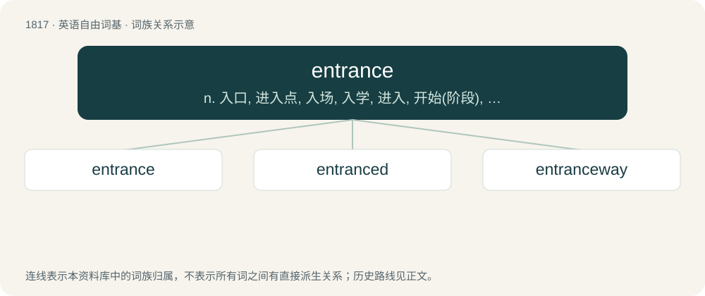

# 1924 · entrance — n. 入口, 进入点, 入场, 入学, 进入, 开始(阶段), 就任；vt. 使出神, 使入迷；\[计\] 入口

[总目录](../00_总目录_按常用程度.md)

**类型**：英语自由词基　｜　**来源语言**：见词源记录

## 核心含义与来源

- 核心含义：n. 入口, 进入点, 入场, 入学, 进入, 开始(阶段), 就任；vt. 使出神, 使入迷；\[计\] 入口
- 英文含义：The action of entering, or going in.
- 词形：entrance

**多个词源／构词路径**：同一拼写可能有不同来源；以下按词性和含义分别列出。

**来源记录 1**（名词；The action of entering, or going in.）

From Middle French entrance (“entry”). Replaced native Middle English ingang (“entrance, admission”), from Old English ingang (“ingress, entry, entrance”).

**来源记录 2**（动词；To delight and fill with wonder.）

From en- + trance (“daze”).

## 词族图

## 单词速览（常用到不常用）

| 单词 | 音标 | 释义 |
|---|---|---|
| [entrance](#w-1) | 英 /ˈɛn.tɹəns/ | n. 入口, 进入点, 入场, 入学, 进入, 开始(阶段), 就任；vt. 使出神, 使入迷；\[计\] 入口 |
| [entranced](#w-2) | 英 /ɛnˈtɹɑːnst/；美 /ɛnˈtɹænst/ | a. 着迷的；狂喜的 |
| [entranceway](#w-3) | /ˈentrəns,wei/ | n. 入口, 大门 |

## 逐词详解

### 1. entrance

**词性**：名词　｜　**音标**：英 /ˈɛn.tɹəns/

**中文释义**：n. 入口, 进入点, 入场, 入学, 进入, 开始(阶段), 就任；vt. 使出神, 使入迷；\[计\] 入口

**英文义项**：The action of entering, or going in. / The act of taking possession, as of property, or of office.

**词源与演化**：

From Middle French entrance (“entry”). Replaced native Middle English ingang (“entrance, admission”), from Old English ingang (“ingress, entry, entrance”).

**例句**：

> Place your bag by the entrance so that you can find it easily.

该用例对应义项：The place of entering, as a gate or doorway.

### 2. entranced

**词性**：形容词　｜　**音标**：英 /ɛnˈtɹɑːnst/；美 /ɛnˈtɹænst/

**中文释义**：a. 着迷的；狂喜的

**英文义项**：Placed in a trance. / Held at attention, as if by magic.

**构词拆分**：From entrance + -ed.

**词源与演化**：

From entrance + -ed.

**例句**：

> I was simply entranced by the beauty of her face.

### 3. entranceway

**词性**：名词　｜　**音标**：/ˈentrəns,wei/

**中文释义**：n. 入口, 大门

**英文义项**：Something that provides access to an entrance; an entryway.

**构词拆分**：entrance + way

**词源与演化**：

From entrance + way.

**例句**：

> This is a code lock type that you can use on the entranceway as well.
