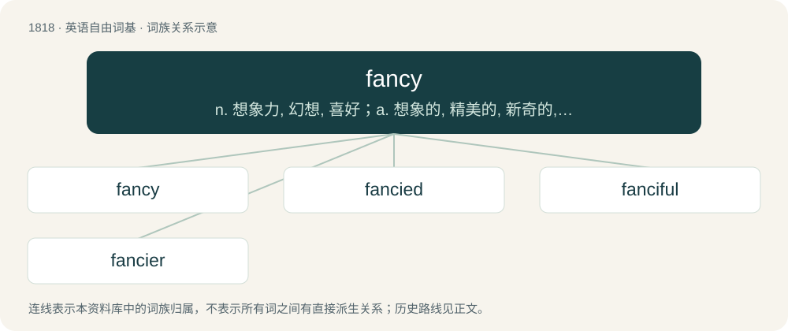

# 1925 · fancy — n. 想象力, 幻想, 喜好；a. 想象的, 精美的, 新奇的, 奇特的, 高价的, 特级的；vt. 想象, 设想, 相信, 喜爱

[总目录](../00_总目录_按常用程度.md)

**类型**：英语自由词基　｜　**来源语言**：见词源记录

## 核心含义与来源

- 核心含义：n. 想象力, 幻想, 喜好；a. 想象的, 精美的, 新奇的, 奇特的, 高价的, 特级的；vt. 想象, 设想, 相信, 喜爱
- 英文含义：The imagination.
- 词形：fancy

**多个词源／构词路径**：同一拼写可能有不同来源；以下按词性和含义分别列出。

**来源记录 1**（名词；The imagination.）

From Middle English fansy, fantsy, a contraction of fantasy, fantasye, fantasie, from Old French fantasie, from Medieval Latin fantasia, from Late Latin phantasia (“an idea, notion, fancy, phantasm”), from Ancient Greek φαντασία (phantasía), from φαντάζω (phantázō, “to render visible”), from φαντός (phantós, “visible”), from φαίνω (phaínō, “to make visible”); from the same root as φάος (pháos, “light”); ultimately from Proto-Indo-European \*bʰh₂nyéti, from the root \*bʰeh₂- (“to shine”). Doublet of fantasia, fantasy, phantasia, and phantasy.

**来源记录 2**（动词；To appreciate without jealousy or greed.）

From Middle English fancien, fantasien, fantesien, from Old French fantasier, from the noun (see above)).

## 词族图

## 单词速览（常用到不常用）

| 单词 | 音标 | 释义 |
|---|---|---|
| [fancy](#w-1) | /ˈfæn.si/ | n. 想象力, 幻想, 喜好；a. 想象的, 精美的, 新奇的, 奇特的, 高价的, 特级的；vt. 想象, 设想, 相信, 喜爱 |
| [fancied](#w-2) | 英 /ˈfænsɪd/ | a. 空想的, 虚构的, 受喜爱的 |
| [fanciful](#w-3) | /ˈfænsɪfl̩/ | a. 奇怪的, 稀奇的, 想像的 |
| [fancier](#w-4) | /ˈfænsiə/ | n. 空想家, 育种者, 爱好者 |

## 逐词详解

### 1. fancy

**词性**：名词　｜　**音标**：/ˈfæn.si/

**中文释义**：n. 想象力, 幻想, 喜好；a. 想象的, 精美的, 新奇的, 奇特的, 高价的, 特级的；vt. 想象, 设想, 相信, 喜爱

**英文义项**：The imagination. / An image or representation of anything formed in the mind.

**词源与演化**：

From Middle English fansy, fantsy, a contraction of fantasy, fantasye, fantasie, from Old French fantasie, from Medieval Latin fantasia, from Late Latin phantasia (“an idea, notion, fancy, phantasm”), from Ancient Greek φαντασία (phantasía), from φαντάζω (phantázō, “to render visible”), from φαντός (phantós, “visible”), from φαίνω (phaínō, “to make visible”); from the same root as φάος (pháos, “light”); ultimately from Proto-Indo-European \*bʰh₂nyéti, from the root \*bʰeh₂- (“to shine”). Doublet of fantasia, fantasy, phantasia, and phantasy.

**例句**：

> He fell out of favor with the boxing fancy after the incident.

该用例对应义项：The enthusiasts of such a pursuit.

### 2. fancied

**词性**：形容词　｜　**音标**：英 /ˈfænsɪd/

**中文释义**：a. 空想的, 虚构的, 受喜爱的

**英文义项**：Existing only in the fancy (“imagination”) or by social convention; imaginary, imagined; supposed; perceived rather than real. / Organized, or (especially of attire) designed, to suit one's fancy or whim.

**构词拆分**：fancy (“to have a fancy for, like; to imagine, suppose”) + -ed

**词源与演化**：

From fancy (“to have a fancy for, like; to imagine, suppose”) + -ed.

**例句**：

> The plant was named for its fancied resemblance to a Roman spear.

该用例对应义项：Existing only in the fancy (“imagination”) or by social convention; imaginary, imagined; supposed; perceived rather than real.

### 3. fanciful

**词性**：形容词　｜　**音标**：/ˈfænsɪfl̩/

**中文释义**：a. 奇怪的, 稀奇的, 想像的

**英文义项**：Imaginative or fantastic; ignoring reality. / Unreal or imagined.

**构词拆分**：fancy + -ful

**词源与演化**：

From fancy + -ful.

**例句**：

> It was fanciful to suppose that all he had to do would be to stride into a top law firm and he would be hired on the spot.

该用例对应义项：Imaginative or fantastic; ignoring reality.

### 4. fancier

**词性**：名词　｜　**音标**：/ˈfænsiə/

**中文释义**：n. 空想家, 育种者, 爱好者

**英文义项**：One who fancies; a person with a special interest, attraction or liking for something. / A person who breeds or grows a particular animal or plant for points of excellence.

**构词拆分**：From fancy (verb) + -er.

**词源与演化**：

From fancy (verb) + -er.

**例句**：

> She's definitely a cat fancier: she has nine of them in her home and the walls are covered with pictures of more.

该用例对应义项：One who fancies; a person with a special interest, attraction or liking for something.
