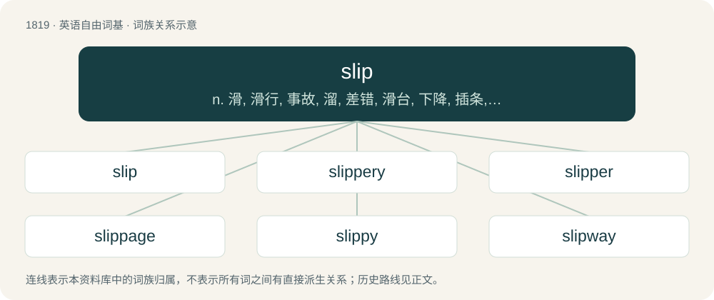

# 1926 · slip — n. 滑, 滑行, 事故, 溜, 差错, 滑台, 下降, 插条, 后裔, 板条, 瘦长的年轻人；vi. 滑动, 滑倒, 失足, 溜走, 滑落, 犯错, 变坏；vt. 使滑动, 滑过, 摆脱, 闪开, 塞入, 从...取接枝

[总目录](../00_总目录_按常用程度.md)

**类型**：英语自由词基　｜　**来源语言**：见词源记录

## 核心含义与来源

- 核心含义：n. 滑, 滑行, 事故, 溜, 差错, 滑台, 下降, 插条, 后裔, 板条, 瘦长的年轻人；vi. 滑动, 滑倒, 失足, 溜走, 滑落, 犯错, 变坏；vt. 使滑动, 滑过, 摆脱, 闪开, 塞入, 从...取接枝
- 英文含义：To lose one’s traction on a slippery surface; to slide due to a lack of friction.
- 词形：slip

**多个词源／构词路径**：同一拼写可能有不同来源；以下按词性和含义分别列出。

**来源记录 1**（动词；To lose one’s traction on a slippery surface; to slide due to a lack of friction.）

From Middle English slippen, probably from Middle Low German slippen, from Old Saxon \*slippian, from Proto-West Germanic \*slippjan, from Proto-Germanic \*slipjaną (“to glide”), an iterative form of \*slīpaną (“to slip, slide”), from Proto-Indo-European \*sleyb- (“slimy; to slide”). Possibly ultimately from Proto-Indo-European \*slewbʰ- (“slip, slide”), or related to Proto-Germanic \*slībaną (“to split”); related to Old English slipor (“slippery”). Cognate with Saterland Frisian slipje (“to slip”), Dutch slippen (“to slip”), German Low German slippen.

**来源记录 2**（名词；A twig or shoot; a cutting.）

Probably from Middle Dutch slippe or Middle Low German slippe, probably ultimately related to Proto-West Germanic \*slīban (“to split”).

**来源记录 3**（名词；A thin, slippery mix of clay and water.）

From Middle English slyp, slep, slyppe, from Old English slyp, slyppe, slipa (“a viscous, slimy substance”), of uncertain origin. Perhaps from Proto-West Germanic \*sleupan, from Proto-Germanic \*sleupaną (“to slip, sneak”), possibly connected with Proto-Indo-European \*slewb-, \*slewbʰ- (“slip, slide”), from Proto-Indo-European \*sel- (“to sneak, crawl”); or alternatively from Proto-Germanic \*slippijaną (“to glide”), from Proto-Indo-European \*sleyb- (“slimy; to glide”). Compare Old English slūpan (“to slip, glide”), Old English cūslyppe, cūsloppe (“cowslip”).

## 词族图

## 单词速览（常用到不常用）

| 单词 | 音标 | 释义 |
|---|---|---|
| [slip](#w-1) | /ˈslɪp/ | n. 滑, 滑行, 事故, 溜, 差错, 滑台, 下降, 插条, 后裔, 板条, 瘦长的年轻人；vi. 滑动, 滑倒, 失足, 溜走, 滑落, 犯错, 变坏；vt. 使滑动, 滑过, 摆脱, 闪开, 塞入, 从...取接枝 |
| [slippery](#w-2) | /ˈslɪpəɹi/ | a. 滑的, 光滑的, 靠不住的, 圆滑的, 不稳固的；\[法\] 狡猾的, 不可靠的, 不安定的 |
| [slipper](#w-3) | 英 /ˈslɪpə(ɹ)/；美 /ˈslɪpəɹ/ | n. 拖鞋, 制轮器；vt. 用拖鞋打 |
| [slippage](#w-4) | /ˈslɪpɪdʒ/ | n. 滑移, 滑动, 滑程；\[经\] 延误 |
| [slippy](#w-5) | /ˈslɪpi/ | a. 快的 |
| [slipway](#w-6) | /ˈslipwei/ | n. 滑台, 船台 |

## 逐词详解

### 1. slip

**词性**：动词　｜　**音标**：/ˈslɪp/

**中文释义**：n. 滑, 滑行, 事故, 溜, 差错, 滑台, 下降, 插条, 后裔, 板条, 瘦长的年轻人；vi. 滑动, 滑倒, 失足, 溜走, 滑落, 犯错, 变坏；vt. 使滑动, 滑过, 摆脱, 闪开, 塞入, 从...取接枝

**英文义项**：To lose one’s traction on a slippery surface; to slide due to a lack of friction. / To err.

**词源与演化**：

From Middle English slippen, probably from Middle Low German slippen, from Old Saxon \*slippian, from Proto-West Germanic \*slippjan, from Proto-Germanic \*slipjaną (“to glide”), an iterative form of \*slīpaną (“to slip, slide”), from Proto-Indo-European \*sleyb- (“slimy; to slide”). Possibly ultimately from Proto-Indo-European \*slewbʰ- (“slip, slide”), or related to Proto-Germanic \*slībaną (“to split”); related to Old English slipor (“slippery”). Cognate with Saterland Frisian slipje (“to slip”), Dutch slippen (“to slip”), German Low German slippen.

**例句**：

> A horse slips his bridle; a dog slips his collar.

该用例对应义项：To cause to slip or slide off, or out of place.

### 2. slippery

**词性**：形容词　｜　**音标**：/ˈslɪpəɹi/

**中文释义**：a. 滑的, 光滑的, 靠不住的, 圆滑的, 不稳固的；\[法\] 狡猾的, 不可靠的, 不安定的

**英文义项**：Of a surface, having low friction, often due to being covered in a non-viscous liquid, and therefore hard to grip, hard to stand on without falling, etc. / Evasive; difficult to pin down.

**构词拆分**：slip + -er

**词源与演化**：

From Middle English slipperie, an extended form ( + -y) of Middle English slipper, sliper (“slippery”), from Old English slipor (“slippery”), from Proto-Germanic \*slipraz (“smooth, slippery”), equivalent to slip + -er. Compare also Middle English slibbri, slubbri (“slippery”) borrowed from Middle Dutch or Middle Low German slibberich (“slippery”). Cognate with German schlüpfrig (“slippery”), Danish slibrig (“slippery”), Swedish slipprig (“slippery”).

**例句**：

> Oily substances render things slippery.

该用例对应义项：Of a surface, having low friction, often due to being covered in a non-viscous liquid, and therefore hard to grip, hard to stand on without falling, etc.

### 3. slipper

**词性**：名词　｜　**音标**：英 /ˈslɪpə(ɹ)/；美 /ˈslɪpəɹ/

**中文释义**：n. 拖鞋, 制轮器；vt. 用拖鞋打

**英文义项**：A low soft shoe that can be slipped on and off easily. / A low soft shoe intended for indoor use; a bedroom slipper or house slipper.

**构词拆分**：slip + -er

**词源与演化**：

From Middle English slypper, equivalent to slip + -er.

**例句**：

> Get out of bed, put on your slippers, and come downstairs.

该用例对应义项：A low soft shoe intended for indoor use; a bedroom slipper or house slipper.

### 4. slippage

**词性**：名词　｜　**音标**：/ˈslɪpɪdʒ/

**中文释义**：n. 滑移, 滑动, 滑程；\[经\] 延误

**英文义项**：The act of slipping, especially from a secure location. / The amount by which something has slipped.

**构词拆分**：slip + -age

**词源与演化**：

From slip + -age.

**例句**：

> Supply-chain problems led to a slippage in production last week.

该用例对应义项：A lessening of performance or achievement.

### 5. slippy

**词性**：形容词　｜　**音标**：/ˈslɪpi/

**中文释义**：a. 快的

**英文义项**：Slippery. / Spry, nimble.

**构词拆分**：slip + -y

**词源与演化**：

From slip + -y. Compare Old English slipiġ (“slippy, slimy, viscid”).

### 6. slipway

**词性**：名词　｜　**音标**：/ˈslipwei/

**中文释义**：n. 滑台, 船台

**英文义项**：A sloping surface, leading down to the shore or to a river, on which ships are built, repaired or stored and from which they are launched. / A slip road.

**构词拆分**：slip + way

**词源与演化**：

From slip + way.

**例句**：

> Tom and Mary launched their boat from the slipway at the tip of the peninsula.
