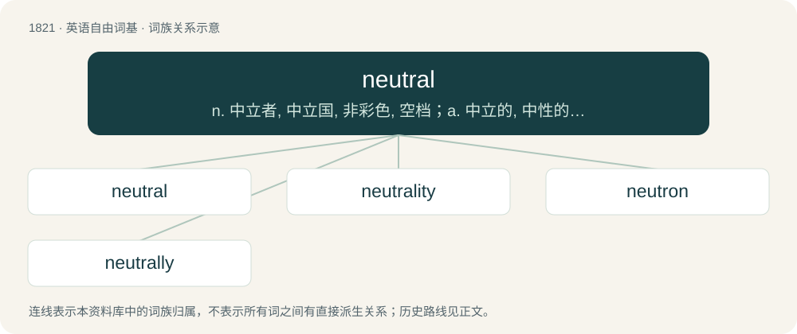

# 1927 · neutral — n. 中立者, 中立国, 非彩色, 空档；a. 中立的, 中性的, 无色的

[总目录](../00_总目录_按常用程度.md)

**类型**：英语自由词基　｜　**来源语言**：见词源记录

## 核心含义与来源

- 核心含义：n. 中立者, 中立国, 非彩色, 空档；a. 中立的, 中性的, 无色的
- 英文含义：Not taking sides in a conflict such as war; nonaligned.
- 词形：neutral

**来源记录 1**（形容词；Not taking sides in a conflict such as war; nonaligned.）

From Middle French neutral (compare modern French neutre), from Latin neutrālis. By surface analysis, neuter + -al.

## 词族图

## 单词速览（常用到不常用）

| 单词 | 音标 | 释义 |
|---|---|---|
| [neutral](#w-1) | 英 /ˈnjuː.tɹəl/；美 /ˈnuː.tɹəl/ | n. 中立者, 中立国, 非彩色, 空档；a. 中立的, 中性的, 无色的 |
| [neutrality](#w-2) | 英 /njuːˈtɹæləti/；美 /nuˈtɹæləti/ | n. 中立, 不偏不倚, 中间状态；\[医\] 中性; 无作用\[性\] |
| [neutron](#w-3) | 英 /ˈn(j)uː.tɹɒn/；美 /ˈnu.tɹɑn/ | n. 中子；\[化\] 中子 |
| [neutrally](#w-4) | /ˈnjuːtɹə.li/ | adv. 中立, 保持中立 |

## 逐词详解

### 1. neutral

**词性**：形容词　｜　**音标**：英 /ˈnjuː.tɹəl/；美 /ˈnuː.tɹəl/

**中文释义**：n. 中立者, 中立国, 非彩色, 空档；a. 中立的, 中性的, 无色的

**英文义项**：Not taking sides in a conflict such as war; nonaligned. / Favoring neither the supporting nor opposing viewpoint of a topic of debate; unbiased.

**词源与演化**：

From Middle French neutral (compare modern French neutre), from Latin neutrālis. By surface analysis, neuter + -al.

**例句**：

> I am neutral regarding the issue of gay marriage.

该用例对应义项：Favoring neither the supporting nor opposing viewpoint of a topic of debate; unbiased.

### 2. neutrality

**词性**：名词　｜　**音标**：英 /njuːˈtɹæləti/；美 /nuˈtɹæləti/

**中文释义**：n. 中立, 不偏不倚, 中间状态；\[医\] 中性; 无作用\[性\]

**英文义项**：The state or quality of being neutral; the condition of being unengaged in contests between others; state of taking no part on either side. / The quality or state of being neutral.

**构词拆分**：neutral + -ity

**词源与演化**：

From Middle French neutralité, from Medieval Latin neutralitas. Morphologically neutral + -ity.

**例句**：

> In 1949, Norway abandoned neutrality and became a member of NATO.

### 3. neutron

**词性**：名词　｜　**音标**：英 /ˈn(j)uː.tɹɒn/；美 /ˈnu.tɹɑn/

**中文释义**：n. 中子；\[化\] 中子

**英文义项**：A subatomic particle forming part of the nucleus of an atom and having no charge; it is a combination of an up quark and two down quarks.

**构词拆分**：neutral + -on

**词源与演化**：

From neutral + -on; by surface analysis, neutr(o)- + -on. Coined by Scottish-Australian physicist William Sutherland in 1899 in a paper in the Philosophical Magazine. Subsequent usage was sporadic and theoretical, sometimes referring to neutrinos rather than neutrons, and the modern sense was reintroduced alongside proton by Ernest Rutherford in 1920.

**例句**：

> The strong force is responsible for 99% of proton and neutron mass.

### 4. neutrally

**词性**：副词　｜　**音标**：/ˈnjuːtɹə.li/

**中文释义**：adv. 中立, 保持中立

**英文义项**：In a neutral manner; evenhandedly or fairly.

**构词拆分**：neutral + -ly

**词源与演化**：

From neutral + -ly.

**例句**：

> The terms of the contract were arbitrated neutrally by a third party.

该用例对应义项：In a neutral manner; evenhandedly or fairly.
