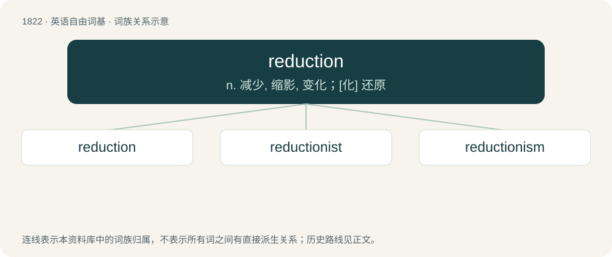

# 1929 · reduction — n. 减少, 缩影, 变化；\[化\] 还原

[总目录](../00_总目录_按常用程度.md)

**类型**：英语自由词基　｜　**来源语言**：见词源记录

## 核心含义与来源

- 核心含义：n. 减少, 缩影, 变化；\[化\] 还原
- 英文含义：The act, process, or result of reducing.
- 词形：reduction

**来源记录 1**（名词；The act, process, or result of reducing.）

From Middle English reduccion, a borrowing from Old French reducion, from Latin reductiō, reductiōnem. Equivalent to reduce + -tion.

## 词族图

## 单词速览（常用到不常用）

| 单词 | 音标 | 释义 |
|---|---|---|
| [reduction](#w-1) | 英 /ɹɪˈdʌk.ʃən/ | n. 减少, 缩影, 变化；\[化\] 还原 |
| [reductionist](#w-2) | /rɪˈdʌkʃənɪst/ | 还原论者 |
| [reductionism](#w-3) | /riˈdʌkʃənizm/ | n. 简化论 |

## 逐词详解

### 1. reduction

**词性**：名词　｜　**音标**：英 /ɹɪˈdʌk.ʃən/

**中文释义**：n. 减少, 缩影, 变化；\[化\] 还原

**英文义项**：The act, process, or result of reducing. / The amount or rate by which something is reduced, e.g. in price.

**构词拆分**：reduce + -tion

**词源与演化**：

From Middle English reduccion, a borrowing from Old French reducion, from Latin reductiō, reductiōnem. Equivalent to reduce + -tion.

**用法示例／搭配（非完整句）**：

> open reduction and internal fixation

该用例对应义项：A medical procedure to restore a fracture or dislocation to the correct alignment, usually with a closed approach but sometimes with an open approach (surgery).

### 2. reductionist

**词性**：形容词　｜　**音标**：/rɪˈdʌkʃənɪst/

**中文释义**：还原论者

**英文义项**：Of, or relating to reductionism.

**构词拆分**：reduction + -ist

**词源与演化**：

From reduction + -ist.

### 3. reductionism

**词性**：名词　｜　**音标**：/riˈdʌkʃənizm/

**中文释义**：n. 简化论

**英文义项**：An approach to studying complex systems or ideas by reducing them to a set of simpler components. / A philosophical position which holds that a complex system is nothing but the sum of its parts, and that an account of it can be reduced to accounts of individual constituents. In a reductionist framework, the phenomena that can be explained completely in terms of relations between other more fundamental phenomena are called "epiphenomena".

**构词拆分**：reduction + -ism

**词源与演化**：

From reduction + -ism.
