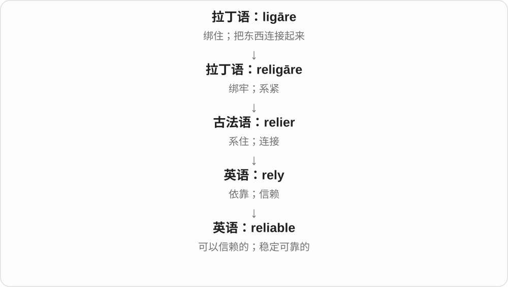
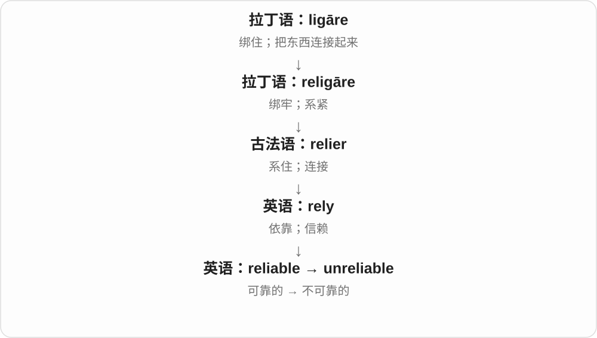

# 1929 · reliable — 可以依靠、运行稳定；性质和方式

[逐词精讲目录](../00_逐词精讲目录.md) · [总目录](../00_总目录_按常用程度.md)

## 核心词根与来源

人能守约、机器少掉链子、材料有可信依据，都能从可以依靠理解。性质名词和副词放在基本形容词后，别散开背。

**RELIABLE：反复交给它，仍然靠得住**

reliable → reliability 可靠性 → reliably 可靠地；unreliable 否定可靠。

- **基本性质、程度与方式**：reliable · reliability · reliably
- **否定可靠**：unreliable

## 词形与演化规律

rely + -able，y 改 i → reliable；reliable → reliability/reliably；un- + reliable。

## 单词速览（按词族由简到繁）

同一基础词的相关扩展放在一起，先读基础形式，再读扩展；各组之间优先读常用的。具体词源关系见各词讲解。

| 单词 | 音标 | 核心意思 |
|---|---|---|
| [reliable](#w-1) | /rɪˈlaɪəbəl/ | 可靠的；可信赖的 |
| [reliability](#w-2) | /rɪˌlaɪəˈbɪləti/ | 可靠性；信度 |
| [reliably](#w-4) | /rɪˈlaɪəbli/ | 可靠地、稳定可信地 |
| [unreliable](#w-3) | /ˌʌnrɪˈlaɪəbəl/ | 不可靠的；不稳定的 |

## 逐词讲解

### 1. reliable — 可靠的；可信赖的

**音标**：/rɪˈlaɪəbəl/

**先抓住这个画面**

reliable 描述在需要的时候表现稳定、能够让人放心依靠的对象。人、消息来源、设备和服务都可以 reliable。一次表现很好，不一定就证明长期可靠。

**怎么拆**

rely + -able；y 在派生中变 i。这里 -able 表示“可以被依靠的”，不是简单给 rely 加“能够”就译成“能够依靠别人的”。

**怎么变成今天的意思**

rely 是“依靠”的动作，reliable 把目光转向依靠的对象：它是否值得被信任。英语在本土构词阶段形成这个形容词，不能把整词当作拉丁语直接借词。

**常见搭配与例句**

a reliable source（可靠来源）；a reliable car（可靠的汽车）；reliable information（可信的信息）。

> We need a reliable source before publishing the story.

刊发这则报道前，我们需要可靠的消息来源。

> This old car is still surprisingly reliable.

这辆旧车仍然出人意料地可靠。

**别混淆**

reliable 强调可依赖的表现；accurate 强调具体内容准确。一把每次都偏同样数值的尺可能重复性好，却不准确。

### 2. reliability — 可靠性；信度

**音标**：/rɪˌlaɪəˈbɪləti/

**先抓住这个画面**

reliability 把“可靠”变成可以讨论、比较或衡量的性质。工程语境关心系统能否稳定工作；测量语境关心结果能否一致复现。

**怎么拆**

reliable + -ity，-able 在这类名词中对应 -ability。不要把它误读成 rely + ability“依赖的能力”；重点是被评价对象的可靠程度。

**怎么变成今天的意思**

这一步发生在英语派生层面：由形容词描述对象，转为名词讨论这种属性。重音移到 -bil- 所在音节，说明派生不仅改变词性，也可能改变读音。

**常见搭配与例句**

improve reliability（提高可靠性）；system reliability（系统可靠性）；the reliability of the results（结果的可靠程度）。

> The upgrade improved the reliability of the network.

这次升级提高了网络的可靠性。

> The researchers checked the reliability of the questionnaire.

研究人员检验了这份问卷的信度。

**别混淆**

reliability 与 validity 不同：前者看结果是否稳定一致，后者看测量或判断是否真正符合所要测的对象。

### 3. reliably — 可靠地、稳定可信地

**音标**：/rɪˈlaɪəbli/

**先抓住这个画面**

不是只碰巧成功一次，而是反复用都靠得住；reliably works 就是能稳定运行，不让人一直提心吊胆。

**怎么拆**

reliable → reliably，-le 这类形容词形成 -ly 副词时，末尾 -le 对应 -ly；可理解为可靠的性质转成做事方式。

**怎么变成今天的意思**

**rely + -able → reliable**  
可以依靠的

↓

**reliable → reliably**  
以稳定、可信的方式

work reliably 稳定运行，reliably predict 可靠预测，reliably informed 由可信来源获悉。后一表达说消息来源可靠，仍应按具体证据判断。

**常见搭配与例句**

work reliably；reliably predict；reliably informed。

> The device works reliably even in cold weather.

这个设备即使在冷天也能稳定运行。

> We cannot reliably predict the result from one example.

仅凭一个例子，我们无法可靠预测结果。

**别混淆**

reliably 说可靠程度，regularly 说规律、定期；定期开机不保证每次都能可靠运行。

### 4. unreliable — 不可靠的；不稳定的

**音标**：/ˌʌnrɪˈlaɪəbəl/

**先抓住这个画面**

unreliable 指你不能放心依靠某人或某物，因为其表现、信息或承诺不够稳定。它不必意味着对方有意欺骗。

**怎么拆**

un-（否定）+ reliable。否定的是“可依赖”这一性质，属于英语内部派生。

**怎么变成今天的意思**

一个 reliable 系统在需要时通常能发挥作用；un- 把这种信任基础否定。消息也可以 unreliable，因为来源不稳或证据不足，而不只是因为已经证实为假。

**常见搭配与例句**

an unreliable witness（不可靠的证人）；unreliable data（不可靠的数据）；an unreliable service（不稳定的服务）。

> The internet connection is too unreliable for video calls.

网络连接太不稳定，无法可靠地进行视频通话。

> We excluded the unreliable measurements from the analysis.

我们在分析中排除了不可靠的测量结果。

**别混淆**

unreliable 与 dishonest 不同：前者说“靠不住”，后者说“不诚实”。一个经常忘事的人可能不可靠，但并非有意撒谎。

## 这一组要分清什么

reliable/reliability 可靠的与可靠性；reliably/regularly 稳定可信与规律定期。

## 串起来练习

A reliable system should work reliably, and its reliability should be tested.

可靠系统应当稳定运行，可靠性也应经过检验。
