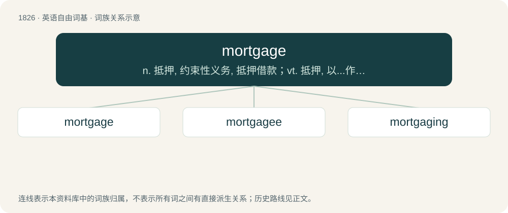

# 1930 · mortgage — n. 抵押, 约束性义务, 抵押借款；vt. 抵押, 以...作担保, 把...许给

[总目录](../00_总目录_按常用程度.md)

**类型**：英语自由词基　｜　**来源语言**：见词源记录

## 核心含义与来源

- 核心含义：n. 抵押, 约束性义务, 抵押借款；vt. 抵押, 以...作担保, 把...许给
- 英文含义：A legal agreement in which a borrower pledges real property as collateral for a loan used to purchase or refinance that property.
- 词形：mortgage

**来源记录 1**（名词；A legal agreement in which a borrower pledges real property as collateral for a loan used to purchase or refinance that property.）

From Middle English morgage and Middle French mortgage, from Anglo-Norman morgage, from Old French mort gage (“dead pledge”), after a translation of judicial Medieval Latin mortuum wadium, with wadium from Frankish \*wadi (“wager, pledge”). Compare gage and also wage. So called because rents and profits from the land were owed to the lender for as long as the gage existed (comparable to interest on a loan today), as opposed to the living gage, in which rents and profits automatically reduced the debt (paying it off over time).

## 词族图

## 单词速览（常用到不常用）

| 单词 | 音标 | 释义 |
|---|---|---|
| [mortgage](#w-1) | 英 /ˈmɔːɡɪd͡ʒ/；美 /ˈmoɹ.ɡɪd͡ʒ/ | n. 抵押, 约束性义务, 抵押借款；vt. 抵押, 以...作担保, 把...许给 |
| [mortgagee](#w-2) | /.mɒːgiˈdʒiː/ | n. 承受抵押人；\[经\] 承受抵押者, 押入者贷款人 |
| [mortgaging](#w-3) | /ˈmɔːɡidʒɪŋ/ | v. 抵押( mortgage的现在分词 ) |

## 逐词详解

### 1. mortgage

**词性**：动词　｜　**音标**：英 /ˈmɔːɡɪd͡ʒ/；美 /ˈmoɹ.ɡɪd͡ʒ/

**中文释义**：n. 抵押, 约束性义务, 抵押借款；vt. 抵押, 以...作担保, 把...许给

**英文义项**：To borrow against a property, to obtain a loan for another purpose by giving away the right of seizure to the lender over a fixed property such as a house or piece of land; to pledge a property in order to get a loan. / To pledge and make liable; to make subject to obligation; to achieve an immediate result by paying for it in the long term.

**词源与演化**：

From Middle English morgage and Middle French mortgage, from Anglo-Norman morgage, from Old French mort gage (“dead pledge”), after a translation of judicial Medieval Latin mortuum wadium, with wadium from Frankish \*wadi (“wager, pledge”). Compare gage and also wage. So called because rents and profits from the land were owed to the lender for as long as the gage existed (comparable to interest on a loan today), as opposed to the living gage, in which rents and profits automatically reduced the debt (paying it off over time).

**用法示例／搭配（非完整句）**：

> to mortgage a property, an estate, or a shop

该用例对应义项：To borrow against a property, to obtain a loan for another purpose by giving away the right of seizure to the lender over a fixed property such as a house or piece of land; to pledge a property in order to get a loan.

### 2. mortgagee

**词性**：名词　｜　**音标**：/.mɒːgiˈdʒiː/

**中文释义**：n. 承受抵押人；\[经\] 承受抵押者, 押入者贷款人

**英文义项**：One who provides a loan secured upon the borrowers' property: the lender in a mortgage agreement.

**构词拆分**：From mortgage + -ee.

**词源与演化**：

From mortgage + -ee.

**例句**：

> The bank became our mortgagee when it accepted our mortgage on our new home.

该用例对应义项：the person who accepts a mortgage

### 3. mortgaging

**词性**：名词　｜　**音标**：/ˈmɔːɡidʒɪŋ/

**中文释义**：v. 抵押( mortgage的现在分词 )

**英文义项**：The act by which something is mortgaged.

**构词拆分**：mortgage + -ing

**词源与演化**：

From mortgage + -ing.

**例句**：

> By creating the financial mortgaging system that Americans still use today, the FHA made home buying more accessible for millions of people.
