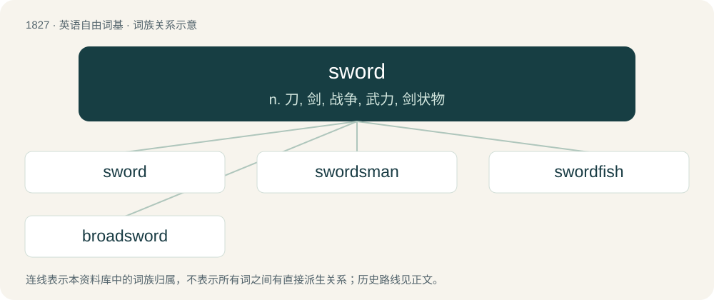

# 1931 · sword — n. 刀, 剑, 战争, 武力, 剑状物

[总目录](../00_总目录_按常用程度.md)

**类型**：英语自由词基　｜　**来源语言**：见词源记录

## 核心含义与来源

- 核心含义：n. 刀, 剑, 战争, 武力, 剑状物
- 英文含义：A long bladed weapon with a grip and typically a pommel and crossguard (together forming a hilt), which is designed to cut, stab, slash and/or hack.
- 词形：sword

**来源记录 1**（名词；A long bladed weapon with a grip and typically a pommel and crossguard (together forming a hilt), which is designed to cut, stab, slash and/or hack.）

Inherited from West Midland Middle English sword (swerd in most dialects), from Old English sweord (“sword”), from Proto-West Germanic \*swerd (“sword”), from Proto-Germanic \*swerdą (“sword”), possibly from Proto-Indo-European \*seh₂w- (“sharp”). Cognates Cognate with North Frisian Swērt, Swiirt, swörd (“sword”), Saterland Frisian Swid, Swäid (“sword”), West Frisian swurd (“sword”), Dutch zwaard (“sword”), German Schwert (“sword”), Luxembourgish Schwäert (“sword”), Vilamovian świert (“sword”), Yiddish שווערד (shverd, “sword”), Danish sværd (“sword”), Faroese svørð (“sword”), Icelandic sverð (“sword”), Norn svird (“small longish object”), Norwegian Bokmål sverd (“sword”), Norwegian Nynorsk sverd, svørd (“sword”), Swedish svärd (“sword”); also Belarusian све́рдзел (svjérdzjel, “drill, drill bit”), Bulgarian свре́дел (svrédel, “drill, drill bit”), Czech svider (“drill bit”), Polish świder (“drill”), Russian сверло́ (sverló, “auger, bore, drill, drill bit”), Serbo-Croatian свр̏дло, svȑdlo (“auger”), Slovene sveder (“drill”), Ukrainian све́рдел (svérdel), све́рдло (svérdlo, “drill bit”).

## 词族图

## 单词速览（常用到不常用）

| 单词 | 音标 | 释义 |
|---|---|---|
| [sword](#w-1) | 英 /sɔːd/；美 /soɹd/ | n. 刀, 剑, 战争, 武力, 剑状物 |
| [swordsman](#w-2) | 英 /ˈsɔːdsmən/；美 /ˈsɔɹdsmən/ | n. 剑术家, 剑客, 武士 |
| [swordfish](#w-3) | /ˈsɔː(ɹ)dfɪʃ/ | n. 箭鱼 |
| [broadsword](#w-4) | 英 /ˈbɹɔːd.sɔːd/；美 /ˈbɹɔd.sɔɹd/ | n. 大刀, 阔刀 |

## 逐词详解

### 1. sword

**词性**：名词　｜　**音标**：英 /sɔːd/；美 /soɹd/

**中文释义**：n. 刀, 剑, 战争, 武力, 剑状物

**英文义项**：A long bladed weapon with a grip and typically a pommel and crossguard (together forming a hilt), which is designed to cut, stab, slash and/or hack. / A suit in certain playing card decks, particularly those used in Spain and Italy, or those used for divination.

**词源与演化**：

Inherited from West Midland Middle English sword (swerd in most dialects), from Old English sweord (“sword”), from Proto-West Germanic \*swerd (“sword”), from Proto-Germanic \*swerdą (“sword”), possibly from Proto-Indo-European \*seh₂w- (“sharp”). Cognates Cognate with North Frisian Swērt, Swiirt, swörd (“sword”), Saterland Frisian Swid, Swäid (“sword”), West Frisian swurd (“sword”), Dutch zwaard (“sword”), German Schwert (“sword”), Luxembourgish Schwäert (“sword”), Vilamovian świert (“sword”), Yiddish שווערד (shverd, “sword”), Danish sværd (“sword”), Faroese svørð (“sword”), Icelandic sverð (“sword”), Norn svird (“small longish object”), Norwegian Bokmål sverd (“sword”), Norwegian Nynorsk sverd, svørd (“sword”), Swedish svärd (“sword”); also Belarusian све́рдзел (svjérdzjel, “drill, drill bit”), Bulgarian свре́дел (svrédel, “drill, drill bit”), Czech svider (“drill bit”), Polish świder (“drill”), Russian сверло́ (sverló, “auger, bore, drill, drill bit”), Serbo-Croatian свр̏дло, svȑdlo (“auger”), Slovene sveder (“drill”), Ukrainian све́рдел (svérdel), све́рдло (svérdlo, “drill bit”).

**例句**：

> He took out his sword and stabbed the man in the stomach.

该用例对应义项：A long bladed weapon with a grip and typically a pommel and crossguard (together forming a hilt), which is designed to cut, stab, slash and/or hack.

### 2. swordsman

**词性**：名词　｜　**音标**：英 /ˈsɔːdsmən/；美 /ˈsɔɹdsmən/

**中文释义**：n. 剑术家, 剑客, 武士

**英文义项**：A person skilled at using swords in sport or combat; a fencer. / A person who fights with a sword.

**构词拆分**：sword + -s- + man

**词源与演化**：

From sword + -s- + man.

**例句**：

> Archers attempted to take down an unknown swordsman.

该用例对应义项：A person who fights with a sword.

### 3. swordfish

**词性**：名词　｜　**音标**：/ˈsɔː(ɹ)dfɪʃ/

**中文释义**：n. 箭鱼

**英文义项**：A large marine fish with a long, pointed bill, Xiphias gladius. / A sudoku technique involving possible cell locations for a digit, or pair, or triple, in uniquely three rows and three columns only. This allows for the elimination of candidates around the grid.

**构词拆分**：sword + fish

**词源与演化**：

From Middle English swerdfysche, from Old English \*sweordfisċ. Equivalent to sword + fish.

**例句**：

> The swordfish was a bit dry, but it tasted good.

### 4. broadsword

**词性**：名词　｜　**音标**：英 /ˈbɹɔːd.sɔːd/；美 /ˈbɹɔd.sɔɹd/

**中文释义**：n. 大刀, 阔刀

**英文义项**：A type of early modern sword that has a broad double-edged blade for cutting (as opposed to the more slender thrust-oriented rapier) and typically a basket hilt. / A person armed with such a sword.

**构词拆分**：broad + sword

**词源与演化**：

From broad + sword.

**例句**：

> I can hold my own, both with single rapier, backsword, sword and dagger, broadsword, or case of falchions.
