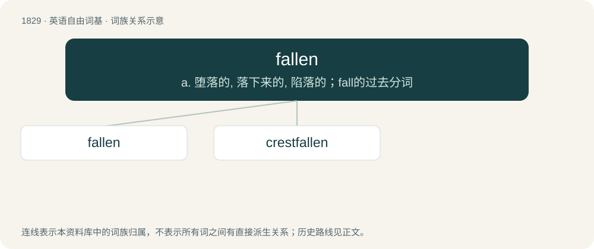

# 1933 · fallen — a. 堕落的, 落下来的, 陷落的；fall的过去分词

[总目录](../00_总目录_按常用程度.md)

**类型**：英语自由词基　｜　**来源语言**：见词源记录

## 核心含义与来源

- 核心含义：a. 堕落的, 落下来的, 陷落的；fall的过去分词
- 英文含义：Having dropped by the force of gravity.
- 词形：fallen

**来源记录 1**（形容词；Having dropped by the force of gravity.）

Morphologically fall + -en.

## 词族图

## 单词速览（常用到不常用）

| 单词 | 音标 | 释义 |
|---|---|---|
| [fallen](#w-1) | 英 /ˈfɔːlən/；美 /ˈfɔlən/ | a. 堕落的, 落下来的, 陷落的；fall的过去分词 |
| [crestfallen](#w-2) | 英 /ˈkɹɛstfɔːlən/；美 /ˈkɹɛstfɔlən/ | a. 垂头丧气的, 意气沮丧的, 气馁的 |

## 逐词详解

### 1. fallen

**词性**：形容词　｜　**音标**：英 /ˈfɔːlən/；美 /ˈfɔlən/

**中文释义**：a. 堕落的, 落下来的, 陷落的；fall的过去分词

**英文义项**：Having dropped by the force of gravity. / Killed, especially in battle.

**构词拆分**：fall + -en

**词源与演化**：

Morphologically fall + -en.

**例句**：

> Fallen leaves covered the forest floor.

该用例对应义项：having dropped by the force of gravity

### 2. crestfallen

**词性**：形容词　｜　**音标**：英 /ˈkɹɛstfɔːlən/；美 /ˈkɹɛstfɔlən/

**中文释义**：a. 垂头丧气的, 意气沮丧的, 气馁的

**英文义项**：Sad because of a disappointment.

**构词拆分**：crest + fallen

**词源与演化**：

From crest + fallen, from the appearance of a horse with its crest (head) on its chest after defeat in a battle.

**例句**：

> The boy was crestfallen when he wasn't allowed to go on the trip.
