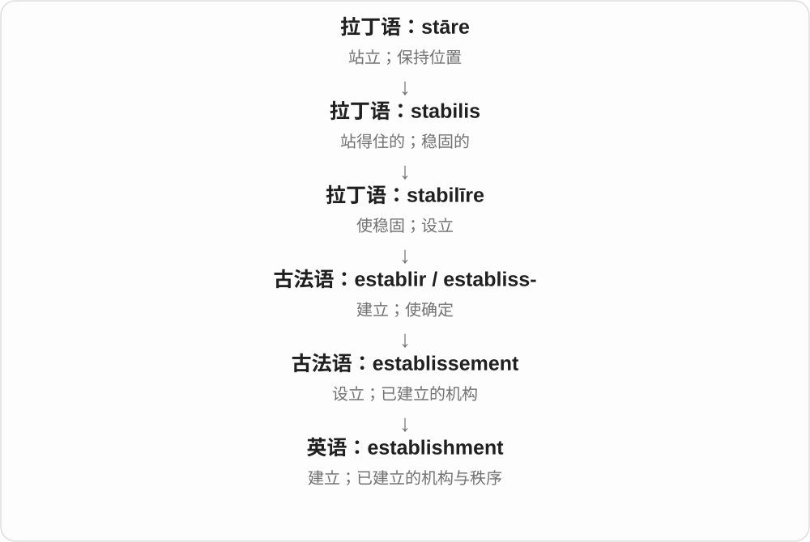

# 1934 · establishment — 建立的行为、已形成制度及其重新恢复

[逐词精讲目录](../00_逐词精讲目录.md) · [总目录](../00_总目录_按常用程度.md)

## 核心词根与来源

名词有过程和结果两面，再加 re- 通常重新启动建立这一动作。不要把前一个词每个义项都机械复制进长词。

**ESTABLISHMENT：建立起来的过程、事物，也可重新建立**

establishment → reestablishment；前者可指建立、机构或权势集团，后者主要说重建、恢复。

- **建立、制度及重建**：establishment · reestablishment
- **establishment 的复数与不同义项**：establishments

## 词形与演化规律

establish + -ment → establishment；re- + establishment → reestablishment。

机构、经营场所可以数为 establishments；the Establishment 常指掌权的社会圈层、既有权势体系，不能把所有复数都译成建制派。

## 单词速览（按词族由简到繁）

同一基础词的相关扩展放在一起，先读基础形式，再读扩展；各组之间优先读常用的。具体词源关系见各词讲解。

| 单词 | 音标 | 核心意思 |
|---|---|---|
| [establishment](#w-1) | /ɪˈstæblɪʃmənt/ | 建立；机构、店铺；既有权势集团 |
| [establishments](#w-4) | 英、美 /ɪˈstæblɪʃmənts/ | 机构；经营场所〔复数〕 |
| [reestablishment](#w-3) | /ˌriːɪˈstæblɪʃmənt/ | 重建、重新建立、恢复 |

## 逐词讲解

### 1. establishment — 建立；机构、店铺；既有权势集团

**音标**：/ɪˈstæblɪʃmənt/

**先抓住这个画面**

事情被建立起来，是 establishment；已经立起来并持续运作的机构，也可这样叫。the establishment 则指掌握既有权力的人与机构。

**怎么拆**

经古法语 establissement 进入英语，历史上对应 establir 的名词；现代可看出 establish + -ment 的形式关系。

**怎么变成今天的意思**

从过程转向结果，再到稳居社会重要位置的体系。a business establishment 常只是营业场所，不自动带政治意味。

**常见搭配与例句**

the establishment of…；a commercial establishment；the political establishment。

> The establishment of the library took several years.

建立这座图书馆花了好几年。

> The café is a small family establishment.

这家咖啡馆是一家小型家庭经营店铺。

**别混淆**

establishment 有三个常见层次：建立过程、具体机构、既有权势集团。冠词和上下文帮助判断。

### 2. establishments — 机构；经营场所〔复数〕

**音标**：英、美 /ɪˈstæblɪʃmənts/

**先抓住这个画面**

把一项事业安顿下来，形成一个固定运作的地方，就可能叫 establishment。餐馆、商店等经营场所，复数可说 establishments。

**怎么拆**

establish + -ment → establishment，再加 -s。establish 经古法语 establir 接拉丁 stabilire 使稳固，-ment 把建立的动作或结果名词化。

**怎么变成今天的意思**

**拉丁 stabilire 使稳固 → 古法语 establir → establish**  
建立、使固定运行

↓

**establish + -ment → establishment → establishments**  
建立起来的机构、场所等现代可数义

food establishments 是餐饮经营场所；educational establishments 是教育机构。看到复数时先找上下文在数哪一类场所。

**常见搭配与例句**

food establishments；educational establishments；local establishments。

> Several food establishments opened near the station.

车站附近开了几家餐饮店。

> The survey included small educational establishments.

这次调查包括了一些小型教育机构。

**别混淆**

the Establishment 常说既有权势体系、掌权圈层，通常作为整体讲；不能看到 establishments 就一律译为建制派。

### 3. reestablishment — 重建、重新建立、恢复

**音标**：/ˌriːɪˈstæblɪʃmənt/

**先抓住这个画面**

已有的关系、服务或机构中断了，现在重新搭起来；可以接续旧基础，也可能作出调整。

**怎么拆**

re- 再次 + establishment 建立、机构等名词。也常见 re-establishment 拼写，这里统一按同一词理解。

**怎么变成今天的意思**

**establish → establishment**  
建立 → 建立行为、已建机构或制度

↓

**re- + establishment → reestablishment**  
再次建立、恢复运作或关系

the reestablishment of relations 恢复关系，the reestablishment of services 恢复服务，the reestablishment of trust 重建信任。

**常见搭配与例句**

the reestablishment of relations；the reestablishment of services；the reestablishment of trust。

> The agreement allowed the reestablishment of diplomatic relations.

协议使外交关系得以恢复。

> The team focused on the reestablishment of public trust.

团队把重点放在重建公众信任上。

**别混淆**

reestablishment 不要求一切恢复到完全原样，也不等于 establishment 某些语境的权势集团义加再一次集团。具体恢复对象决定中文。

## 这一组要分清什么

establishment 可是机构或权势集团；reestablishment 主要看重建对象，不必完全照旧。

## 串起来练习

The reestablishment of the service required a new arrangement.

恢复这项服务需要重新作安排。
