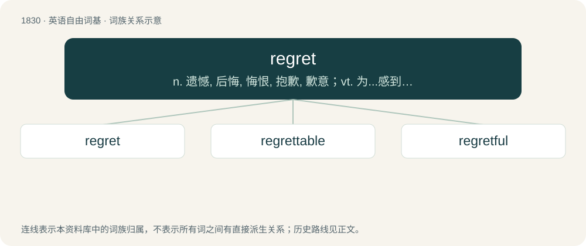

# 1934 · regret — n. 遗憾, 后悔, 悔恨, 抱歉, 歉意；vt. 为...感到遗憾, 后悔, 惋惜, 懊悔, 抱歉；vi. 感到抱歉

[总目录](../00_总目录_按常用程度.md)

**类型**：英语自由词基　｜　**来源语言**：见词源记录

## 核心含义与来源

- 核心含义：n. 遗憾, 后悔, 悔恨, 抱歉, 歉意；vt. 为...感到遗憾, 后悔, 惋惜, 懊悔, 抱歉；vi. 感到抱歉
- 英文含义：To feel sorry about (a thing that has or has not happened), afterthink: to wish that a thing had not happened, that something else had happened instead.
- 词形：regret

**来源记录 1**（动词；To feel sorry about (a thing that has or has not happened), afterthink: to wish that a thing had not happened, that something else had happened instead.）

From Middle English regretten, regreten, from Old French regreter, regrater (“to lament”), from re- (intensive prefix) + \*greter, \*grater (“to weep”), from Frankish \*grātan (“to weep, mourn, lament”), from Proto-Germanic \*grētaną (“to weep”), from Proto-Indo-European \*ǵʰreh₁d- (“to sound”); and Frankish \*greutan (“to cry, weep”), from Proto-Germanic \*greutaną (“to weep, cry”), from Proto-Indo-European \*gʰrewd- (“to weep, be sad”), equivalent to re- + greet. Cognate with Old High German grāzan (“to cry”), Old English grǣtan (“to weep, greet”), Old English grēotan (“to weep, lament”), Old Norse gráta (“to weep, groan”), Gothic 𐌲𐍂𐌴𐍄𐌰𐌽 (grētan, “to weep”). More at greet.

## 词族图

## 单词速览（常用到不常用）

| 单词 | 音标 | 释义 |
|---|---|---|
| [regret](#w-1) | /ɹɪˈɡɹɛt/ | n. 遗憾, 后悔, 悔恨, 抱歉, 歉意；vt. 为...感到遗憾, 后悔, 惋惜, 懊悔, 抱歉；vi. 感到抱歉 |
| [regrettable](#w-2) | /riˈgretəbl/ | a. 可悲的, 可惜的, 抱歉的 |
| [regretful](#w-3) | /riˈgretful/ | a. 惋惜的, 遗憾的, 抱歉的 |

## 逐词详解

### 1. regret

**词性**：动词　｜　**音标**：/ɹɪˈɡɹɛt/

**中文释义**：n. 遗憾, 后悔, 悔恨, 抱歉, 歉意；vt. 为...感到遗憾, 后悔, 惋惜, 懊悔, 抱歉；vi. 感到抱歉

**英文义项**：To feel sorry about (a thing that has or has not happened), afterthink: to wish that a thing had not happened, that something else had happened instead. / To feel sorry about (any thing).

**构词拆分**：re- + greet

**词源与演化**：

From Middle English regretten, regreten, from Old French regreter, regrater (“to lament”), from re- (intensive prefix) + \*greter, \*grater (“to weep”), from Frankish \*grātan (“to weep, mourn, lament”), from Proto-Germanic \*grētaną (“to weep”), from Proto-Indo-European \*ǵʰreh₁d- (“to sound”); and Frankish \*greutan (“to cry, weep”), from Proto-Germanic \*greutaną (“to weep, cry”), from Proto-Indo-European \*gʰrewd- (“to weep, be sad”), equivalent to re- + greet. Cognate with Old High German grāzan (“to cry”), Old English grǣtan (“to weep, greet”), Old English grēotan (“to weep, lament”), Old Norse gráta (“to weep, groan”), Gothic 𐌲𐍂𐌴𐍄𐌰𐌽 (grētan, “to weep”). More at greet.

**例句**：

> I don't regret enrolling in law, but I regret not studying some Chinese.

该用例对应义项：To feel sorry about (a thing that has or has not happened), afterthink: to wish that a thing had not happened, that something else had happened instead.

### 2. regrettable

**词性**：形容词　｜　**音标**：/riˈgretəbl/

**中文释义**：a. 可悲的, 可惜的, 抱歉的

**英文义项**：Able to be regretted, especially deserving of regret.

**构词拆分**：regret + -able

**词源与演化**：

From regret + -able.

**例句**：

> The officers' actions were regrettable, yes, but there's nothing to be done now but to relocate everyone to the mainland in a calm and orderly manner.

该用例对应义项：Able to be regretted, especially deserving of regret.

### 3. regretful

**词性**：形容词　｜　**音标**：/riˈgretful/

**中文释义**：a. 惋惜的, 遗憾的, 抱歉的

**英文义项**：Full of feelings of regret, indulging in regrets. / Sorrowful about what has been lost or done.

**构词拆分**：regret + -ful

**词源与演化**：

From regret + -ful.

**用法示例／搭配（非完整句）**：

> feel sincerely regretful

该用例对应义项：Sorrowful about what has been lost or done.
