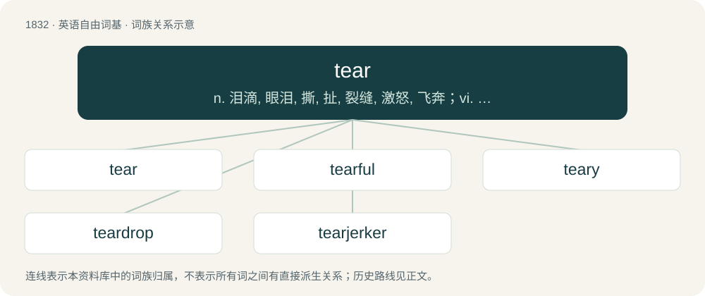

# 1935 · tear — n. 泪滴, 眼泪, 撕, 扯, 裂缝, 激怒, 飞奔；vi. 流泪, 撕破, 赶快, 飞奔, 被撕破；vt. 撕裂, 戳破, 拉掉, 撕掉, 使分裂, 使精神不安, 折磨

[总目录](../00_总目录_按常用程度.md)

**类型**：英语自由词基　｜　**来源语言**：见词源记录

## 核心含义与来源

- 核心含义：n. 泪滴, 眼泪, 撕, 扯, 裂缝, 激怒, 飞奔；vi. 流泪, 撕破, 赶快, 飞奔, 被撕破；vt. 撕裂, 戳破, 拉掉, 撕掉, 使分裂, 使精神不安, 折磨
- 英文含义：To rend (a solid material) by holding or restraining in two places and pulling apart, whether intentionally or not; to destroy or separate.
- 词形：tear

**多个词源／构词路径**：同一拼写可能有不同来源；以下按词性和含义分别列出。

**来源记录 1**（动词；To rend (a solid material) by holding or restraining in two places and pulling apart, whether intentionally or not; to destroy or separate.）

From Middle English teren, from Old English teran (“to tear, lacerate”), from Proto-Germanic \*teraną (“to tear, tear apart, rip”), from Proto-Indo-European \*der- (“to tear, tear apart”). Cognate with Scots tere, teir, tair (“to rend, lacerate, wound, rip, tear out”), Dutch teren (“to eliminate, efface, live, survive by consumption”), German zehren (“to consume, misuse”), German zerren (“to tug, rip, tear”), Danish tære (“to consume”), Swedish tära (“to fret, consume, deplete, use up”), Icelandic tæra (“to clear, corrode”). Outside Germanic, cognate to Ancient Greek δέρω (dérō, “to skin”), Albanian ther (“to slay, skin, pierce”). Doublet of tire.

**来源记录 2**（名词；A drop of clear, salty liquid produced from the eyes by crying or irritation.）

From Middle English tear, teer, teere, ter, tere, tyar, tyear, tyer, tær (“tear”), from Old English teagor, tēar, tæher, from Proto-West Germanic \*tahr, from Proto-Germanic \*tahrą (“tear”), from Proto-Indo-European \*dáḱru- (“tear”). Cognates Cognate with German Zähre (“tear”), Danish, Norwegian Bokmål, and Norwegian Nynorsk tåre (“tear”), Faroese and Icelandic tár (“tear”), Swedish tår (“tear”), Gothic 𐍄𐌰𐌲𐍂 (tagr, “teardrop”); also Cornish dager (“tear; drop”), Irish deoir (“tear”), Manx jeir (“tear”), Scottish Gaelic deur (“tear; drop”), Welsh deigryn (“tear”), Latin dacrima, dacruma, lachryma, lacrima, lacruma, lacryma (“tear”), Greek δάκρυ (dákry, “tear”), Armenian արտոսր (artosr, “tear”).

## 词族图

## 单词速览（常用到不常用）

| 单词 | 音标 | 释义 |
|---|---|---|
| [tear](#w-1) | 英 /tɛə/；美 /tɛɹ/ | n. 泪滴, 眼泪, 撕, 扯, 裂缝, 激怒, 飞奔；vi. 流泪, 撕破, 赶快, 飞奔, 被撕破；vt. 撕裂, 戳破, 拉掉, 撕掉, 使分裂, 使精神不安, 折磨 |
| [tearful](#w-2) | 英 /ˈtɪə(ɹ)fʊl/；美 /ˈtɪɹfʊl/ | a. 含泪的, 使人流泪的, 流泪的 |
| [teary](#w-3) | 英 /ˈtɪəɹi/；美 /ˈtɪɚi/ | a. 哭泣的 |
| [teardrop](#w-4) | /ˈtɪədɹɒp/ | n. 泪珠, 泪珠状物 |
| [tearjerker](#w-5) | /ˈtiə.dʒəːkə/ | n. 使人流泪的电影(或歌曲、故事) |

## 逐词详解

### 1. tear

**词性**：动词　｜　**音标**：英 /tɛə/；美 /tɛɹ/

**中文释义**：n. 泪滴, 眼泪, 撕, 扯, 裂缝, 激怒, 飞奔；vi. 流泪, 撕破, 赶快, 飞奔, 被撕破；vt. 撕裂, 戳破, 拉掉, 撕掉, 使分裂, 使精神不安, 折磨

**英文义项**：To rend (a solid material) by holding or restraining in two places and pulling apart, whether intentionally or not; to destroy or separate. / To injure as if by pulling apart.

**词源与演化**：

From Middle English teren, from Old English teran (“to tear, lacerate”), from Proto-Germanic \*teraną (“to tear, tear apart, rip”), from Proto-Indo-European \*der- (“to tear, tear apart”). Cognate with Scots tere, teir, tair (“to rend, lacerate, wound, rip, tear out”), Dutch teren (“to eliminate, efface, live, survive by consumption”), German zehren (“to consume, misuse”), German zerren (“to tug, rip, tear”), Danish tære (“to consume”), Swedish tära (“to fret, consume, deplete, use up”), Icelandic tæra (“to clear, corrode”). Outside Germanic, cognate to Ancient Greek δέρω (dérō, “to skin”), Albanian ther (“to slay, skin, pierce”). Doublet of tire.

**例句**：

> The tornado lingered, tearing through town, leaving nothing upright.

该用例对应义项：To move or act with great speed, energy, or violence.

### 2. tearful

**词性**：形容词　｜　**音标**：英 /ˈtɪə(ɹ)fʊl/；美 /ˈtɪɹfʊl/

**中文释义**：a. 含泪的, 使人流泪的, 流泪的

**英文义项**：Accompanied by tears; crying, or about to cry. / Sorrowful.

**构词拆分**：tear + -ful

**词源与演化**：

From tear + -ful.

**例句**：

> Aaron got a little tearful until Laura came to reassure him.

该用例对应义项：Accompanied by tears; crying, or about to cry.

### 3. teary

**词性**：形容词　｜　**音标**：英 /ˈtɪəɹi/；美 /ˈtɪɚi/

**中文释义**：a. 哭泣的

**英文义项**：Of a person, having eyes filled with tears; inclined to cry. / Of eyes, filled with tears.

**构词拆分**：tear + -y

**词源与演化**：

From Middle English tery; equivalent to tear + -y.

**例句**：

> No wonder Ryan was teary; he missed his parents.

该用例对应义项：Of a person, having eyes filled with tears; inclined to cry.

### 4. teardrop

**词性**：名词　｜　**音标**：/ˈtɪədɹɒp/

**中文释义**：n. 泪珠, 泪珠状物

**英文义项**：a single tear (clear, salty liquid secreted by the eye). / The shape of a drop of liquid about to fall. (Note that once detached from a surface, a drop changes shape to become spherical).

**构词拆分**：tear + drop

**词源与演化**：

From tear + drop.

**例句**：

> Devin's teardrop landed on Cody's head.

该用例对应义项：a single tear (clear, salty liquid secreted by the eye).

### 5. tearjerker

**词性**：名词　｜　**音标**：/ˈtiə.dʒəːkə/

**中文释义**：n. 使人流泪的电影(或歌曲、故事)

**英文义项**：An emotionally charged film, novel, song, opera, television episode, etc., usually with one or more sad passages or ending.

**构词拆分**：tear + jerker

**词源与演化**：

From tear + jerker, so termed because it suggests one is likely to cry during its performance.

**例句**：

> That movie was a real tearjerker.
