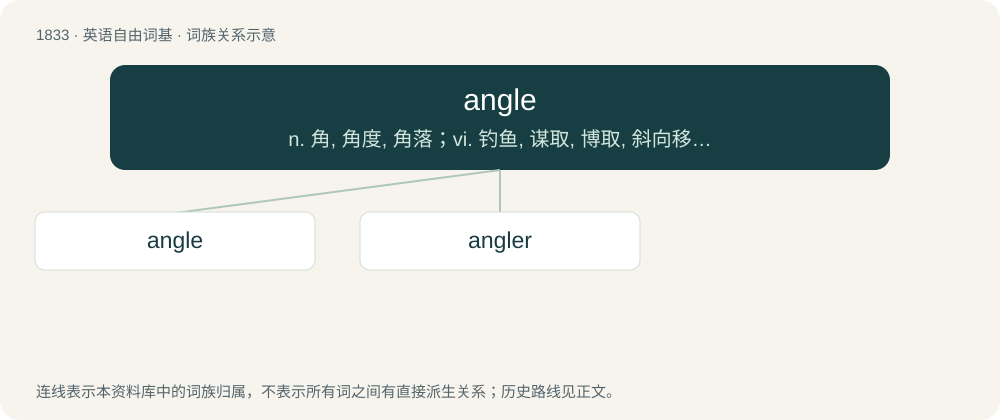

# 1936 · angle — n. 角, 角度, 角落；vi. 钓鱼, 谋取, 博取, 斜向移动, 转变角度；vt. 使转动角度, 在...钓鱼, 获取

[总目录](../00_总目录_按常用程度.md)

**类型**：英语自由词基　｜　**来源语言**：见词源记录

## 核心含义与来源

- 核心含义：n. 角, 角度, 角落；vi. 钓鱼, 谋取, 博取, 斜向移动, 转变角度；vt. 使转动角度, 在...钓鱼, 获取
- 英文含义：A figure formed by two rays which start from a common point (a plane angle) or by three planes that intersect (a solid angle).
- 词形：angle

**多个词源／构词路径**：同一拼写可能有不同来源；以下按词性和含义分别列出。

**来源记录 1**（名词；A figure formed by two rays which start from a common point (a plane angle) or by three planes that intersect (a solid angle).）

From Middle English angle, angul, angule, borrowed from Middle French angle, from Latin angulus, anglus (“corner, remote area”). Cognate with Old High German ancha (“nape of the neck”), Middle High German anke (“joint of the foot, nape of neck”). Doublet of angulus and ankle.

**来源记录 2**（动词；To place (something) at an angle.）

From Middle English anglen (“to meet at an angle, converge”), from the noun (see above).

**来源记录 3**（名词；A fishhook; tackle for catching fish, consisting of a line, hook, and bait, with or without a rod.）

From Middle English angel (“fishhook”), from Old English angel (“hook, fishhook”), from Proto-West Germanic \*angul, from Proto-Germanic \*angulaz (“hook”), from Proto-Indo-European \*h₂enk- (“to make crooked, bend”). Cognate with Saterland Frisian Ongle (“fishhook; fishing pole”), West Frisian angel (“fishing rod, stinger”), Dutch angel (“fishhook”), German Angel (“fishing pole”), Luxembourgish Aangel (“fishing rod”), Icelandic öngull (“fishhook”), Norwegian Nynorsk angel, ongel, ongul (“fishhook”), Swedish angel (“pike hook”), Prasuni uku (“shoulder”).

**来源记录 4**（动词；To try to catch fish with a hook and line.）

From Middle English anglen (“to fish, fish with a hook”, literally “to fish-hook”), perhaps from Old English \*anglian, from Proto-West Germanic \*anglōn (“to hook”). Cognate with Saterland Frisian ongelje (“to fish, angle”), Dutch hengelen (“to fish, angle”), German Low German angeln (“to fish, angle”), German angeln (“to fish, angle”).

## 词族图

## 单词速览（常用到不常用）

| 单词 | 音标 | 释义 |
|---|---|---|
| [angle](#w-1) | 美 /ˈeɪ̯ŋ.ɡəl/；/ˈæŋ.ɡəl/ | n. 角, 角度, 角落；vi. 钓鱼, 谋取, 博取, 斜向移动, 转变角度；vt. 使转动角度, 在...钓鱼, 获取 |
| [angler](#w-2) | 英 /ˈæŋ.ɡlə(ɹ)/；美 /ˈæŋ.ɡlɚ/ | n. 钓鱼, 攫取, 追逐 |

## 逐词详解

### 1. angle

**词性**：名词　｜　**音标**：美 /ˈeɪ̯ŋ.ɡəl/；/ˈæŋ.ɡəl/

**中文释义**：n. 角, 角度, 角落；vi. 钓鱼, 谋取, 博取, 斜向移动, 转变角度；vt. 使转动角度, 在...钓鱼, 获取

**英文义项**：A figure formed by two rays which start from a common point (a plane angle) or by three planes that intersect (a solid angle). / The measure of such a figure. In the case of a plane angle, this is the ratio (or proportional to the ratio) of the arc length to the radius of a section of a circle cut by the two rays, centered at their common point. In the case of a solid angle, this is the ratio of the surface area to the square of the radius of the section of a sphere.

**词源与演化**：

From Middle English angle, angul, angule, borrowed from Middle French angle, from Latin angulus, anglus (“corner, remote area”). Cognate with Old High German ancha (“nape of the neck”), Middle High German anke (“joint of the foot, nape of neck”). Doublet of angulus and ankle.

**例句**：

> The angle between lines A and B is π/4 radians, or 45 degrees.

该用例对应义项：The measure of such a figure. In the case of a plane angle, this is the ratio (or proportional to the ratio) of the arc length to the radius of a section of a circle cut by the two rays, centered at their common point. In the case of a solid angle, this is the ratio of the surface area to the square of the radius of the section of a sphere.

### 2. angler

**词性**：名词　｜　**音标**：英 /ˈæŋ.ɡlə(ɹ)/；美 /ˈæŋ.ɡlɚ/

**中文释义**：n. 钓鱼, 攫取, 追逐

**英文义项**：A person who fishes with a hook and line. / An anglerfish, Lophius piscatorius.

**构词拆分**：angle + -er

**词源与演化**：

From Middle English angler, angleer, angeler, equivalent to angle + -er.

**例句**：

> A throng of anglers lined the trout stream on opening day of trout season.

该用例对应义项：A person who fishes with a hook and line.
