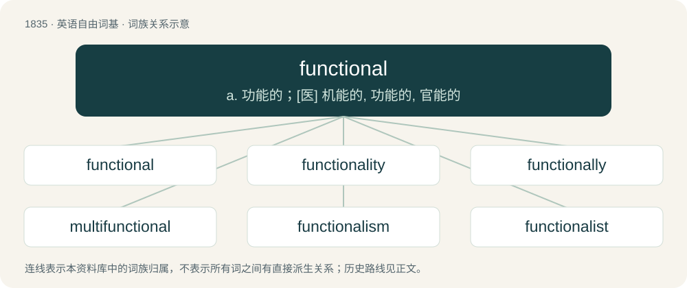

# 1937 · functional — a. 功能的；\[医\] 机能的, 功能的, 官能的

[总目录](../00_总目录_按常用程度.md)

**类型**：英语自由词基　｜　**来源语言**：见词源记录

## 核心含义与来源

- 核心含义：a. 功能的；\[医\] 机能的, 功能的, 官能的
- 英文含义：In good working order.
- 词形：functional

**来源记录 1**（形容词；In good working order.）

From function + -al.

## 词族图

## 单词速览（常用到不常用）

| 单词 | 音标 | 释义 |
|---|---|---|
| [functional](#w-1) | /ˈfʌŋkt͡ʃənəl/ | a. 功能的；\[医\] 机能的, 功能的, 官能的 |
| [functionality](#w-2) | /,fʌŋkəʃəˈnæliti/ | \[计\] 功能性, 泛函性；\[化\] 官能度 |
| [functionally](#w-3) |  | adv. 官能, 有功能, 职务, 机能, 在起作用, 从使用/实用的观点设计, 函数；\[计\] 功能地 |
| [multifunctional](#w-4) |  | \[计\] 多功能的；\[化\] 多官能的; 多功能的 |
| [functionalism](#w-5) | /ˈfʌŋkʃənəlɪzəm/ | n. 功能论, 机能心理学, 功能主义, 实用第一主义 |
| [functionalist](#w-6) | /ˈfʌŋkʃənəlɪst/ | n. 机能主义者 |
| [nonfunctional](#w-7) | /nɒnˈfʌŋkʃənl/ | \[医\]无功能的 |

## 逐词详解

### 1. functional

**词性**：形容词　｜　**音标**：/ˈfʌŋkt͡ʃənəl/

**中文释义**：a. 功能的；\[医\] 机能的, 功能的, 官能的

**英文义项**：In good working order. / Useful; serving a purpose, fulfilling a function.

**构词拆分**：function + -al

**词源与演化**：

From function + -al.

**例句**：

> That sculpture is not merely artistic, but also functional: it can be used as a hatrack.

该用例对应义项：Useful; serving a purpose, fulfilling a function.

### 2. functionality

**词性**：名词　｜　**音标**：/,fʌŋkəʃəˈnæliti/

**中文释义**：\[计\] 功能性, 泛函性；\[化\] 官能度

**英文义项**：The ability to do a task, performance, or execution; a set of functions that something is able or equipped to perform. / In trademark law, the tendency of a product design to serve a function other than the identification of the product, preventing that design from being protected as a trademark.

**构词拆分**：functional + -ity

**词源与演化**：

From functional + -ity.

**例句**：

> Many software companies offer free versions of their products, albeit with limited functionality.

### 3. functionally

**词性**：副词

**中文释义**：adv. 官能, 有功能, 职务, 机能, 在起作用, 从使用/实用的观点设计, 函数；\[计\] 功能地

**英文义项**：In a functional manner.

**构词拆分**：functional + -ly

**词源与演化**：

From functional + -ly.

### 4. multifunctional

**词性**：形容词

**中文释义**：\[计\] 多功能的；\[化\] 多官能的; 多功能的

**英文义项**：Having multiple functions.

**构词拆分**：multi- + functional

**词源与演化**：

From multi- + functional.

### 5. functionalism

**词性**：名词　｜　**音标**：/ˈfʌŋkʃənəlɪzəm/

**中文释义**：n. 功能论, 机能心理学, 功能主义, 实用第一主义

**英文义项**：A doctrine, in several fields, that the function of something should be reflected in its design and the materials used in its construction. / The definition of mental states in terms of their causes and effects.

**构词拆分**：functional + -ism

**词源与演化**：

From functional + -ism.

### 6. functionalist

**词性**：名词　｜　**音标**：/ˈfʌŋkʃənəlɪst/

**中文释义**：n. 机能主义者

**英文义项**：One who believes in functionalism.

**构词拆分**：functional + -ist

**词源与演化**：

From functional + -ist.

**例句**：

> According to functionalist theory, acne outbreaks provide a necessary limit on the number of prom attendees.

### 7. nonfunctional

**词性**：形容词　｜　**音标**：/nɒnˈfʌŋkʃənl/

**中文释义**：\[医\]无功能的

**英文义项**：Not functional; useless; broken. / Not of the functional programming paradigm.

**构词拆分**：non- + functional

**词源与演化**：

From non- + functional.
