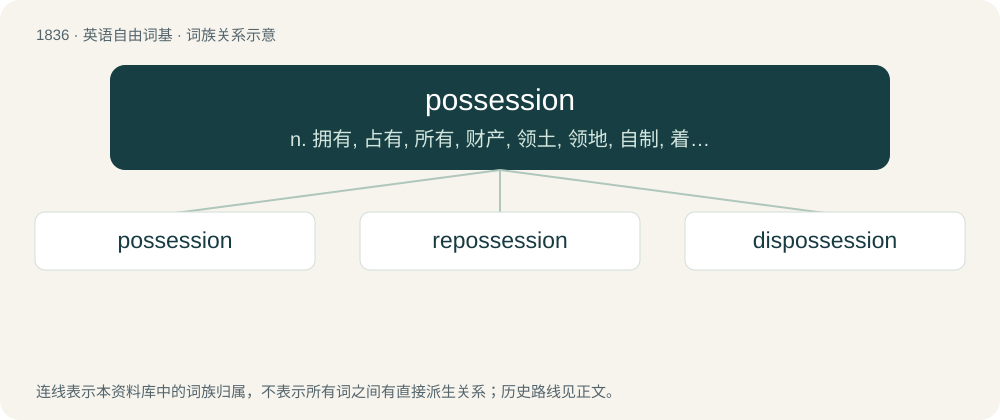

# 1939 · possession — n. 拥有, 占有, 所有, 财产, 领土, 领地, 自制, 着迷；\[经\] 占有, 持有

[总目录](../00_总目录_按常用程度.md)

**类型**：英语自由词基　｜　**来源语言**：见词源记录

## 核心含义与来源

- 核心含义：n. 拥有, 占有, 所有, 财产, 领土, 领地, 自制, 着迷；\[经\] 占有, 持有
- 英文含义：A control or occupancy of something for which one does not necessarily have private property rights.
- 词形：possession

**来源记录 1**（名词；A control or occupancy of something for which one does not necessarily have private property rights.）

From Latin possessiō, possessiōnis. Equivalent to possess + -ion.

## 词族图

## 单词速览（常用到不常用）

| 单词 | 音标 | 释义 |
|---|---|---|
| [possession](#w-1) | /pəˈzɛʃn̩/ | n. 拥有, 占有, 所有, 财产, 领土, 领地, 自制, 着迷；\[经\] 占有, 持有 |
| [repossession](#w-2) | /.riːpəˈzeʃən/ | n. 取回；\[经\] 重新获得 |
| [dispossession](#w-3) | 英 /dɪspəˈzɛʃn̩/ | n. 强占不动产, 驱逐, 夺取；\[法\] 剥夺, 抢夺, 强占 |

## 逐词详解

### 1. possession

**词性**：名词　｜　**音标**：/pəˈzɛʃn̩/

**中文释义**：n. 拥有, 占有, 所有, 财产, 领土, 领地, 自制, 着迷；\[经\] 占有, 持有

**英文义项**：A control or occupancy of something for which one does not necessarily have private property rights. / Something that is owned.

**构词拆分**：possess + -ion

**词源与演化**：

From Latin possessiō, possessiōnis. Equivalent to possess + -ion.

**例句**：

> The scoreboard shows a little football symbol next to the name of the team that has possession.

该用例对应义项：A control of the ball; the opportunity to be on the offensive.

### 2. repossession

**词性**：名词　｜　**音标**：/.riːpəˈzeʃən/

**中文释义**：n. 取回；\[经\] 重新获得

**英文义项**：The condition of being repossessed. / The act of repossessing.

**构词拆分**：re- + possession

**词源与演化**：

From re- + possession.

**例句**：

> Taxation of the rich is repossession of stolen wealth.

### 3. dispossession

**词性**：名词　｜　**音标**：英 /dɪspəˈzɛʃn̩/

**中文释义**：n. 强占不动产, 驱逐, 夺取；\[法\] 剥夺, 抢夺, 强占

**英文义项**：The act of dispossessing someone of something. / The casting out of an evil spirit that has possessed someone; exorcism.

**构词拆分**：dis- + possession

**词源与演化**：

From dis- + possession.
