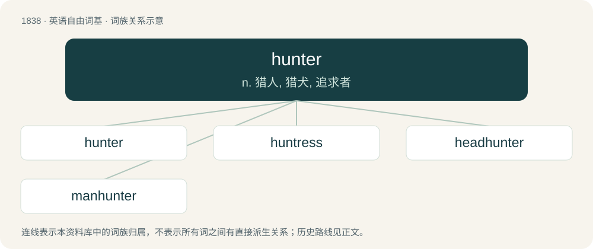

# 1941 · hunter — n. 猎人, 猎犬, 追求者

[总目录](../00_总目录_按常用程度.md)

**类型**：英语自由词基　｜　**来源语言**：见词源记录

## 核心含义与来源

- 核心含义：n. 猎人, 猎犬, 追求者
- 英文含义：One who hunts game for sport or for food; a huntsman or huntswoman.
- 词形：hunter

**来源记录 1**（名词；One who hunts game for sport or for food; a huntsman or huntswoman.）

From Middle English huntere, hunter, equivalent to hunt + -er. Compare Old English hunta (“hunter”).

## 词族图

## 单词速览（常用到不常用）

| 单词 | 音标 | 释义 |
|---|---|---|
| [hunter](#w-1) | 英 /ˈhʌntə/；美 /ˈhʌntɚ/ | n. 猎人, 猎犬, 追求者 |
| [huntress](#w-2) | /ˈhʌntɹɪs/ | n. 女猎人 |
| [headhunter](#w-3) | 美 /ˈhɛdˌhʌntɚ/ | n. (原始社会中)猎取人头者, 物色人才的人 |
| [manhunter](#w-4) |  | \[法\] 搜索逃犯者 |

## 逐词详解

### 1. hunter

**词性**：名词　｜　**音标**：英 /ˈhʌntə/；美 /ˈhʌntɚ/

**中文释义**：n. 猎人, 猎犬, 追求者

**英文义项**：One who hunts game for sport or for food; a huntsman or huntswoman. / A dog used in hunting; a hunting dog.

**构词拆分**：hunt + -er

**词源与演化**：

From Middle English huntere, hunter, equivalent to hunt + -er. Compare Old English hunta (“hunter”).

**例句**：

> The hunter becomes the hunted.

该用例对应义项：One who hunts or seeks after anything.

### 2. huntress

**词性**：名词　｜　**音标**：/ˈhʌntɹɪs/

**中文释义**：n. 女猎人

**英文义项**：A female hunter.

**构词拆分**：hunter + -ess

**词源与演化**：

A variant of hunteress, from Middle English hunteras, hunteres, hunteresse, equivalent to hunter + -ess, possibly on the model of the likes of mistress.

**例句**：

> The horse of the fair huntress showed symptoms of impatience and restiveness.

### 3. headhunter

**词性**：名词　｜　**音标**：美 /ˈhɛdˌhʌntɚ/

**中文释义**：n. (原始社会中)猎取人头者, 物色人才的人

**英文义项**：A person who practises headhunting, the taking and preserving of a person's head after killing them. / One who recruits skilled personnel, especially executive-level ones, for a company.

**构词拆分**：head + hunter

**词源与演化**：

From head + hunter.

**例句**：

> A headhunter called me out of the blue with an offer I couldn't refuse.

该用例对应义项：One who recruits skilled personnel, especially executive-level ones, for a company.

### 4. manhunter

**词性**：名词

**中文释义**：\[法\] 搜索逃犯者

**英文义项**：Someone who hunts down a target in a manhunt. / A person who seeks men as sexual partners.

**构词拆分**：man + hunter

**词源与演化**：

From man + hunter.
