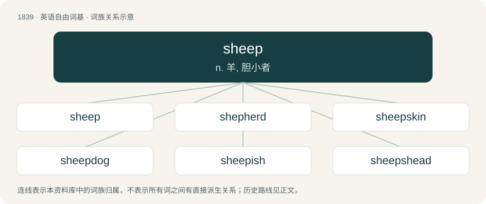

# 1943 · sheep — n. 羊, 胆小者

[总目录](../00_总目录_按常用程度.md)

**类型**：英语自由词基　｜　**来源语言**：见词源记录

## 核心含义与来源

- 核心含义：n. 羊, 胆小者
- 英文含义：A woolly ruminant of the genus Ovis.
- 词形：sheep

**来源记录 1**（名词；A woolly ruminant of the genus Ovis.）

Inherited from Middle English schep, schepe, from Anglian Old English sċēp (West Saxon sċēap), from Proto-West Germanic \*skāp, from Proto-Germanic \*skēpą, of unknown origin. Perhaps from the same Scythian word (compare Ossetian цӕу (cæw, “goat”), Persian چپش (čapiš, “yearling goat”)) which was borrowed into Albanian as cjap, sqap (“buck”) and into Slavic (compare Polish cap). After Kroonen, \*skēpą is instead from the root of Proto-Germanic \*skabaną (“to scratch”) via Kluge's law. Cognates Cognate with Scots sheep (“sheep”), Yola sheep, zheep (“sheep”), North Frisian schep, schäip, Sjip (“sheep”), Saterland Frisian Schäip, Skäip (“sheep”), West Frisian skiep (“sheep”), Alemannic German Schaf, Schooff (“sheep”), Bavarian Schof, Schouf, Schåf (“sheep”), Dutch schaap (“sheep”), German Schaf (“sheep”), German Low German Schaap (“sheep”), Limburgish Schoëp, sjaop (“sheep”), Luxembourgish Schof (“sheep”), Vilamovian siöf (“sheep”), Yiddish שאָף (shof, “sheep”).

## 词族图

## 单词速览（常用到不常用）

| 单词 | 音标 | 释义 |
|---|---|---|
| [sheep](#w-1) | /ˈʃiːp/ | n. 羊, 胆小者 |
| [shepherd](#w-2) | 英 /ˈʃɛpəd/；美 /ˈʃɛpəɹd/ | n. 牧羊人, 牧羊犬, 牧师, 保护者；vt. 看守, 领导, 指导, 牧羊 |
| [sheepskin](#w-3) | /ˈʃiːpskin/ | n. 绵羊毛皮, 羊皮袄, 羊皮纸, 羊皮革, 羊皮毯, (写在羊皮纸上的)文件, 毕业文凭 |
| [sheepdog](#w-4) |  | n. 牧羊狗 |
| [sheepish](#w-5) | /ˈʃiːpɪʃ/ | a. 懦弱的, 羞怯的 |
| [sheepshead](#w-6) | /ˈʃiːpshed/ | n. 羊头, 蠢人 |

## 逐词详解

### 1. sheep

**词性**：名词　｜　**音标**：/ˈʃiːp/

**中文释义**：n. 羊, 胆小者

**英文义项**：A woolly ruminant of the genus Ovis. / A member of the domestic species Ovis aries, the most well-known species of Ovis.

**词源与演化**：

Inherited from Middle English schep, schepe, from Anglian Old English sċēp (West Saxon sċēap), from Proto-West Germanic \*skāp, from Proto-Germanic \*skēpą, of unknown origin. Perhaps from the same Scythian word (compare Ossetian цӕу (cæw, “goat”), Persian چپش (čapiš, “yearling goat”)) which was borrowed into Albanian as cjap, sqap (“buck”) and into Slavic (compare Polish cap). After Kroonen, \*skēpą is instead from the root of Proto-Germanic \*skabaną (“to scratch”) via Kluge's law. Cognates Cognate with Scots sheep (“sheep”), Yola sheep, zheep (“sheep”), North Frisian schep, schäip, Sjip (“sheep”), Saterland Frisian Schäip, Skäip (“sheep”), West Frisian skiep (“sheep”), Alemannic German Schaf, Schooff (“sheep”), Bavarian Schof, Schouf, Schåf (“sheep”), Dutch schaap (“sheep”), German Schaf (“sheep”), German Low German Schaap (“sheep”), Limburgish Schoëp, sjaop (“sheep”), Luxembourgish Schof (“sheep”), Vilamovian siöf (“sheep”), Yiddish שאָף (shof, “sheep”).

**例句**：

> His students followed him like sheep.

该用例对应义项：a docile and vulnerable person who would rather follow than make an independent decision

### 2. shepherd

**词性**：名词　｜　**音标**：英 /ˈʃɛpəd/；美 /ˈʃɛpəɹd/

**中文释义**：n. 牧羊人, 牧羊犬, 牧师, 保护者；vt. 看守, 领导, 指导, 牧羊

**英文义项**：A person who tends sheep, especially a grazing flock. / A male sheep tender

**构词拆分**：sheep + herd (“herder”)

**词源与演化**：

From Middle English schepherde, from Old English sċēaphierde, a compound of sċēap (“sheep”) and hierde (“herdsman”), equivalent to modern sheep + herd (“herder”).

**例句**：

> Later that night, the shepherd herded his sheep and went to bed.

### 3. sheepskin

**词性**：名词　｜　**音标**：/ˈʃiːpskin/

**中文释义**：n. 绵羊毛皮, 羊皮袄, 羊皮纸, 羊皮革, 羊皮毯, (写在羊皮纸上的)文件, 毕业文凭

**英文义项**：The skin of a sheep, especially an adult sheep, and especially when used to make parchment or in bookbinding. / The tanned skin of a sheep with the fleece left on, especially when used for clothing, rugs, etc.

**构词拆分**：sheep + skin

**词源与演化**：

From sheep + skin.

**例句**：

> The coarse sieve mocks the fine sieve, while the sheepskin rug smiles mischievously.

### 4. sheepdog

**词性**：名词

**中文释义**：n. 牧羊狗

**英文义项**：Any of various breeds of dog used for herding sheep; an individual of such a breed. / Any of various breeds of dog used for guarding sheep; an individual of such a breed.

**构词拆分**：sheep + dog

**词源与演化**：

From sheep + dog.

**例句**：

> The sheepdog barked loudly, alerting Matthew to a jackal lurking near the flock.

### 5. sheepish

**词性**：形容词　｜　**音标**：/ˈʃiːpɪʃ/

**中文释义**：a. 懦弱的, 羞怯的

**英文义项**：Having the characteristics of a sheep, as meekness, shyness, or docility. / Shy, meek, ashamed or embarrassed.

**构词拆分**：sheep + -ish

**词源与演化**：

From Middle English schepische, shepisse, shepisshe; equivalent to sheep + -ish.

**用法示例／搭配（非完整句）**：

> a sheepish girl

该用例对应义项：Shy, meek, ashamed or embarrassed.

### 6. sheepshead

**词性**：名词　｜　**音标**：/ˈʃiːpshed/

**中文释义**：n. 羊头, 蠢人

**英文义项**：A fish of the species Archosargus probatocephalus. / A trick-taking card game.

**构词拆分**：sheep + -s- + head

**词源与演化**：

From sheep + -s- + head.
