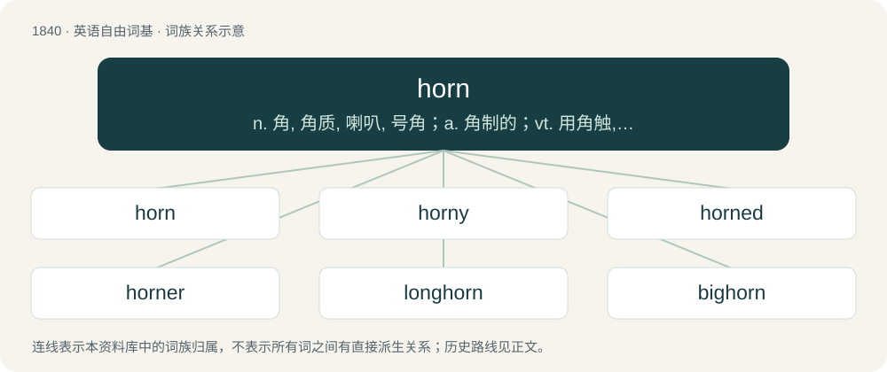

# 1944 · horn — n. 角, 角质, 喇叭, 号角；a. 角制的；vt. 用角触, 长角于

[总目录](../00_总目录_按常用程度.md)

**类型**：英语自由词基　｜　**来源语言**：见词源记录

## 核心含义与来源

- 核心含义：n. 角, 角质, 喇叭, 号角；a. 角制的；vt. 用角触, 长角于
- 英文含义：A hard growth of keratin that protrudes from the top of the head of certain animals, usually paired.
- 词形：horn

**来源记录 1**（名词；A hard growth of keratin that protrudes from the top of the head of certain animals, usually paired.）

From Middle English horn, horne, from Old English horn, from Proto-West Germanic \*horn, from Proto-Germanic \*hurną. Compare West Frisian hoarn, Dutch hoorn, Low German Hoorn, horn, German Horn, Danish and Swedish horn, Gothic 𐌷𐌰𐌿𐍂𐌽 (haurn). Ultimately from Proto-Indo-European \*ḱr̥h₂-nó-m, from \*ḱerh₂- (“head, horn”). Compare Breton kern (“horn”), Latin cornū, Ancient Greek κέρας (kéras), Proto-Slavic \*sьrna, Old Church Slavonic сьрна (sĭrna, “roedeer”), Hittite \[script needed\] (surna, “horn”), Persian سر (sar), Sanskrit शृङ्ग (śṛṅga, “horn”). Doublet of corn (“callus”), corno, and cornu. (telephone): From the horn-shaped earpieces of old communication systems that used air tubes.

## 词族图

## 单词速览（常用到不常用）

| 单词 | 音标 | 释义 |
|---|---|---|
| [horn](#w-1) | 英 /hɔːn/；美 /hɔɹn/ | n. 角, 角质, 喇叭, 号角；a. 角制的；vt. 用角触, 长角于 |
| [horny](#w-2) | 英 /ˈhɔːni/；美 /ˈhoɹni/ | a. 角的, 似角一样坚硬的, 角质的, 老茧的；\[医\] 角性的, 角的 |
| [horned](#w-3) | /ˈhɔː(ɹ)nd/ | a. 有角的, 角状的 |
| [horner](#w-4) | /ˈhɔːnə(r)/ | n. 吹号角者, (非正式)服海洛因的人 |
| [longhorn](#w-5) | 英 /ˈlɒŋhɔːn/；美 /ˈlɔŋhɔɹn/ | n. 长角牛 |
| [bighorn](#w-6) | /ˈbighɒːn/ | n. 加拿大盘羊 |
| [hornblower](#w-7) |  | n. (Hornblower)人名；(英)霍恩布洛尔 |
| [elkhorn](#w-8) |  | \[地名\] \[加拿大、美国\] 埃尔克霍恩 |
| [bullhorn](#w-9) | 美 /ˈbʊlˌhɔɹn/ | n. 手提式电子扩音器 |
| [foghorn](#w-10) | /ˈfɒghɒːn/ | n. 雾号, 响而尖的声音 |
| [horning](#w-11) |  | vi. 不请自来（horn的现在分词形式） |
| [shoehorn](#w-12) | 英 /ˈʃuːˌhɔːn/；美 /ˈʃuːˌhɔɹn/ | n. 鞋拔；vt. 硬塞进 |
| [pronghorn](#w-13) | /ˈprɒŋhɒːn/ | n. 叉角羚 |

## 逐词详解

### 1. horn

**词性**：名词　｜　**音标**：英 /hɔːn/；美 /hɔɹn/

**中文释义**：n. 角, 角质, 喇叭, 号角；a. 角制的；vt. 用角触, 长角于

**英文义项**：A hard growth of keratin that protrudes from the top of the head of certain animals, usually paired. / Any similar real or imaginary growth or projection such as the elongated tusk of a narwhal, the eyestalk of a snail, the pointed growth on the nose of a rhinoceros, or the hornlike projection on the head of a demon or similar.

**词源与演化**：

From Middle English horn, horne, from Old English horn, from Proto-West Germanic \*horn, from Proto-Germanic \*hurną. Compare West Frisian hoarn, Dutch hoorn, Low German Hoorn, horn, German Horn, Danish and Swedish horn, Gothic 𐌷𐌰𐌿𐍂𐌽 (haurn). Ultimately from Proto-Indo-European \*ḱr̥h₂-nó-m, from \*ḱerh₂- (“head, horn”). Compare Breton kern (“horn”), Latin cornū, Ancient Greek κέρας (kéras), Proto-Slavic \*sьrna, Old Church Slavonic сьрна (sĭrna, “roedeer”), Hittite \[script needed\] (surna, “horn”), Persian سر (sar), Sanskrit शृङ्ग (śṛṅga, “horn”). Doublet of corn (“callus”), corno, and cornu. (telephone): From the horn-shaped earpieces of old communication systems that used air tubes.

**例句**：

> Get him on the horn so that we can have a discussion about this.

该用例对应义项：A telephone.

### 2. horny

**词性**：形容词　｜　**音标**：英 /ˈhɔːni/；美 /ˈhoɹni/

**中文释义**：a. 角的, 似角一样坚硬的, 角质的, 老茧的；\[医\] 角性的, 角的

**英文义项**：Hard or bony, like an animal's horn. / Having the hard consistency and pale colour of an animal's horn.

**构词拆分**：horn + -y

**词源与演化**：

From Middle English horny, equivalent to horn + -y. Compare German hornig. Compare also Dutch hoornachtig, Swedish hornaktig, Old English hyrniġ (“angular”). Piecewise doublet of corny.

**例句**：

> It's hard to find good fanart of this character because most of the drawings are super horny.

该用例对应义项：Sexually exciting; arousing.

### 3. horned

**词性**：形容词　｜　**音标**：/ˈhɔː(ɹ)nd/

**中文释义**：a. 有角的, 角状的

**英文义项**：Having horns.

**构词拆分**：horn (“noun”) + -ed

**词源与演化**：

From Middle English horned, hornyd, from Old English hyrned, ġehyrned (“having horns; horned”), from Proto-Germanic \*hurnidaz (“horned”), past participle of Proto-Germanic \*hurnijaną (“to horn; provide or fit with horns”); equivalent to horn (“noun”) + -ed. Cognate with Dutch gehoornd (“horned”), German gehörnt (“horned”), Danish hornede (“horned”).

**例句**：

> A goat is a horned animal.

该用例对应义项：Having horns.

### 4. horner

**词性**：名词　｜　**音标**：/ˈhɔːnə(r)/

**中文释义**：n. 吹号角者, (非正式)服海洛因的人

**英文义项**：Someone who works or deals in (animal) horn or horns. / The British sand lance or sand eel, Hyperoplus lanceolatus.

**构词拆分**：horn + -er

**词源与演化**：

From Middle English horner, hornere, equivalent to horn + -er.

### 5. longhorn

**词性**：名词　｜　**音标**：英 /ˈlɒŋhɔːn/；美 /ˈlɔŋhɔɹn/

**中文释义**：n. 长角牛

**英文义项**：A breed of beef cattle, having long horns, bred in Texas and other parts of southwest United States.

**构词拆分**：long + horn

**词源与演化**：

From long + horn.

**例句**：

> This enormous longhorn beetle is found around mango and fig trees.

### 6. bighorn

**词性**：名词　｜　**音标**：/ˈbighɒːn/

**中文释义**：n. 加拿大盘羊

**英文义项**：Certain North American species of sheep / especially, Ovis canadensis, having large, curving horns.

**构词拆分**：big + horn

**词源与演化**：

From big + horn.

**例句**：

> Public safety workers spotted the object while conducting a count of bighorn sheep.

### 7. hornblower

**词性**：名词

**中文释义**：n. (Hornblower)人名；(英)霍恩布洛尔

**英文义项**：Someone or something that blows a horn.

**构词拆分**：horn + blower

**词源与演化**：

From horn + blower, or from Old English hornblāwere.

### 8. elkhorn

**词性**：名词

**中文释义**：\[地名\] \[加拿大、美国\] 埃尔克霍恩

**英文义项**：The horn of an elk. / A highly-branched coral (Acropora palmata) supposed to resemble the horns of an elk.

**构词拆分**：elk + horn

**词源与演化**：

From elk + horn.

**例句**：

> Elkhorn corals are listed as threatened under the U.S. Endangered Species Act.

### 9. bullhorn

**词性**：名词　｜　**音标**：美 /ˈbʊlˌhɔɹn/

**中文释义**：n. 手提式电子扩音器

**英文义项**：A megaphone which electronically amplifies a person’s natural voice.

**构词拆分**：bull + horn

**词源与演化**：

From bull + horn, attested since the 1950s.

### 10. foghorn

**词性**：名词　｜　**音标**：/ˈfɒghɒːn/

**中文释义**：n. 雾号, 响而尖的声音

**英文义项**：A very loud low-pitched horn, used especially in lighthouses and on large boats. / A strong gossiper.

**构词拆分**：fog + horn

**词源与演化**：

From fog + horn.

**例句**：

> We could hear a foghorn in the distance.

### 11. horning

**词性**：名词

**中文释义**：vi. 不请自来（horn的现在分词形式）

**英文义项**：The activity of blowing the horn of a train. / The appearance of the Moon when increasing, or in the form of a crescent.

**构词拆分**：horn + -ing

**词源与演化**：

From Middle English hornynge; equivalent to horn + -ing.

### 12. shoehorn

**词性**：动词　｜　**音标**：英 /ˈʃuːˌhɔːn/；美 /ˈʃuːˌhɔɹn/

**中文释义**：n. 鞋拔；vt. 硬塞进

**英文义项**：To use a shoehorn. / To force (something) into (a tight space); to squeeze (something) into (a schedule, etc); to exert great effort to insert or include (something); to include (something) despite potent reasons not to.

**构词拆分**：shoe + horn

**词源与演化**：

From shoe + horn.

**例句**：

> I shoehorned his dozen burgeoning bags into the backseat of my tiny car, and off we went.

该用例对应义项：To force (something) into (a tight space); to squeeze (something) into (a schedule, etc); to exert great effort to insert or include (something); to include (something) despite potent reasons not to.

### 13. pronghorn

**词性**：名词　｜　**音标**：/ˈprɒŋhɒːn/

**中文释义**：n. 叉角羚

**英文义项**：A North American mammal, Antilocapra americana, that resembles an antelope.

**构词拆分**：prong + horn

**词源与演化**：

From prong + horn.

**例句**：

> We must have seen a thousand pronghorn on the drive across Kansas.
