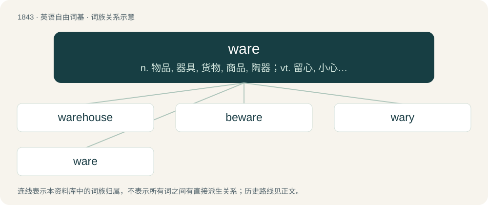

# 1946 · ware — n. 物品, 器具, 货物, 商品, 陶器；vt. 留心, 小心；a. 知道的, 意识到的, 留神的

[总目录](../00_总目录_按常用程度.md)

**类型**：英语自由词基　｜　**来源语言**：见词源记录

## 核心含义与来源

- 核心含义：n. 物品, 器具, 货物, 商品, 陶器；vt. 留心, 小心；a. 知道的, 意识到的, 留神的
- 英文含义：Goods or a type of goods offered for sale or use.
- 词形：ware

**多个词源／构词路径**：同一拼写可能有不同来源；以下按词性和含义分别列出。

**来源记录 1**（名词；Goods or a type of goods offered for sale or use.）

From Middle English ware, from Old English waru, from Proto-West Germanic \*waru, from Proto-Germanic \*warō (“attention”) as in beware, in the sense of “an object of care, a valuable”, from Proto-Indo-European \*wer- (“to watch, keep guard”), whence also ward. Cognate with Saterland Frisian Were (“an item for exchange, barter, or sale; ware”), Dutch waar (“goods offered for sale or use; ware”), German Ware (“ware”), Danish, Norwegian Bokmål, Norwegian Nynorsk vare (“ware”), Faroese vøra (“ware”), Icelandic and Swedish vara (“ware”).

**来源记录 2**（形容词；Aware.）

From Middle English ware, war, from Old English wær, from Proto-West Germanic \*war, from Proto-Germanic \*waraz.

**来源记录 3**（名词；Spring, springtime.）

From Middle English ware, from Old Norse vár (“spring”), from Proto-Germanic \*wazrą. Cognate with Icelandic vor (“spring”), Swedish vår (“spring”), Danish vår (“spring”), Scots ware, wair (“spring”).

## 词族图

## 单词速览（常用到不常用）

| 单词 | 音标 | 释义 |
|---|---|---|
| [warehouse](#w-1) | /ˈwɛə(ɹ)haʊs/ | n. 仓库, 货栈, 大商店；vt. 储入仓库 |
| [beware](#w-2) | /biˈwɛɚ/ | v. 小心, 谨防 |
| [wary](#w-3) | 英 /ˈwɛə.ɹi/；美 /ˈwɛɚ.i/ | a. 谨慎的, 小心的, 机警的, 周到的, 唯恐的 |
| [ware](#w-4) | 英 /ˈwɛə/；美 /ˈwɛɹ/ | n. 物品, 器具, 货物, 商品, 陶器；vt. 留心, 小心；a. 知道的, 意识到的, 留神的 |

## 逐词详解

### 1. warehouse

**词性**：动词　｜　**音标**：/ˈwɛə(ɹ)haʊs/

**中文释义**：n. 仓库, 货栈, 大商店；vt. 储入仓库

**英文义项**：To store in a warehouse or similar. / To confine (a person) to an institution for a long period.

**构词拆分**：ware + house

**词源与演化**：

From ware + house.

**例句**：

> Who was it that forgot to lock the door of the warehouse?

### 2. beware

**词性**：动词　｜　**音标**：/biˈwɛɚ/

**中文释义**：v. 小心, 谨防

**英文义项**：To use caution, pay attention to (used both with and without of).

**构词拆分**：be + ware；be + aware

**词源与演化**：

From Middle English bewar, be war, be ware, forms of Middle English ben ware (“to be on one's guard, be vigilant”, literally “be ware”), equivalent to be + ware or be + aware. Compare Old English bewarian.

**例句**：

> And Abraham said: Beware thou never bring my son back again thither.

### 3. wary

**词性**：形容词　｜　**音标**：英 /ˈwɛə.ɹi/；美 /ˈwɛɚ.i/

**中文释义**：a. 谨慎的, 小心的, 机警的, 周到的, 唯恐的

**英文义项**：Cautious of danger; carefully watching and guarding against deception, trickery, and dangers; suspiciously prudent / Characterized by caution; guarded; careful; on one's guard

**构词拆分**：ware + -y

**词源与演化**：

From the adjective ware + -y.

**例句**：

> He is wary of dogs.

该用例对应义项：Cautious of danger; carefully watching and guarding against deception, trickery, and dangers; suspiciously prudent

### 4. ware

**词性**：名词　｜　**音标**：英 /ˈwɛə/；美 /ˈwɛɹ/

**中文释义**：n. 物品, 器具, 货物, 商品, 陶器；vt. 留心, 小心；a. 知道的, 意识到的, 留神的

**英文义项**：Goods or a type of goods offered for sale or use. / See wares.

**词源与演化**：

From Middle English ware, from Old English waru, from Proto-West Germanic \*waru, from Proto-Germanic \*warō (“attention”) as in beware, in the sense of “an object of care, a valuable”, from Proto-Indo-European \*wer- (“to watch, keep guard”), whence also ward. Cognate with Saterland Frisian Were (“an item for exchange, barter, or sale; ware”), Dutch waar (“goods offered for sale or use; ware”), German Ware (“ware”), Danish, Norwegian Bokmål, Norwegian Nynorsk vare (“ware”), Faroese vøra (“ware”), Icelandic and Swedish vara (“ware”).
