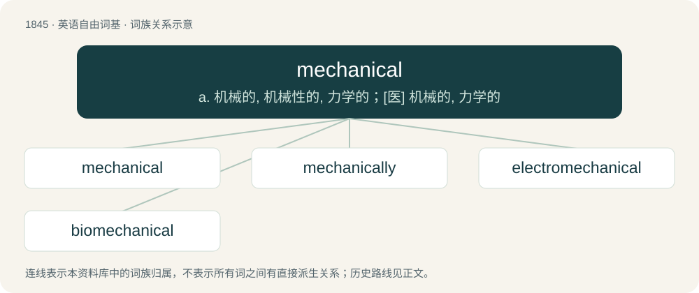

# 1947 · mechanical — a. 机械的, 机械性的, 力学的；\[医\] 机械的, 力学的

[总目录](../00_总目录_按常用程度.md)

**类型**：英语自由词基　｜　**来源语言**：见词源记录

## 核心含义与来源

- 核心含义：a. 机械的, 机械性的, 力学的；\[医\] 机械的, 力学的
- 英文含义：Related to mechanics (the branch of physics that deals with forces acting on matter).
- 词形：mechanical

**来源记录 1**（形容词；Related to mechanics (the branch of physics that deals with forces acting on matter).）

From Middle English mechanical, mechanicalle, mechanycalle, equivalent to mechanic + -al.

## 词族图

## 单词速览（常用到不常用）

| 单词 | 音标 | 释义 |
|---|---|---|
| [mechanical](#w-1) | 英 /məˈkænɪkəl/；美 /məˈkænəkəl/ | a. 机械的, 机械性的, 力学的；\[医\] 机械的, 力学的 |
| [mechanically](#w-2) | /məˈkænɪkli/ | adv. 机械, 用机械, 机械学, 物理, 力学, 呆板, 无意识, 手工操作, 技工 |
| [electromechanical](#w-3) | /i,lektrəjmiˈkænikəl/ | a. 电机的, 电机学的；\[计\] 机电的 |
| [biomechanical](#w-4) |  | 生物力学 |

## 逐词详解

### 1. mechanical

**词性**：形容词　｜　**音标**：英 /məˈkænɪkəl/；美 /məˈkænəkəl/

**中文释义**：a. 机械的, 机械性的, 力学的；\[医\] 机械的, 力学的

**英文义项**：Related to mechanics (the branch of physics that deals with forces acting on matter). / Related to mechanics (the design and construction of machines).

**构词拆分**：mechanic + -al

**词源与演化**：

From Middle English mechanical, mechanicalle, mechanycalle, equivalent to mechanic + -al.

**例句**：

> Why don't you ask Joe to fix it? He's very mechanical.

该用例对应义项：Handy with machines.

### 2. mechanically

**词性**：副词　｜　**音标**：/məˈkænɪkli/

**中文释义**：adv. 机械, 用机械, 机械学, 物理, 力学, 呆板, 无意识, 手工操作, 技工

**英文义项**：From a mechanical point of view. / In a mechanical manner, mindlessly, thoughtlessly, automatically, without thinking.

**构词拆分**：mechanical + -ly

**词源与演化**：

From mechanical + -ly.

**用法示例／搭配（非完整句）**：

> mechanically speaking

该用例对应义项：From a mechanical point of view.

### 3. electromechanical

**词性**：形容词　｜　**音标**：/i,lektrəjmiˈkænikəl/

**中文释义**：a. 电机的, 电机学的；\[计\] 机电的

**英文义项**：Related to both electricity (or electronics) and mechanics.

**构词拆分**：electro- + mechanical

**词源与演化**：

From electro- + mechanical.

### 4. biomechanical

**词性**：形容词

**中文释义**：生物力学

**英文义项**：Of or pertaining to biomechanics

**构词拆分**：bio- + mechanical

**词源与演化**：

From bio- + mechanical.
