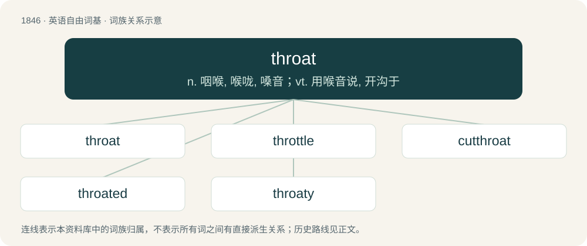

# 1948 · throat — n. 咽喉, 喉咙, 嗓音；vt. 用喉音说, 开沟于

[总目录](../00_总目录_按常用程度.md)

**类型**：英语自由词基　｜　**来源语言**：见词源记录

## 核心含义与来源

- 核心含义：n. 咽喉, 喉咙, 嗓音；vt. 用喉音说, 开沟于
- 英文含义：The front part of the neck.
- 词形：throat

**来源记录 1**（名词；The front part of the neck.）

From Middle English throte, from Old English þrote, þrota, þrotu (“throat”), from Proto-West Germanic \*þrotu, from Proto-Germanic \*þrutō (“throat”), from Proto-Indo-European \*trud- (“to swell, become stiff”). Cognate with Dutch strot (“throat”), German Drossel (“throttle, gorge of game (wild animals)”), Faroese troti (“swelling”), Icelandic þroti (“swelling”), Norwegian trut (“mouth”), Swedish trut.

## 词族图

## 单词速览（常用到不常用）

| 单词 | 音标 | 释义 |
|---|---|---|
| [throat](#w-1) | 英 /ˈθɹəʊt/；美 /ˈθɹoʊt/ | n. 咽喉, 喉咙, 嗓音；vt. 用喉音说, 开沟于 |
| [throttle](#w-2) | 英 /ˈθɹɒtəl/；美 /ˈθɹɑtəl/ | n. 节流阀, 节气阀, 喉咙；vt. 扼喉咙, 使窒息, 压制, 使节流；vi. 窒息, 节流, 减速 |
| [cutthroat](#w-3) | 英 /ˈkʌtθɹəʊt/；美 /ˈkʌtθɹoʊt/ | n. 凶手, 谋杀者；a. 杀人的, 残酷的 |
| [throated](#w-4) | /ˈθɹəʊ.təd/ | vt. 用沙哑的声音或嗓音发音（throat的过去式与过去分词形式） |
| [throaty](#w-5) | /ˈθɹəʊti/ | a. 喉音的, 嘶哑的 |

## 逐词详解

### 1. throat

**词性**：名词　｜　**音标**：英 /ˈθɹəʊt/；美 /ˈθɹoʊt/

**中文释义**：n. 咽喉, 喉咙, 嗓音；vt. 用喉音说, 开沟于

**英文义项**：The front part of the neck. / The gullet or windpipe.

**词源与演化**：

From Middle English throte, from Old English þrote, þrota, þrotu (“throat”), from Proto-West Germanic \*þrotu, from Proto-Germanic \*þrutō (“throat”), from Proto-Indo-European \*trud- (“to swell, become stiff”). Cognate with Dutch strot (“throat”), German Drossel (“throttle, gorge of game (wild animals)”), Faroese troti (“swelling”), Icelandic þroti (“swelling”), Norwegian trut (“mouth”), Swedish trut.

**例句**：

> The wild pitch bounced and hit the catcher in the throat.

该用例对应义项：The front part of the neck.

### 2. throttle

**词性**：名词　｜　**音标**：英 /ˈθɹɒtəl/；美 /ˈθɹɑtəl/

**中文释义**：n. 节流阀, 节气阀, 喉咙；vt. 扼喉咙, 使窒息, 压制, 使节流；vi. 窒息, 节流, 减速

**英文义项**：A valve that regulates the supply of fuel-air mixture to an internal combustion engine and thus controls its speed; a similar valve that controls the air supply to an engine. / The lever or pedal that controls this valve.

**构词拆分**：throat + -le

**词源与演化**：

From Middle English \*throtel, diminutive of throte (“throat”), equivalent to throat + -le. Compare German Drossel (“throttle”). More at throat.

**例句**：

> I need to drop these useless perceptions to take full throttle over my life.

### 3. cutthroat

**词性**：形容词　｜　**音标**：英 /ˈkʌtθɹəʊt/；美 /ˈkʌtθɹoʊt/

**中文释义**：n. 凶手, 谋杀者；a. 杀人的, 残酷的

**英文义项**：Involving the cutting of throats. / Of or relating to a card game where everyone plays for him or herself rather than playing with a partner.

**构词拆分**：From cut + throat.

**词源与演化**：

From cut + throat.

**例句**：

> He found that playing cutthroat Spades was much more difficult than playing with a partner.

该用例对应义项：Of or relating to a card game where everyone plays for him or herself rather than playing with a partner.

### 4. throated

**词性**：形容词　｜　**音标**：/ˈθɹəʊ.təd/

**中文释义**：vt. 用沙哑的声音或嗓音发音（throat的过去式与过去分词形式）

**英文义项**：Having the specified type of throat.

**构词拆分**：From throat + -ed.

**词源与演化**：

From throat + -ed.

### 5. throaty

**词性**：形容词　｜　**音标**：/ˈθɹəʊti/

**中文释义**：a. 喉音的, 嘶哑的

**英文义项**：Produced in the throat; having a rough or coarse quality like a sound produced in the throat. / Having a dewlap or excess skin hanging under the neck. (of livestock or dogs)

**构词拆分**：throat + -y

**词源与演化**：

From throat + -y.

**用法示例／搭配（非完整句）**：

> A throaty cough.

该用例对应义项：Produced in the throat; having a rough or coarse quality like a sound produced in the throat.
