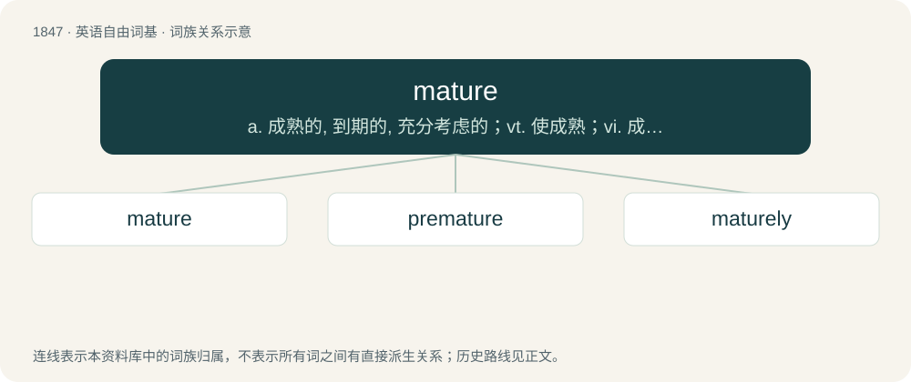

# 1951 · mature — a. 成熟的, 到期的, 充分考虑的；vt. 使成熟；vi. 成熟, 到期

[总目录](../00_总目录_按常用程度.md)

**类型**：英语自由词基　｜　**来源语言**：见词源记录

## 核心含义与来源

- 核心含义：a. 成熟的, 到期的, 充分考虑的；vt. 使成熟；vi. 成熟, 到期
- 英文含义：Fully developed; grown up in terms of physical appearance, behaviour or thinking; ripe.
- 词形：mature

**多个词源／构词路径**：同一拼写可能有不同来源；以下按词性和含义分别列出。

**来源记录 1**（形容词；Fully developed; grown up in terms of physical appearance, behaviour or thinking; ripe.）

From late Middle English mature, from Middle French mature, from Latin mātūrus. Doublet of maduro. Partially displaced ripe, from Old English rīpe (“ripe, mature”).

**来源记录 2**（动词；To proceed toward maturity: full development or completion (either of concrete or of abstract things, e.g. plans, judgments, qualities).）

From Middle English maturen, from Middle French maturer (“to mature”), from Latin mātūrō.

## 词族图

## 单词速览（常用到不常用）

| 单词 | 音标 | 释义 |
|---|---|---|
| [mature](#w-1) | 英 /məˈtjʊə/；美 /məˈt͡ʃʊ(ə)ɹ/ | a. 成熟的, 到期的, 充分考虑的；vt. 使成熟；vi. 成熟, 到期 |
| [premature](#w-2) | 英 /ˌpɹɛ.məˈtjʊə/；美 /ˌpɹi.məˈtʊɹ/ | a. 早产的, 过早的, 不成熟的；n. 早产儿, 过早发生的事物 |
| [maturely](#w-3) | /məˈtjʊə(ɹ)li/ | adv. 成熟地；充分地 |

## 逐词详解

### 1. mature

**词性**：形容词　｜　**音标**：英 /məˈtjʊə/；美 /məˈt͡ʃʊ(ə)ɹ/

**中文释义**：a. 成熟的, 到期的, 充分考虑的；vt. 使成熟；vi. 成熟, 到期

**英文义项**：Fully developed; grown up in terms of physical appearance, behaviour or thinking; ripe. / Brought to a state of complete readiness.

**词源与演化**：

From late Middle English mature, from Middle French mature, from Latin mātūrus. Doublet of maduro. Partially displaced ripe, from Old English rīpe (“ripe, mature”).

**例句**：

> The excellent mature eggplants grown in the garden plot are quickly being picked up by family and friends.

该用例对应义项：Fully developed; grown up in terms of physical appearance, behaviour or thinking; ripe.

### 2. premature

**词性**：形容词　｜　**音标**：英 /ˌpɹɛ.məˈtjʊə/；美 /ˌpɹi.məˈtʊɹ/

**中文释义**：a. 早产的, 过早的, 不成熟的；n. 早产儿, 过早发生的事物

**英文义项**：Occurring before a state of readiness or maturity has arrived. / Taking place earlier than anticipated, prepared for, or desired.

**构词拆分**：pre- + mature

**词源与演化**：

From Latin praemātūrus, equivalent to pre- + mature. First use appears c. 1440 in a translation of Palladius's De Re Rustica.

**用法示例／搭配（非完整句）**：

> premature reports of the singer's death

该用例对应义项：Occurring before a state of readiness or maturity has arrived.

### 3. maturely

**词性**：副词　｜　**音标**：/məˈtjʊə(ɹ)li/

**中文释义**：adv. 成熟地；充分地

**英文义项**：In a mature manner. / Acting with maturity.

**构词拆分**：mature + -ly

**词源与演化**：

From mature + -ly.

**例句**：

> Maturely, she simply declined to participate in the ceremony.

该用例对应义项：Acting with maturity.
