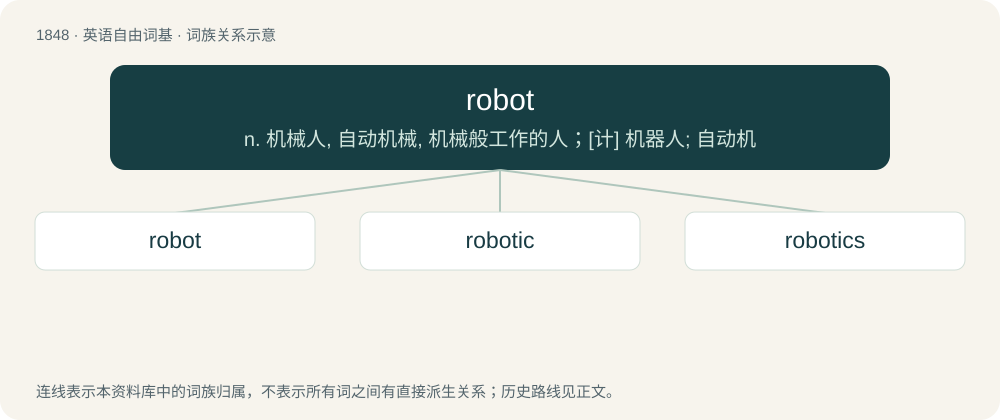

# 1952 · robot — n. 机械人, 自动机械, 机械般工作的人；\[计\] 机器人; 自动机

[总目录](../00_总目录_按常用程度.md)

**类型**：英语自由词基　｜　**来源语言**：见词源记录

## 核心含义与来源

- 核心含义：n. 机械人, 自动机械, 机械般工作的人；\[计\] 机器人; 自动机
- 英文含义：An intelligent mechanical being designed to look like a human or other creature, and usually made from metal.
- 词形：robot

**多个词源／构词路径**：同一拼写可能有不同来源；以下按词性和含义分别列出。

**来源记录 1**（名词；An intelligent mechanical being designed to look like a human or other creature, and usually made from metal.）

Borrowed from Czech robot, from robota (“drudgery, servitude”). Coined in the 1920 science-fiction play R.U.R. by Karel Čapek after having been suggested to him by his brother Josef. Ultimately a cognate with Middle English arveth from Old English earfoþe, and German Arbeit; see dialectal erf. Doublet of etymology 1. Related to English orphan, but with a -t- suffix from Proto-Slavic instead of the -an- from Ancient Greek. Compare Polish robotnik and Russian работник (rabotnik, “worker”), sometimes mistakenly cited as the direct source of the English word.

**来源记录 2**（名词；A habitual poster on the /r9k/ board on 4chan; a member of the /r9k/ community.）

Referencing the origin of the name of the 4chan imageboard /r9k/ (created in 2008), so-called because it implements the ROBOT9000 algorithm by Randall Munroe to prevent the reposting of content. Possibly overlapping with the sense of robot (“a person who does not seem to have any emotions”), alluding to autism, due to the prevalence of personal stories describing awkward or embarrassing situations on the board.

## 词族图

## 单词速览（常用到不常用）

| 单词 | 音标 | 释义 |
|---|---|---|
| [robot](#w-1) | 英 /ˈɹəʊ.bɒt/；美 /ˈɹoʊ.bɑt/ | n. 机械人, 自动机械, 机械般工作的人；\[计\] 机器人; 自动机 |
| [robotic](#w-2) | 英 /ɹəʊˈbɒt.ɪk/；美 /ɹoʊˈbɑtɪk/ | a. 自动的；机器人的, 像机器人的 |
| [robotics](#w-3) | 英 /ɹəʊˈbɒt.ɪks/；美 /ɹoʊˈbɑ.tɪks/ | \[计\] 机器人学, 自动机工程学 |

## 逐词详解

### 1. robot

**词性**：名词　｜　**音标**：英 /ˈɹəʊ.bɒt/；美 /ˈɹoʊ.bɑt/

**中文释义**：n. 机械人, 自动机械, 机械般工作的人；\[计\] 机器人; 自动机

**英文义项**：An intelligent mechanical being designed to look like a human or other creature, and usually made from metal. / A machine built to carry out some complex task or group of tasks by physically moving, especially one which can be programmed.

**词源与演化**：

Borrowed from Czech robot, from robota (“drudgery, servitude”). Coined in the 1920 science-fiction play R.U.R. by Karel Čapek after having been suggested to him by his brother Josef. Ultimately a cognate with Middle English arveth from Old English earfoþe, and German Arbeit; see dialectal erf. Doublet of etymology 1. Related to English orphan, but with a -t- suffix from Proto-Slavic instead of the -an- from Ancient Greek. Compare Polish robotnik and Russian работник (rabotnik, “worker”), sometimes mistakenly cited as the direct source of the English word.

**例句**：

> We have a robot in the house that does the vacuuming.

该用例对应义项：A machine built to carry out some complex task or group of tasks by physically moving, especially one which can be programmed.

### 2. robotic

**词性**：形容词　｜　**音标**：英 /ɹəʊˈbɒt.ɪk/；美 /ɹoʊˈbɑtɪk/

**中文释义**：a. 自动的；机器人的, 像机器人的

**英文义项**：Of, relating to, or resembling a robot; mechanical, lacking emotion or personality, etc.

**构词拆分**：robot + -ic

**词源与演化**：

From robot + -ic. Coined by American science fiction author Isaac Asimov in 1941 in his short story Liar!.

**例句**：

> Among our robotic devices is a vacuum cleaner.

该用例对应义项：of or relating to mechanical robots

### 3. robotics

**词性**：名词　｜　**音标**：英 /ɹəʊˈbɒt.ɪks/；美 /ɹoʊˈbɑ.tɪks/

**中文释义**：\[计\] 机器人学, 自动机工程学

**英文义项**：The science and technology of robots, their design, manufacture, and application

**构词拆分**：robot + -ics

**词源与演化**：

Coined by American science fiction author Isaac Asimov in 1941 from robot + -ics by comparison to "physics ... hydraulics, celestial mechanics, and so on" in his short story Liar!.

**例句**：

> Barry, a transhumanist, has a soft robotics part which is his right arm.
