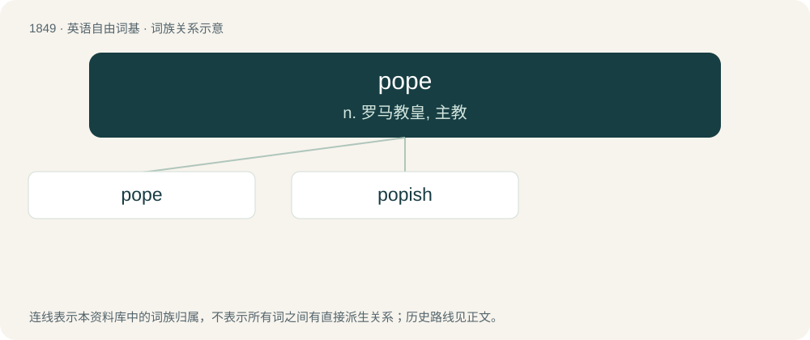

# 1954 · pope — n. 罗马教皇, 主教

[总目录](../00_总目录_按常用程度.md)

**类型**：英语自由词基　｜　**来源语言**：见词源记录

## 核心含义与来源

- 核心含义：n. 罗马教皇, 主教
- 英文含义：An honorary title of the Roman Catholic bishop of Rome as father and head of his church, a sovereign of the Vatican city state.
- 词形：pope

**多个词源／构词路径**：同一拼写可能有不同来源；以下按词性和含义分别列出。

**来源记录 1**（名词；An honorary title of the Roman Catholic bishop of Rome as father and head of his church, a sovereign of the Vatican city state.）

From Middle English pope, popa, from Old English pāpa, from Vulgar Latin papa (title for priests and bishops, esp. and by 8th c. only the bishop of Rome), from early Byzantine Greek παπᾶς (papâs, title for priests and bishops, especially by 3rd c. the bishop of Alexandria), from late Ancient Greek πάπας (pápas, title for priests and bishops, in the sense of spiritual father), from πάππας (páppas, “papa, daddy”).

**来源记录 2**（名词；Any mulled wine (traditionally including tokay) considered similar and superior to bishop.）

By analogy with bishop (“mulled and spiced wine”).

**来源记录 3**（名词；The nighthawk (Chordeiles minor).）

Of Onomatopoeic origin.

## 词族图

## 单词速览（常用到不常用）

| 单词 | 音标 | 释义 |
|---|---|---|
| [pope](#w-1) | 英 /pəʊp/；美 /poʊp/ | n. 罗马教皇, 主教 |
| [popish](#w-2) | 英 /ˈpəʊpɪʃ/；美 /ˈpoʊpɪʃ/ | a. 天主教的 |

## 逐词详解

### 1. pope

**词性**：名词　｜　**音标**：英 /pəʊp/；美 /poʊp/

**中文释义**：n. 罗马教皇, 主教

**英文义项**：An honorary title of the Roman Catholic bishop of Rome as father and head of his church, a sovereign of the Vatican city state. / Any similarly absolute and 'infallible' authority.

**词源与演化**：

From Middle English pope, popa, from Old English pāpa, from Vulgar Latin papa (title for priests and bishops, esp. and by 8th c. only the bishop of Rome), from early Byzantine Greek παπᾶς (papâs, title for priests and bishops, especially by 3rd c. the bishop of Alexandria), from late Ancient Greek πάπας (pápas, title for priests and bishops, in the sense of spiritual father), from πάππας (páppas, “papa, daddy”).

**例句**：

> The new Pope is not a woman and that's not a surprise.

### 2. popish

**词性**：形容词　｜　**音标**：英 /ˈpəʊpɪʃ/；美 /ˈpoʊpɪʃ/

**中文释义**：a. 天主教的

**英文义项**：of or pertaining to Roman Catholicism / acting like, or holding beliefs similar to, the pope.

**构词拆分**：pope + -ish

**词源与演化**：

From pope + -ish.
