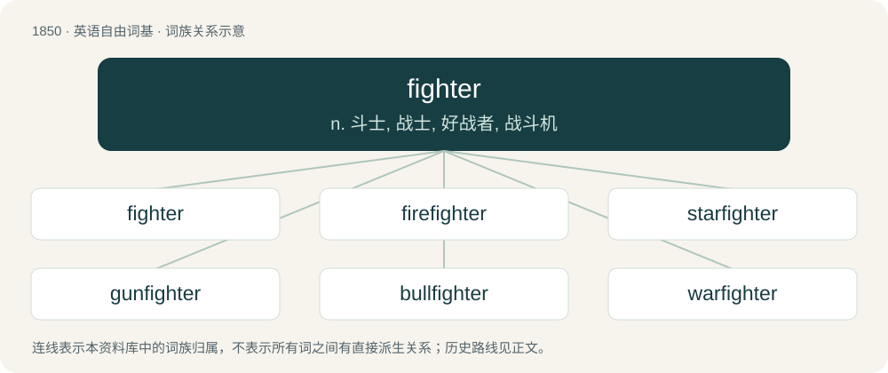

# 1955 · fighter — n. 斗士, 战士, 好战者, 战斗机

[总目录](../00_总目录_按常用程度.md)

**类型**：英语自由词基　｜　**来源语言**：见词源记录

## 核心含义与来源

- 核心含义：n. 斗士, 战士, 好战者, 战斗机
- 英文含义：A person who fights; a combatant.
- 词形：fighter

**来源记录 1**（名词；A person who fights; a combatant.）

From Middle English fightere, feghtere, from Old English feohtere. Equivalent to fight + -er.

## 词族图

## 单词速览（常用到不常用）

| 单词 | 音标 | 释义 |
|---|---|---|
| [fighter](#w-1) | 英 /ˈfaɪ.tə(ɹ)/；美 /ˈfaɪtɚ/ | n. 斗士, 战士, 好战者, 战斗机 |
| [firefighter](#w-2) | 英 /ˈfaɪə(ɹ)ˌfaɪ.tə(ɹ)/；美 /ˈfaɪ.ɚˌfaɪ.tɚ/ | n. &lt;美&gt;消防队员 |
| [starfighter](#w-3) |  | 星座式战斗机 |
| [gunfighter](#w-4) |  | n. 用枪格斗出名的人 |
| [bullfighter](#w-5) | /ˈbʊlfaɪtə(r)/ | n. 斗牛士 |
| [warfighter](#w-6) |  | 【英文】A servicemember of an armed force; (often specifically) one who sees combat. |
| [prizefighter](#w-7) | /ˈpraizfaitə/ | n. 职业拳击手 |

## 逐词详解

### 1. fighter

**词性**：名词　｜　**音标**：英 /ˈfaɪ.tə(ɹ)/；美 /ˈfaɪtɚ/

**中文释义**：n. 斗士, 战士, 好战者, 战斗机

**英文义项**：A person who fights; a combatant. / A warrior; a fighting soldier.

**构词拆分**：fight + -er

**词源与演化**：

From Middle English fightere, feghtere, from Old English feohtere. Equivalent to fight + -er.

**例句**：

> With only a single drop of poison, the well-known fighter was defeated.

### 2. firefighter

**词性**：名词　｜　**音标**：英 /ˈfaɪə(ɹ)ˌfaɪ.tə(ɹ)/；美 /ˈfaɪ.ɚˌfaɪ.tɚ/

**中文释义**：n. &lt;美&gt;消防队员

**英文义项**：A person who has been trained to put out fires.

**构词拆分**：fire + fighter

**词源与演化**：

From fire + fighter. Created as a gender-neutral term for fireman and firewoman.

**例句**：

> The erected tower should help the firefighter to notice fires in time.

### 3. starfighter

**词性**：名词

**中文释义**：星座式战斗机

**英文义项**：A fictional type of spacecraft that is intended to be used like a fighter plane in outer space.

**构词拆分**：star + fighter

**词源与演化**：

From star + fighter.

### 4. gunfighter

**词性**：名词

**中文释义**：n. 用枪格斗出名的人

**英文义项**：A person who engages in gunfights; a gunslinger.

**构词拆分**：gun + fighter

**词源与演化**：

From gun + fighter.

### 5. bullfighter

**词性**：名词　｜　**音标**：/ˈbʊlfaɪtə(r)/

**中文释义**：n. 斗牛士

**英文义项**：One who engages in bullfighting; a toreador or matador.

**构词拆分**：bull + fighter

**词源与演化**：

From bull + fighter.

**例句**：

> The bull is stronger than the bullfighter, but he almost always loses.

### 6. warfighter

**词性**：名词

**英文义项**：A servicemember of an armed force; (often specifically) one who sees combat.

**构词拆分**：war + fighter

**词源与演化**：

From war + fighter.

### 7. prizefighter

**词性**：名词　｜　**音标**：/ˈpraizfaitə/

**中文释义**：n. 职业拳击手

**英文义项**：A professional boxer.

**构词拆分**：prize + fighter；prizefight + -er (“person, agent”)

**词源与演化**：

From prize + fighter or prizefight + -er (“person, agent”). See prizefight for sense development.
