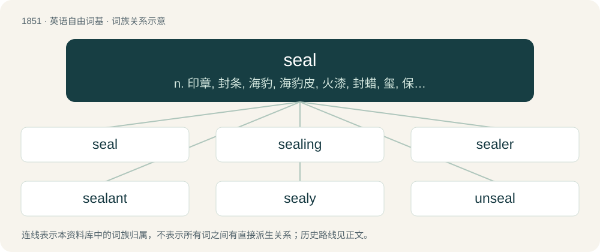

# 1956 · seal — n. 印章, 封条, 海豹, 海豹皮, 火漆, 封蜡, 玺, 保证, 批准, 象征, 标志；vt. 封闭, 盖印, 盖章；vi. 猎海豹

[总目录](../00_总目录_按常用程度.md)

**类型**：英语自由词基　｜　**来源语言**：见词源记录

## 核心含义与来源

- 核心含义：n. 印章, 封条, 海豹, 海豹皮, 火漆, 封蜡, 玺, 保证, 批准, 象征, 标志；vt. 封闭, 盖印, 盖章；vi. 猎海豹
- 英文含义：A pinniped (Pinnipedia), particularly an earless seal (true seal) or eared seal.
- 词形：seal

**多个词源／构词路径**：同一拼写可能有不同来源；以下按词性和含义分别列出。

**来源记录 1**（名词；A pinniped (Pinnipedia), particularly an earless seal (true seal) or eared seal.）

From Middle English sel, from an inflectional form of Old English seolh, from Proto-West Germanic \*selh, from Proto-Germanic \*selhaz (compare Scots selch,selkie, North Frisian selich, Middle Dutch seel, zēle, Old High German selah, Danish sæl, Middle Low German sale, Icelandic selur), either from Proto-Indo-European \*selk- (“to pull”) (compare dialectal English sullow (“plough”)) or from early Proto-Finnic \*šülkeš (later \*hülgeh, compare dialectal Finnish hylki, standard hylje, Estonian hüljes).

**来源记录 2**（名词；A stamp used to impress a design on a soft substance such as wax.）

Inherited from Middle English sel, sele, from Anglo-Norman seel, from Latin sigillum, a diminutive of signum (“sign”). Doublet of sigil and sigillum.

**来源记录 3**（动词；To tie up animals (especially cattle) in their stalls.）

From Middle English \*selen (suggested by Middle English sele (“harness; hame”)), perhaps from Old English sǣlan (“to bind”).

## 词族图

## 单词速览（常用到不常用）

| 单词 | 音标 | 释义 |
|---|---|---|
| [seal](#w-1) | /siːl/ | n. 印章, 封条, 海豹, 海豹皮, 火漆, 封蜡, 玺, 保证, 批准, 象征, 标志；vt. 封闭, 盖印, 盖章；vi. 猎海豹 |
| [sealing](#w-2) | /ˈsiːlɪŋ/ | \[化\] 封闭; 封闭处理；\[医\] 封闭, 封口(创伤) |
| [sealer](#w-3) | 英 /ˈsiːlə/；美 /ˈsiːlɚ/ | \[计\] 密封层, 密封器；\[化\] 表面保护层 |
| [sealant](#w-4) | /ˈsiːlənt/ | n. 密封剂；\[化\] 密封胶 |
| [sealy](#w-5) |  | \[人名\] \[英格兰人姓氏\] 西利 Sealey的变体; \[地名\] \[美国\] 锡利 |
| [unseal](#w-6) | /ʌnˈsiːl/ | vt. 开封, 开启, 使解除束缚 |

## 逐词详解

### 1. seal

**词性**：名词　｜　**音标**：/siːl/

**中文释义**：n. 印章, 封条, 海豹, 海豹皮, 火漆, 封蜡, 玺, 保证, 批准, 象征, 标志；vt. 封闭, 盖印, 盖章；vi. 猎海豹

**英文义项**：A pinniped (Pinnipedia), particularly an earless seal (true seal) or eared seal.

**词源与演化**：

From Middle English sel, from an inflectional form of Old English seolh, from Proto-West Germanic \*selh, from Proto-Germanic \*selhaz (compare Scots selch,selkie, North Frisian selich, Middle Dutch seel, zēle, Old High German selah, Danish sæl, Middle Low German sale, Icelandic selur), either from Proto-Indo-European \*selk- (“to pull”) (compare dialectal English sullow (“plough”)) or from early Proto-Finnic \*šülkeš (later \*hülgeh, compare dialectal Finnish hylki, standard hylje, Estonian hüljes).

**例句**：

> The seals in the harbor looked better than they smelled.

该用例对应义项：A pinniped (Pinnipedia), particularly an earless seal (true seal) or eared seal.

### 2. sealing

**词性**：形容词　｜　**音标**：/ˈsiːlɪŋ/

**中文释义**：\[化\] 封闭; 封闭处理；\[医\] 封闭, 封口(创伤)

**英文义项**：Used for closing securely.

**构词拆分**：seal + -ing

**词源与演化**：

From seal (“device”) + -ing.

**例句**：

> Mary extended her little finger, sealing their agreement with a solemn pinky swear.

### 3. sealer

**词性**：名词　｜　**音标**：英 /ˈsiːlə/；美 /ˈsiːlɚ/

**中文释义**：\[计\] 密封层, 密封器；\[化\] 表面保护层

**英文义项**：A tool used to seal something. / A person who is employed to seal things.

**构词拆分**：seal + -er

**词源与演化**：

From seal + -er.

### 4. sealant

**词性**：名词　｜　**音标**：/ˈsiːlənt/

**中文释义**：n. 密封剂；\[化\] 密封胶

**英文义项**：Any material used to seal a surface so as to prevent passage of a fluid. / A mixture of polymers, fillers, and pigments used to fill and seal joints where moderate movement is expected.

**构词拆分**：seal + -ant

**词源与演化**：

From seal + -ant.

**例句**：

> Wood left outdoors should be dried off and properly finished with sealant before the rot sets in.

### 5. sealy

**词性**：形容词

**中文释义**：\[人名\] \[英格兰人姓氏\] 西利 Sealey的变体; \[地名\] \[美国\] 锡利

**英文义项**：Resembling or characteristic of a seal (the animal).

**构词拆分**：seal + -y

**词源与演化**：

From seal + -y.

### 6. unseal

**词性**：动词　｜　**音标**：/ʌnˈsiːl/

**中文释义**：vt. 开封, 开启, 使解除束缚

**英文义项**：To break the seal of (something) in order to open it. / To open by having a seal broken.

**构词拆分**：un- + seal

**词源与演化**：

From un- + seal.

**例句**：

> Gustavo managed to unseal the sword.
