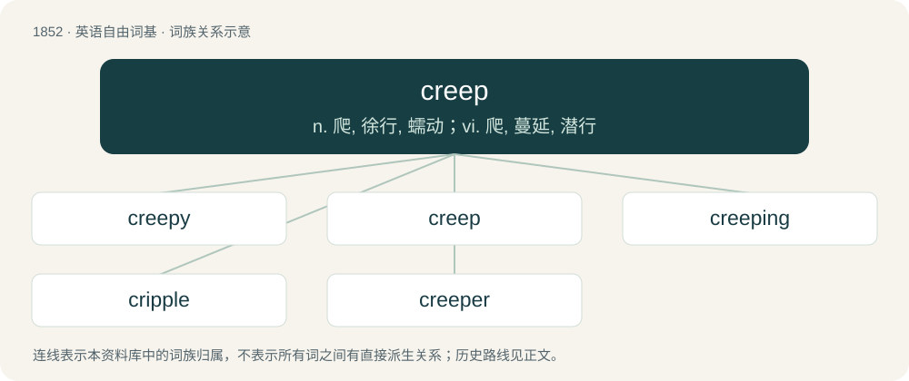

# 1957 · creep — n. 爬, 徐行, 蠕动；vi. 爬, 蔓延, 潜行

[总目录](../00_总目录_按常用程度.md)

**类型**：英语自由词基　｜　**来源语言**：见词源记录

## 核心含义与来源

- 核心含义：n. 爬, 徐行, 蠕动；vi. 爬, 蔓延, 潜行
- 英文含义：To move slowly with the abdomen close to the ground.
- 词形：creep

**来源记录 1**（动词；To move slowly with the abdomen close to the ground.）

From Middle English crepen, from Old English crēopan (“to creep, crawl”), from Proto-West Germanic \*kreupan, from Proto-Germanic \*kreupaną (“to twist, creep”), from Proto-Indo-European \*grewbʰ- (“to turn, wind”). Cognates Cognate with West Frisian krûpe (“to creep, crawl”), Central Franconian kruffe (“to creep, crawl”), Dutch kruipen (“to creep, crawl”), Low German krepen, krupen (“to creep, crawl”), Danish krybe (“to creep”), Faroese krúpa (“to creep”), Icelandic krjúpa (“to kneel down, to genuflect, to get down on one's knees”), Norwegian Bokmål krype (“to creep”), Norwegian Nynorsk krjupa, krjupe, krypa, krype (“to creep, crawl”), Swedish krypa (“to creep, crawl”). The noun is derived from the verb. Etymology tree Proto-Indo-European \*grewbʰ-der. Proto-Germanic \*kreupaną Proto-West Germanic \*kreupan Old English crēopan Middle English crepen English creep

## 词族图

## 单词速览（常用到不常用）

| 单词 | 音标 | 释义 |
|---|---|---|
| [creepy](#w-1) | 英 /ˈkɹiːpi/；美 /ˈkɹipi/ | a. 爬行的, 令人毛骨悚然的 |
| [creep](#w-2) | /kɹiːp/ | n. 爬, 徐行, 蠕动；vi. 爬, 蔓延, 潜行 |
| [creeping](#w-3) | /ˈkɹiːpɪŋ/ | n. 爬行；a. 爬行的 |
| [cripple](#w-4) | /ˈkɹɪp(ə)l/ | n. 跛者, 残废；vt. 使跛, 使成残废, 削弱；a. 跛的, 残废的 |
| [creeper](#w-5) | 美 /ˈkɹipɚ/ | n. 爬行者 |

## 逐词详解

### 1. creepy

**词性**：形容词　｜　**音标**：英 /ˈkɹiːpi/；美 /ˈkɹipi/

**中文释义**：a. 爬行的, 令人毛骨悚然的

**英文义项**：Moving by creeping along. / Producing an uneasy fearful sensation, as of things crawling over one's skin.

**构词拆分**：creep + -y

**词源与演化**：

From creep + -y.

**例句**：

> That creepy old man keeps leering at me!

该用例对应义项：Causing discomfort through exhibiting sexually inappropriate behavior.

### 2. creep

**词性**：动词　｜　**音标**：/kɹiːp/

**中文释义**：n. 爬, 徐行, 蠕动；vi. 爬, 蔓延, 潜行

**英文义项**：To move slowly with the abdomen close to the ground. / To grow across a surface rather than upwards.

**词源与演化**：

From Middle English crepen, from Old English crēopan (“to creep, crawl”), from Proto-West Germanic \*kreupan, from Proto-Germanic \*kreupaną (“to twist, creep”), from Proto-Indo-European \*grewbʰ- (“to turn, wind”). Cognates Cognate with West Frisian krûpe (“to creep, crawl”), Central Franconian kruffe (“to creep, crawl”), Dutch kruipen (“to creep, crawl”), Low German krepen, krupen (“to creep, crawl”), Danish krybe (“to creep”), Faroese krúpa (“to creep”), Icelandic krjúpa (“to kneel down, to genuflect, to get down on one's knees”), Norwegian Bokmål krype (“to creep”), Norwegian Nynorsk krjupa, krjupe, krypa, krype (“to creep, crawl”), Swedish krypa (“to creep, crawl”). The noun is derived from the verb. Etymology tree Proto-Indo-European \*grewbʰ-der. Proto-Germanic \*kreupaną Proto-West Germanic \*kreupan Old English crēopan Middle English crepen English creep

**例句**：

> The collodion on a negative, or a coat of varnish, may creep in drying.

该用例对应义项：To slip, or to become slightly displaced.

### 3. creeping

**词性**：名词　｜　**音标**：/ˈkɹiːpɪŋ/

**中文释义**：n. 爬行；a. 爬行的

**英文义项**：The act of something that creeps.

**构词拆分**：creep + -ing

**词源与演化**：

From Middle English creping, crepynge, from Old English crēopung, equivalent to creep + -ing.

**例句**：

> Tobias saw light creeping out from under the crack of the door.

### 4. cripple

**词性**：名词　｜　**音标**：/ˈkɹɪp(ə)l/

**中文释义**：n. 跛者, 残废；vt. 使跛, 使成残废, 削弱；a. 跛的, 残废的

**英文义项**：A person who has severely impaired physical abilities because of deformation, injury, or amputation of parts of the body. / A person who is severely impaired or deficient in some non-physical way.

**构词拆分**：creep + -le

**词源与演化**：

From Middle English cripel, crepel, crüpel, from Old English crypel (“crippled; a cripple”), from Proto-Germanic \*krupilaz (“tending to crawl; a cripple”), from Proto-Indo-European \*grewb- (“to bend, crouch, crawl”), from Proto-Indo-European \*ger- (“to bend, twist”), equivalent to creep + -le. Cognate with Dutch kreupel, Low German Kröpel, German Krüppel, Old Norse kryppill.

**例句**：

> He returned from war a cripple.

该用例对应义项：A person who has severely impaired physical abilities because of deformation, injury, or amputation of parts of the body.

### 5. creeper

**词性**：名词　｜　**音标**：美 /ˈkɹipɚ/

**中文释义**：n. 爬行者

**英文义项**：A person or a thing that crawls or creeps. / Any creeping animal (such as a serpent), reptile.

**构词拆分**：creep + -er

**词源与演化**：

From Middle English crepere, from Old English crēopere, equivalent to creep + -er. Slang usage derived from phrase give the creeps or creep out (distinct from merely one who creeps).

**例句**：

> Don't go to a nightclub to find a boyfriend. They're all creepers there.

该用例对应义项：A person who creeps people out; a creepy person.
