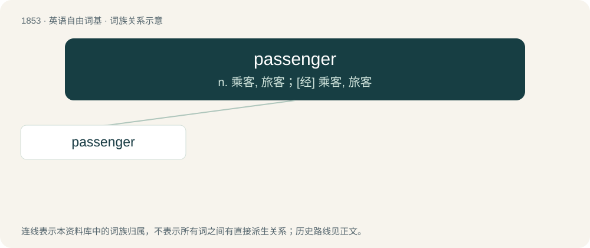

# 1958 · passenger — n. 乘客, 旅客；\[经\] 乘客, 旅客

[总目录](../00_总目录_按常用程度.md)

**类型**：英语自由词基　｜　**来源语言**：见词源记录

## 核心含义与来源

- 核心含义：n. 乘客, 旅客；\[经\] 乘客, 旅客
- 英文含义：One who rides or travels in a vehicle, but who does not operate it and is not a member of the crew.
- 词形：passenger

**来源记录 1**（名词；One who rides or travels in a vehicle, but who does not operate it and is not a member of the crew.）

From Old French passagier with intrusive n (see etymology of messenger).

## 词族图

## 单词速览（常用到不常用）

| 单词 | 音标 | 释义 |
|---|---|---|
| [passenger](#w-1) | 英 /ˈpæs.ɪn.d͡ʒə/；美 /ˈpæs.ɪn.d͡ʒɚ/ | n. 乘客, 旅客；\[经\] 乘客, 旅客 |

## 逐词详解

### 1. passenger

**词性**：名词　｜　**音标**：英 /ˈpæs.ɪn.d͡ʒə/；美 /ˈpæs.ɪn.d͡ʒɚ/

**中文释义**：n. 乘客, 旅客；\[经\] 乘客, 旅客

**英文义项**：One who rides or travels in a vehicle, but who does not operate it and is not a member of the crew. / Somebody in a team who does not do their fair share of the work.

**词源与演化**：

From Old French passagier with intrusive n (see etymology of messenger).

**例句**：

> There is a limit of two pieces of luggage for each passenger.
