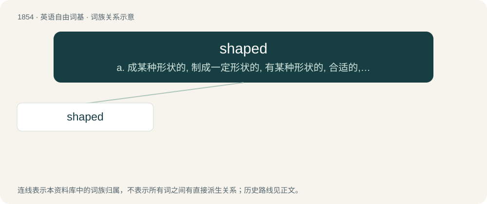

# 1959 · shaped — a. 成某种形状的, 制成一定形状的, 有某种形状的, 合适的, 计划好的, 有目标的；\[医\] 具形的, 形似的

[总目录](../00_总目录_按常用程度.md)

**类型**：英语自由词基　｜　**来源语言**：见词源记录

## 核心含义与来源

- 核心含义：a. 成某种形状的, 制成一定形状的, 有某种形状的, 合适的, 计划好的, 有目标的；\[医\] 具形的, 形似的
- 英文含义：Having been given a shape, especially a curved shape.
- 词形：shaped

**来源记录 1**（形容词；Having been given a shape, especially a curved shape.）

From Middle English schaped, ischaped, equivalent to shape + -ed.

## 词族图

## 单词速览（常用到不常用）

| 单词 | 音标 | 释义 |
|---|---|---|
| [shaped](#w-1) | /ʃeɪpt/ | a. 成某种形状的, 制成一定形状的, 有某种形状的, 合适的, 计划好的, 有目标的；\[医\] 具形的, 形似的 |

## 逐词详解

### 1. shaped

**词性**：形容词　｜　**音标**：/ʃeɪpt/

**中文释义**：a. 成某种形状的, 制成一定形状的, 有某种形状的, 合适的, 计划好的, 有目标的；\[医\] 具形的, 形似的

**英文义项**：Having been given a shape, especially a curved shape. / Having a particular shape (sharing the appearance of something in space, especially its outline – often a basic geometric two-dimensional figure).

**构词拆分**：shape + -ed

**词源与演化**：

From Middle English schaped, ischaped, equivalent to shape + -ed.

**例句**：

> The shaped sides of the wardrobe give it a more attractive appearance.

该用例对应义项：Having been given a shape, especially a curved shape.
