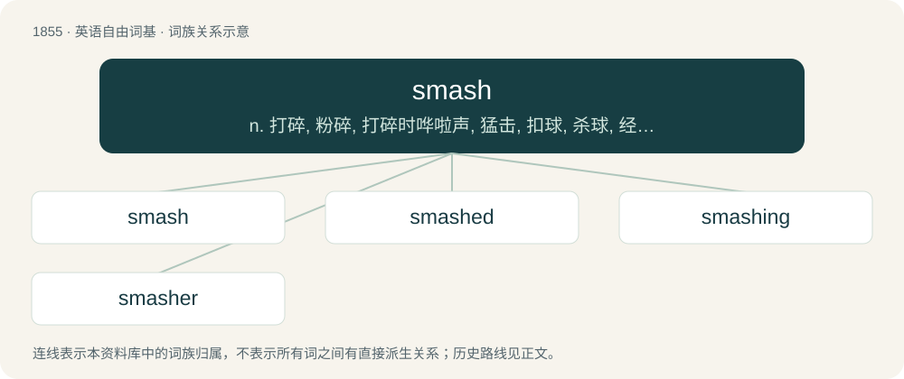

# 1960 · smash — n. 打碎, 粉碎, 打碎时哗啦声, 猛击, 扣球, 杀球, 经营失败, 破产, 硬币, 假硬币；a. 非常轰动的, 了不起的；vt. 打碎, 粉碎, 击溃, 使破产, 使裂变, 使用假硬币

[总目录](../00_总目录_按常用程度.md)

**类型**：英语自由词基　｜　**来源语言**：见词源记录

## 核心含义与来源

- 核心含义：n. 打碎, 粉碎, 打碎时哗啦声, 猛击, 扣球, 杀球, 经营失败, 破产, 硬币, 假硬币；a. 非常轰动的, 了不起的；vt. 打碎, 粉碎, 击溃, 使破产, 使裂变, 使用假硬币
- 英文含义：The sound of a violent impact; a violent striking together.
- 词形：smash

**来源记录 1**（名词；The sound of a violent impact; a violent striking together.）

Uncertain, probably of onomatopoeic origin. Compare Swedish smask (“to smack with the lips”), dialectal Swedish smaska (“to smack, kiss”), Danish smaske (“to smack with the lips”), Low German smaksen (“to smack with the lips, kiss”).

## 词族图

## 单词速览（常用到不常用）

| 单词 | 音标 | 释义 |
|---|---|---|
| [smash](#w-1) | /smæʃ/ | n. 打碎, 粉碎, 打碎时哗啦声, 猛击, 扣球, 杀球, 经营失败, 破产, 硬币, 假硬币；a. 非常轰动的, 了不起的；vt. 打碎, 粉碎, 击溃, 使破产, 使裂变, 使用假硬币 |
| [smashed](#w-2) | /smæʃt/ | a. 喝醉酒的；\[法\] 酒醉的 |
| [smashing](#w-3) | /ˈsmæʃɪŋ/ | a. 猛烈的, 发出撞击声的, 了不起的, 轰动的 |
| [smasher](#w-4) | /smæʃɚ/ | n. 打碎者, 善于叩球者, 摔跟头, (非正式)出色的人, 使用假钞票者, 收买脏物者；\[法\] 使用假钞票者, 收买赃物者 |

## 逐词详解

### 1. smash

**词性**：名词　｜　**音标**：/smæʃ/

**中文释义**：n. 打碎, 粉碎, 打碎时哗啦声, 猛击, 扣球, 杀球, 经营失败, 破产, 硬币, 假硬币；a. 非常轰动的, 了不起的；vt. 打碎, 粉碎, 击溃, 使破产, 使裂变, 使用假硬币

**英文义项**：The sound of a violent impact; a violent striking together. / A traffic collision.

**词源与演化**：

Uncertain, probably of onomatopoeic origin. Compare Swedish smask (“to smack with the lips”), dialectal Swedish smaska (“to smack, kiss”), Danish smaske (“to smack with the lips”), Low German smaksen (“to smack with the lips, kiss”).

**例句**：

> I could hear the screech of the brakes, then the horrible smash of cars colliding.

该用例对应义项：The sound of a violent impact; a violent striking together.

### 2. smashed

**词性**：形容词　｜　**音标**：/smæʃt/

**中文释义**：a. 喝醉酒的；\[法\] 酒醉的

**英文义项**：Extensively broken; especially, in shards. / Drunk.

**构词拆分**：From smash + -ed.

**词源与演化**：

From smash + -ed.

**例句**：

> Some of the pottery is so smashed that it's not feasible even to do a restorative repair.

该用例对应义项：Extensively broken; especially, in shards.

### 3. smashing

**词性**：形容词　｜　**音标**：/ˈsmæʃɪŋ/

**中文释义**：a. 猛烈的, 发出撞击声的, 了不起的, 轰动的

**英文义项**：Serving to smash (something). / Wonderful, very good or impressive.

**构词拆分**：smash + -ing

**词源与演化**：

From smash + -ing. As a synonym for wonderful, the term first appeared in the United States in the early twentieth century, and possibly derives from the sense of smash used in smash hit and similar terms. Popular folk etymology connects the term to the broadly homophonous Irish is maith sin or Scottish Gaelic 's math sin ("that is good"), but this has been described as "improbable", and does not appear in the etymological dictionaries.

**例句**：

> The boxer delivered a smashing blow to his opponent's head.

该用例对应义项：Serving to smash (something).

### 4. smasher

**词性**：名词　｜　**音标**：/smæʃɚ/

**中文释义**：n. 打碎者, 善于叩球者, 摔跟头, (非正式)出色的人, 使用假钞票者, 收买脏物者；\[法\] 使用假钞票者, 收买赃物者

**英文义项**：Something that, or someone who, smashes. / An attractive person (see also smashing).

**构词拆分**：From smash + -er.

**词源与演化**：

From smash + -er.

**例句**：

> A volleyball player must be a good smasher.
