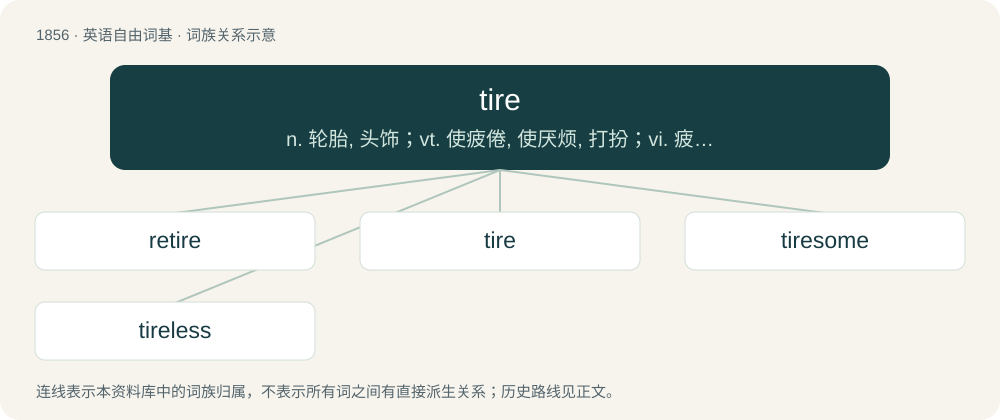

# 1961 · tire — n. 轮胎, 头饰；vt. 使疲倦, 使厌烦, 打扮；vi. 疲劳, 厌倦

[总目录](../00_总目录_按常用程度.md)

**类型**：英语自由词基　｜　**来源语言**：见词源记录

## 核心含义与来源

- 核心含义：n. 轮胎, 头饰；vt. 使疲倦, 使厌烦, 打扮；vi. 疲劳, 厌倦
- 英文含义：To become sleepy or weary.
- 词形：tire

**多个词源／构词路径**：同一拼写可能有不同来源；以下按词性和含义分别列出。

**来源记录 1**（动词；To become sleepy or weary.）

From Middle English tiren, tirien, teorien, from Old English tȳrian, tēorian (“to fail, cease, become weary, be tired, exhausted; tire, weary, exhaust”), of uncertain origin. Possibly from Proto-West Germanic \*teuʀōn (“to cease”), which is possibly from Proto-Indo-European \*dews- (“to fail, be behind, lag”). Compare Ancient Greek δεύομαι (deúomai, “to lack”), Sanskrit दोष (dóṣa, “crime, fault, vice, deficiency”).

**来源记录 2**（名词；US and Canada spelling of tyre: The rubber covering on a wheel.）

Probably from Middle English tir(e) (“equipment, furnshings, ornament”). See the details at tyre.

## 词族图

## 单词速览（常用到不常用）

| 单词 | 音标 | 释义 |
|---|---|---|
| [retire](#w-1) | 美 /ɹiˈtaɪɚ/ | 【英文】To fit (a vehicle) with new tires. |
| [tire](#w-2) | 英 /ˈtaɪ̯ə(ɹ)/；美 /ˈtaɪ̯ɚ/ | n. 轮胎, 头饰；vt. 使疲倦, 使厌烦, 打扮；vi. 疲劳, 厌倦 |
| [tiresome](#w-3) | 英 /ˈtaɪəsəm/；美 /ˈtaɪɚsəm/ | a. 累人的, 烦人的 |
| [tireless](#w-4) | /ˈtaiəlis/ | a. 不疲倦的, 不厌倦的, 不屈不挠的 |

## 逐词详解

### 1. retire

**词性**：动词　｜　**音标**：美 /ɹiˈtaɪɚ/

**英文义项**：To fit (a vehicle) with new tires.

**构词拆分**：re- + tire

**词源与演化**：

From re- + tire.

### 2. tire

**词性**：动词　｜　**音标**：英 /ˈtaɪ̯ə(ɹ)/；美 /ˈtaɪ̯ɚ/

**中文释义**：n. 轮胎, 头饰；vt. 使疲倦, 使厌烦, 打扮；vi. 疲劳, 厌倦

**英文义项**：To become sleepy or weary. / To make sleepy or weary.

**词源与演化**：

From Middle English tiren, tirien, teorien, from Old English tȳrian, tēorian (“to fail, cease, become weary, be tired, exhausted; tire, weary, exhaust”), of uncertain origin. Possibly from Proto-West Germanic \*teuʀōn (“to cease”), which is possibly from Proto-Indo-European \*dews- (“to fail, be behind, lag”). Compare Ancient Greek δεύομαι (deúomai, “to lack”), Sanskrit दोष (dóṣa, “crime, fault, vice, deficiency”).

**例句**：

> I tire of this book.

该用例对应义项：To become bored or impatient (with).

### 3. tiresome

**词性**：形容词　｜　**音标**：英 /ˈtaɪəsəm/；美 /ˈtaɪɚsəm/

**中文释义**：a. 累人的, 烦人的

**英文义项**：Causing fatigue or boredom; wearisome.

**构词拆分**：tire + -some

**词源与演化**：

From tire + -some.

**例句**：

> Eventually his long stories became tiresome.

该用例对应义项：Causing fatigue or boredom; wearisome.

### 4. tireless

**词性**：形容词　｜　**音标**：/ˈtaiəlis/

**中文释义**：a. 不疲倦的, 不厌倦的, 不屈不挠的

**英文义项**：Indefatigable, untiring and not yielding to fatigue

**构词拆分**：tire + -less

**词源与演化**：

From tire (“to become sleepy or weary”) + -less.

**例句**：

> It was your tireless efforts and devotion that made the event successful.
