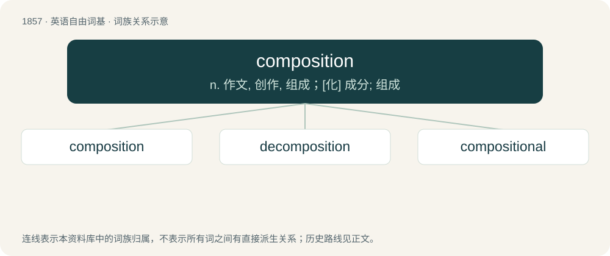

# 1963 · composition — n. 作文, 创作, 组成；\[化\] 成分; 组成

[总目录](../00_总目录_按常用程度.md)

**类型**：英语自由词基　｜　**来源语言**：见词源记录

## 核心含义与来源

- 核心含义：n. 作文, 创作, 组成；\[化\] 成分; 组成
- 英文含义：The act of putting together; assembly.
- 词形：composition

**来源记录 1**（名词；The act of putting together; assembly.）

From Middle English composicioun, borrowed from Old French composicion, from Latin compositiō, compositiōnem.

## 词族图

## 单词速览（常用到不常用）

| 单词 | 音标 | 释义 |
|---|---|---|
| [composition](#w-1) | 英 /ˌkɒmpəˈzɪʃən/；美 /ˌkɑm.pəˈzɪʃ.ən/ | n. 作文, 创作, 组成；\[化\] 成分; 组成 |
| [decomposition](#w-2) | 英 /diːˌkɒmpəˈzɪʃən/ | n. 分解, 腐败, 变质；\[化\] 分解; 裂解 |
| [compositional](#w-3) | /ˌkɒm.pəˈzɪ.ʃən.əl/ | \[计\] 组合的 |

## 逐词详解

### 1. composition

**词性**：名词　｜　**音标**：英 /ˌkɒmpəˈzɪʃən/；美 /ˌkɑm.pəˈzɪʃ.ən/

**中文释义**：n. 作文, 创作, 组成；\[化\] 成分; 组成

**英文义项**：The act of putting together; assembly. / A mixture or compound; the result of composing.

**词源与演化**：

From Middle English composicioun, borrowed from Old French composicion, from Latin compositiō, compositiōnem.

**用法示例／搭配（非完整句）**：

> weapon composition

该用例对应义项：The characters, roles, weapons, etc. being used by a team.

### 2. decomposition

**词性**：名词　｜　**音标**：英 /diːˌkɒmpəˈzɪʃən/

**中文释义**：n. 分解, 腐败, 变质；\[化\] 分解; 裂解

**英文义项**：A biological process through which organic material is reduced to e.g. compost. / The act of taking something apart, e.g. for analysis.

**构词拆分**：de- + composition

**词源与演化**：

From de- + composition.

**例句**：

> Sami's body was in an advanced state of decomposition.

### 3. compositional

**词性**：形容词　｜　**音标**：/ˌkɒm.pəˈzɪ.ʃən.əl/

**中文释义**：\[计\] 组合的

**英文义项**：Of or relating to composition. / Being the sum of its parts.

**构词拆分**：From composition + -al.

**词源与演化**：

From composition + -al.

**例句**：

> The compositional aspects of this work are less than ideal.

该用例对应义项：Of or relating to composition.
