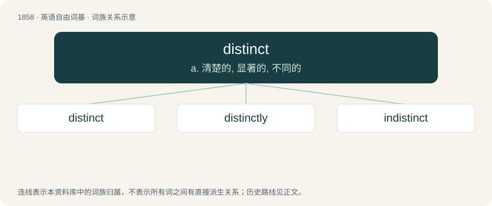

# 1964 · distinct — a. 清楚的, 显著的, 不同的

[总目录](../00_总目录_按常用程度.md)

**类型**：英语自由词基　｜　**来源语言**：见词源记录

## 核心含义与来源

- 核心含义：a. 清楚的, 显著的, 不同的
- 英文含义：Capable of being perceived very clearly.
- 词形：distinct

**来源记录 1**（形容词；Capable of being perceived very clearly.）

From Middle English distincte, past participle of distincten (“to distinguish, discern”), from Old French destincter, from Latin distinctus, past participle of distinguere (“to distinguish”); see distinguish.

## 词族图

## 单词速览（常用到不常用）

| 单词 | 音标 | 释义 |
|---|---|---|
| [distinct](#w-1) | /dɪˈstɪŋkt/ | a. 清楚的, 显著的, 不同的 |
| [distinctly](#w-2) | /dɪˈstɪŋktli/ | adv. 显然地, 明显地, 清楚地 |
| [indistinct](#w-3) | /ˌɪndɪsˈtɪŋkt/ | a. 不清楚的, 朦胧的, 难以清楚辨认的 |

## 逐词详解

### 1. distinct

**词性**：形容词　｜　**音标**：/dɪˈstɪŋkt/

**中文释义**：a. 清楚的, 显著的, 不同的

**英文义项**：Capable of being perceived very clearly. / Different from one another (with the preferable adposition being "from").

**词源与演化**：

From Middle English distincte, past participle of distincten (“to distinguish, discern”), from Old French destincter, from Latin distinctus, past participle of distinguere (“to distinguish”); see distinguish.

**例句**：

> Olga's voice is quite distinct because of her accent.

该用例对应义项：Noticeably different from others; distinctive.

### 2. distinctly

**词性**：副词　｜　**音标**：/dɪˈstɪŋktli/

**中文释义**：adv. 显然地, 明显地, 清楚地

**英文义项**：In a distinct manner.

**构词拆分**：distinct + -ly

**词源与演化**：

From distinct + -ly.

**例句**：

> I distinctly remember the voice of my deceased grandmother.

该用例对应义项：In a distinct manner.

### 3. indistinct

**词性**：形容词　｜　**音标**：/ˌɪndɪsˈtɪŋkt/

**中文释义**：a. 不清楚的, 朦胧的, 难以清楚辨认的

**英文义项**：not clearly defined or not having a sharp outline; faint or dim / hazy or vague

**构词拆分**：in- + distinct

**词源与演化**：

From Middle French indistinct, from Latin indistinctus. English equivalent in- + distinct.

**用法示例／搭配（非完整句）**：

> indistinct consonant sound

该用例对应义项：difficult to understand through being muffled or slurred
