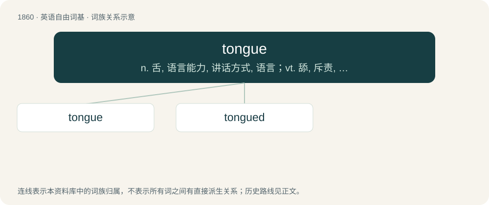

# 1967 · tongue — n. 舌, 语言能力, 讲话方式, 语言；vt. 舔, 斥责, 发...的音；vi. 使用舌头, 吹管乐器

[总目录](../00_总目录_按常用程度.md)

**类型**：英语自由词基　｜　**来源语言**：见词源记录

## 核心含义与来源

- 核心含义：n. 舌, 语言能力, 讲话方式, 语言；vt. 舔, 斥责, 发...的音；vi. 使用舌头, 吹管乐器
- 英文含义：The flexible muscular organ in the mouth that is used to move food around, for tasting and that is moved into various positions to modify the flow of air from the lungs in order to produce different sounds in speech.
- 词形：tongue

**来源记录 1**（名词；The flexible muscular organ in the mouth that is used to move food around, for tasting and that is moved into various positions to modify the flow of air from the lungs in order to produce different sounds in speech.）

From Middle English tongue, a late spelling of tong(e), tung(e), from Old English tunge, from Proto-West Germanic \*tungā (“tongue”), from Proto-Germanic \*tungǭ (“tongue”), from Proto-Indo-European \*dn̥ǵʰwéh₂s (“tongue”). Doublet of langue and lingua. Cognates Germanic: West Frisian tonge, Dutch tong, Luxembourgish Zong, German Zunge, Danish, Norwegian Bokmål, and Norwegian Nynorsk tunge, Faroese, Icelandic, and Swedish tunga, Gothic 𐍄𐌿𐌲𐌲𐍉 (tuggō). Italic: Asturian and Catalan llengua, Aragonese luenga, French langue, Galician, Italian, and Latin lingua, Leonese llingua, Mirandese lhéngua, Portuguese língua, Spanish lengua. Celtic: Irish teanga. Slavic: Belarusian and Russian язык (jazyk), Bulgarian ези́к (ezík), Czech and Slovak jazyk, Macedonian јазик (jazik), Polish język, Serbo-Croatian jèzik (“tongue”), Slovene jézik, Ukrainian язи́к (jazýk). Indo-Iranic: Persian زبان (zabân), Sanskrit जि॒ह्वा (jihvā́). The expected modern spelling, both phonetically and etymologically, would be tung. Using ⟨on⟩ for ⟨un⟩ was fairly common in Middle English; compare e.g. yong (“young”). The final ⟨gue⟩ arose to prevent tonge being misread with a soft /dʒ/. However, this spelling only became common at a time when the final ⟨e⟩ was already largely silent, so it is not clear why it was not simply dropped instead. Perhaps the spelling was influenced directly by French langue (“tongue”).

## 词族图

## 单词速览（常用到不常用）

| 单词 | 音标 | 释义 |
|---|---|---|
| [tongue](#w-1) | 英 /tʌŋ/ | n. 舌, 语言能力, 讲话方式, 语言；vt. 舔, 斥责, 发...的音；vi. 使用舌头, 吹管乐器 |
| [tongued](#w-2) | /tʌŋd/ | a. 有...舌头的, 有...说话方式的 |

## 逐词详解

### 1. tongue

**词性**：名词　｜　**音标**：英 /tʌŋ/

**中文释义**：n. 舌, 语言能力, 讲话方式, 语言；vt. 舔, 斥责, 发...的音；vi. 使用舌头, 吹管乐器

**英文义项**：The flexible muscular organ in the mouth that is used to move food around, for tasting and that is moved into various positions to modify the flow of air from the lungs in order to produce different sounds in speech. / Such an organ, as taken from animals and used for food (especially from cows).

**词源与演化**：

From Middle English tongue, a late spelling of tong(e), tung(e), from Old English tunge, from Proto-West Germanic \*tungā (“tongue”), from Proto-Germanic \*tungǭ (“tongue”), from Proto-Indo-European \*dn̥ǵʰwéh₂s (“tongue”). Doublet of langue and lingua. Cognates Germanic: West Frisian tonge, Dutch tong, Luxembourgish Zong, German Zunge, Danish, Norwegian Bokmål, and Norwegian Nynorsk tunge, Faroese, Icelandic, and Swedish tunga, Gothic 𐍄𐌿𐌲𐌲𐍉 (tuggō). Italic: Asturian and Catalan llengua, Aragonese luenga, French langue, Galician, Italian, and Latin lingua, Leonese llingua, Mirandese lhéngua, Portuguese língua, Spanish lengua. Celtic: Irish teanga. Slavic: Belarusian and Russian язык (jazyk), Bulgarian ези́к (ezík), Czech and Slovak jazyk, Macedonian јазик (jazik), Polish język, Serbo-Croatian jèzik (“tongue”), Slovene jézik, Ukrainian язи́к (jazýk). Indo-Iranic: Persian زبان (zabân), Sanskrit जि॒ह्वा (jihvā́). The expected modern spelling, both phonetically and etymologically, would be tung. Using ⟨on⟩ for ⟨un⟩ was fairly common in Middle English; compare e.g. yong (“young”). The final ⟨gue⟩ arose to prevent tonge being misread with a soft /dʒ/. However, this spelling only became common at a time when the final ⟨e⟩ was already largely silent, so it is not clear why it was not simply dropped instead. Perhaps the spelling was influenced directly by French langue (“tongue”).

**例句**：

> She can have a sharp tongue when she's annoyed.

该用例对应义项：A manner of speaking, often habitually.

### 2. tongued

**词性**：形容词　｜　**音标**：/tʌŋd/

**中文释义**：a. 有...舌头的, 有...说话方式的

**英文义项**：Resembling a tongue. / Having a particular manner of speaking.

**构词拆分**：tongue + -ed

**词源与演化**：

From Middle English tonged, tunged, equivalent to tongue + -ed. Compare Old English ġetynġe (“skilled with speech, talkative, eloquent”).

**例句**：

> Calling them “silver tongued pundits,” Kenner says their job is to simplify and manipulate arcane scientific data for public consumption.
